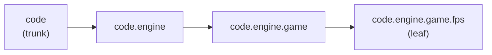
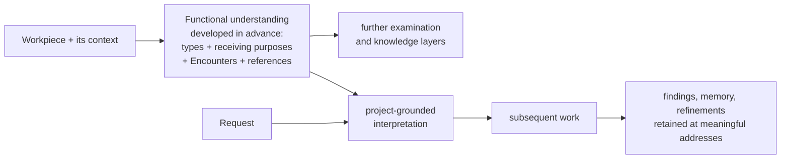
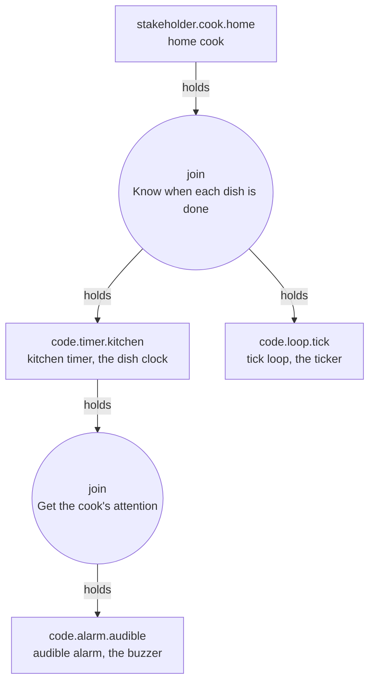

> "Empty your mind. Be formless, shapeless, like water. You put water into a cup,
> it becomes the cup. You put water into a bottle, it becomes the bottle.
> You put it in a teapot, it becomes the teapot. Water can flow, or it can crash.
> Be water, my friend."
> — Bruce Lee

---

# Inference Metaform

**Develop understanding before the work. Make that understanding available for the work that follows.**

[Documentation](docs/README.md) · [Getting started](docs/guides/getting-started.md) · [Worked project example](docs/examples/project-walkthrough.md) · [Technical](#technical)

## What is Metaform?

Metaform uses the concept of *meta* to abstract your ideas into their purest
functional form — then stores that form as a living, queryable structure your
agents navigate, recompose, and build from.

A codebase is a forest. An agent can have perfect memory of every file, every
doc, every past session — and still be lost, because memory doesn't say where
you are, what anything is for, or which direction serves the purpose. Metaform
is the view from above: the functional shape visible at once, purposes laid out
as terrain, every agent's position marked within it. And because ideas are
stored as functional forms rather than implementation descriptions, the forest
itself can be recomposed. The form is built once, before the work starts, and
amortized across every agent, every session, and every operation that follows.

The organizing question is not simply what an agent should remember. It is **what reasoning can be performed in advance to offset reasoning that would otherwise have to happen while doing the work?** Identifying a project's functional parts, understanding a dependency, interpreting a request against project terminology, and deriving the consequences of a particular realization are all reasoning tasks. Metaform retains their useful results so that subsequent work can begin from them, examine them, and extend them.

This is **advance inference amortization**. Its principal subject is reasoning effort, not a promise that every request will contain fewer tokens. A prepared input can be longer while carrying more semantic work that the executing agent no longer needs to originate.

## The name

**Meta** — showing or suggesting an explicit awareness of itself or oneself as
a member of its category : cleverly self-referential

**Form** — a type or kind of something
           to cause (something) to have a particular shape or form.
           to get, create, or develop (something) over a period of time
           to make or create (something)
           to be arranged in (a shape)

## What it does

**Orients.** Every element has an address, the purposes it serves, and a record of what
depends on it. Agents receive their position, their purpose, and exactly the
knowledge in scope — the stored functional record, not a paraphrase of last
session's chat.

**Abstracts.** The shape of your AI agent's workpiece is derived from its functionality, not
its medium, genre, style, encoding, file layout, class hierarchy, or framework.

**Recomposes.** Functional forms can be rearranged. Attach knowledge layers,
hide old ones, swap realizations under stable purposes, graft a capability from
one project into another. The addresses don't move; the purposes don't change.

**Traces.** Every layer keeps the record of how it was made — the module,
workflow, model and role behind it, and the prompt version it came from.
Refinements keep every earlier version, and variants keep each worker's files
against one origin. *Why is it like this?* is a query, not an excavation.

## How the mechanism works

### Type understanding supplies an orientation

Models already bring understanding of kinds of things to a task. Metaform engages this **primordial type understanding** through meaningful functional addresses. For example:



Each prefix is a usable type and a prompting surface. In the author's supplied address-only examples, requests for best practices at these four addresses produced distinct guidance about general code, engines, game engines, and first-person game engines. The final segment supplies specificity; the ancestry keeps the inference in the intended domain. General knowledge belongs at the parent where it applies, rather than being copied beneath every specialization.

### Relationships connect the type to this particular workpiece

A type address is not a substitute for knowing the project. The address `code.timer.kitchen` engages understanding of kitchen timers. Its recorded relationships establish what **this** kitchen timer provides, to whom, and for what purpose.

A Receiving Entity owns an **Operative Purpose**: the reason it needs something. A Providing Element supplies an **Encounter Function**: how the required effect is delivered, used, or experienced. The join retains that relationship: the receiver's purpose, the Encounter Function as an active-voice fragment in `ef`, and `ifd`, the direction of the flow. Findings and references attach to it in knowledge layers. The relationship has an identity of its own, so an agent can reason about it and attach knowledge to it. An element is only its address, `name_length` and role; its name is its address read backward through `name_length`.

**Function** concerns operative capability. **Encounter** concerns its expression or realization. The term Encounter Function deliberately accommodates both the encounter of a functionality and the functionality of an encounter. It is not restricted to a callable function in source code. Every join carries `ef`, the Encounter Function as free text: an active-voice fragment that starts with a third-person verb, such as "tells the cook when a dish is done". It is not a two-word marker.

### Understanding is selected, used, and extended



The prompt directs an operation; the Metaform supplies the semantic orientation through which it is interpreted. Selected knowledge can provide information or, when that is the layer's purpose, additional imperatives. Memory is attached to elements and joins, rather than detached from the functionality it concerns.

It also lets a critic find gaps in the design: functions and Encounters the system should have and does not. Code alone shows how a system behaves, not what it is for, so the recorded purposes are what make a missing piece visible. The critic examines the Metaform on its own, or the Metaform together with the code. Each gap becomes a blindspot challenge, which asks the project for substantive reasoning: why a concern was already considered and adds no benefit, why an unexplored concern matters, or where another part of the system already fulfills the apparent omission.

## What it looks like

A kitchen timer's firmware, mapped. The home cook receives the kitchen timer, which the project calls the dish clock. The timer receives the audible alarm's Encounter, the buzzer. The tick loop is annealed into the cook's join: it is one more element that join holds. The cook holds a join, the join holds the elements that serve the cook's purpose, and each join is its own object, drawn here as a circle:



An agent handed the address `code.timer.kitchen` reads it once, with `metaform map where code.timer.kitchen --json` or the `map_where` tool, and receives the stored record: `provides`, the joins that hold the timer and so what relies on it, `receives`, the joins the timer holds as receiver and so what it relies on, and what the `sources` layer, a review layer and memory hold at it. The record below is the real output for this map, with `memory` after `layers`:

```json
{
  "kind": "element",
  "element": {
    "address": "code.timer.kitchen",
    "layer": "intake",
    "reading": "kitchen timer code",
    "short_name": "kitchen timer",
    "name_length": 2,
    "role": "DE",
    "name": "dish clock"
  },
  "provides": [
    {
      "receiver": "stakeholder.cook.home",
      "layer": "intake",
      "type": "purpose",
      "purpose": "Know when each dish is done without watching the clock.",
      "ef": "tells the cook when a dish is done",
      "ifd": "receives",
      "elements": [
        {
          "address": "code.timer.kitchen",
          "short_name": "kitchen timer",
          "name_length": 2,
          "name": "dish clock",
          "role": "DE"
        },
        {
          "address": "code.loop.tick",
          "short_name": "tick loop",
          "name_length": 2,
          "name": "ticker",
          "role": "SE"
        }
      ]
    }
  ],
  "receives": [
    {
      "layer": "intake",
      "type": "purpose",
      "purpose": "Get the cook's attention the moment a countdown ends.",
      "ef": "sounds the end of a countdown through the speaker",
      "ifd": "receives",
      "elements": [
        {
          "address": "code.alarm.audible",
          "short_name": "audible alarm",
          "name_length": 2,
          "name": "buzzer",
          "role": "SE"
        }
      ]
    }
  ],
  "layers": [
    {
      "layer": "sources",
      "kind": "layer",
      "items": [
        {
          "layer": "sources",
          "value": "code.timer.kitchen",
          "refs": [
            {
              "key": "path",
              "value": "src/main.c"
            }
          ]
        }
      ]
    },
    {
      "layer": "review-notes",
      "kind": "layer",
      "items": [
        {
          "layer": "review-notes",
          "value": {
            "finding": "Each dish keeps its own countdown."
          }
        }
      ]
    }
  ],
  "memory": {
    "entities": [
      {
        "name": "countdown drift",
        "entityType": "behavior",
        "observations": ["The countdown drifts one second an hour on the first board."]
      }
    ],
    "relations": []
  }
}
```

Ids and empty fields are left out; `full=true` keeps them. Every agent that touches this element, this session, next month, a different model from a different vendor — sees the same stored purpose. [Getting started](docs/guides/getting-started.md#record-a-small-map-by-hand) records this map by hand, without a model, and [Working with Metaform](docs/guides/working-with-metaform.md) adds the memory and the review layer.

The web GUI draws the same map:


### Extending Metaform itself

The earlier map of this repository, recorded on September 26, 2026 and kept as an [export](docs/examples/project-metaform.json), records **the module contract and loader** as a provider. One of its receivers is **the module author**, whose recorded purpose is:

> Add a capability to Metaform as a module, declared once in its own folder, that runs as a metaform command and an MCP tool with its own settings, events, status line and lifecycle, without changing the chassis.

The join explains how a `MODULE = Module(...)` declaration supplies those surfaces. In that snapshot, two subtype joins hold **template** and **hello**. The snapshot has the shape of its day; in the current shape the module author's join holds **template** and **hello** as elements beside the module contract. Either way they are part of the relationship, not extra top-level subsystems inferred from their filenames.

An agent asked to add a module can receive the provider's project name, this receiving purpose, the template and example, and the source references for the declaration and loader. It can then implement against the existing shared facilities rather than invent separate command registration, settings storage, or an event mechanism. The same provider also has relationships to the command line, MCP server, package builder, chassis, and agent instructions. Those relationships make the consequences of a change available from the receivers' perspectives, and `metaform map where` on the provider's address returns all of them in one read.

A **derived illustration of project-grounded lexicalization** uses the request:

```text
Review error handling in the plugin system.
```

The project-grounded request becomes:

```text
Review error handling in the module contract and loader.
```

A separate mapping connects `module contract and loader` to the provider's namespace address, with directions to the relevant joins and selected knowledge. The operation remains a review of error handling. The preprocessing does not perform the review or add a new assignment.

The graph reads and addressed memory are implemented. The lexicalization producer described here is intended functionality, not a shipped command. [Follow the complete example](docs/examples/project-walkthrough.md) for the records, the reads that return them, and the distinction between recorded material and derived use.

### Refactoring legacy code

A capability smeared across twelve files gets one coherent functional shape,
bound back to the exact locations where it lives. Ask "what is the
authentication flow" and get an answer that spans files, references exact
lines, and describes purposes and encounters — not which class calls which
method. The map is generated from what the code *does*, not from its AST, so it
stays stable while the implementation moves under it.

### Porting across languages

**Before:** elements carry layers of C++ best practices and memory-management
concerns, injected into prompts when agents work on those elements.
**During:** a "porting to Rust" layer attaches — ownership semantics, lifetime
annotations, error handling — while the C++ layers mask out.
**After:** the C++ layers hide (kept and still readable, never deleted); the
Rust layers activate. Addresses unchanged. Purposes unchanged. The knowledge
swapped. Past prompts remain exactly as issued; future prompts receive the new
layers.

## What it makes possible

Metaform connects several parts of the work process rather than treating them as unrelated utilities:

| During the work | What the prepared understanding contributes |
|---|---|
| Understand a whole system | Functional parts, receiving purposes, and relationships that cross file or medium boundaries. |
| Prepare a task | Project names and functional addresses through which a reusable operation can be interpreted. |
| Retain findings | Meaningful locations for observations about a part or a relationship. |
| Change perspective | Reason from a receiver's need, a provider's effects, a broader type, or a particular Encounter. |
| Find gaps | Functions and Encounters the design lacks, found from the Metaform alone or with the code, each answered with the project's reasoning or the place that already handles it. |
| Shape the workpiece | Preserve relevant identity while changing a realization, or deliberately transform the purposes and effects that define it. |

A workpiece can be software, a document, a narrative, an image, a collection, or an idea under construction. The same method asks what the artifact is doing in its context. A photograph used as an asset has a different relationship to the surrounding work from the same photograph examined on its own; a functional type does not erase its particular subject or occasion.

## Community-extensible by construction

The implementation is a Python chassis with discoverable modules. A module declares its verbs, input nouns, settings, event subscriptions, lifecycle hooks, and purpose. The chassis uses those declarations to expose commands, MCP tools, help, settings, and agent instructions.

Modules receive a per-call context with the selected project, store, folder, settings, and output facilities. Shared facilities include graph and knowledge storage, addressed memory operations, work records for the condition of an element or a join, event delivery, owned asynchronous work, reports, and packaging. Modules are discovered from the bundled module directory, the user's Metaform home, and installed entry points.

The current modules provide intake, map operations, memory, MCP service, and a web interface. The disabled-by-default **hello** module exercises the contract; **template** supplies its empty starting shape. The existence of a shared facility is distinct from how many modules currently use it. A new inference producer can use the existing chassis without rebuilding those facilities.

[Extend Metaform](docs/guides/extending-metaform.md) explains the actual contract, scheduling, lifecycle, and packaging behavior.

## Begin using it

From a source checkout, use Python 3.11 or newer. These commands install the local project and the dependencies needed for the MCP/build path in this source edition:

```sh
python -m venv .venv
. .venv/bin/activate
python -m pip install -e . "mcp>=2.2" uv
metaform list modules
```

On Windows PowerShell, activate with `.\.venv\Scripts\Activate.ps1` instead.

### Install from the repository onto your path

To have the `metaform` command on your path, and the MCP server agents launch, run the code in a checkout, install the checkout as an editable [uv](https://docs.astral.sh/uv/) tool, with the MCP and agent-protocol packages beside it:

```sh
uv tool install --editable /path/to/metaform --with "mcp>=2.2" --with "agent-client-protocol>=0.12.1,<0.13" --force
```

The command lands in uv's tool folder, `~/.local/bin` on Linux and macOS, and imports Metaform from the checkout's `src/`. Every command then runs the checkout as it is now: after a pull or an edit, nothing is installed again. Processes already running keep the code they started with:

- each agent session reconnects its MCP server, with `/mcp` in Claude Code, or starts again;
- the web GUI restarts with `metaform web stop` and then `metaform web start`, and an open page reloads;
- an agent dispatch started keeps the code it started with until its session ends.

Run the install again only when `pyproject.toml` changes Metaform's dependencies or entry points.

Register an existing workpiece folder:

```sh
cd /path/to/workpiece
metaform add project example .
metaform intake prompt
```

The last command serves the intake instructions, the Digital Typology procedure; **the agent performs the intake**. It examines the workpiece, follows the served method, and records the map one object at a time as it reasons it, through the intake tools, then reads it back, proofs it and finishes it with `intake_finish`. `metaform web` draws the map live while it is recorded. You choose the workpiece and direct the work; Metaform retains the resulting functional representation. Start reading it with `metaform map roots`, read one address with `metaform map where <address>`, or open `metaform web`. `metaform clear project <project> --confirm` removes the project's metaforms and reports so the intake can be taken again from nothing.

For an agent connection, build the selected modules with `metaform build`, then run `metaform install` to choose a detected supported client. The installer registers a wheel-backed stdio MCP server and probes it. [Getting started](docs/guides/getting-started.md) covers the source and wheel paths, supported installer adapters, how the intake is recorded, retained data, and first useful inspection. It also records a small map by hand, without a model.

## Documentation

The [documentation index](docs/README.md) connects the complete set:

- [Getting started](docs/guides/getting-started.md): install, connect, register, perform intake, and inspect the first result.
- [Working with Metaform](docs/guides/working-with-metaform.md): relationships, memory, layers, refining the metaform, project context, GUI, and exchange.
- [Reading an Inference Metaform](docs/guides/reading-a-metaform.md): types, names, receiving purposes, joins, and the project's own functional map.
- [Extending Metaform](docs/guides/extending-metaform.md): build a module using the template, example, and shared facilities.

## Technical

The [preprint](docs/preprint/inference-metaform.md) develops the complete causal account, including exact relational identity, Encounter propagation, lexicalization, provenance, and formation through intent. A [typeset PDF](docs/preprint/inference-metaform.pdf) and [citation information](docs/preprint/CITATION.md) accompany it.

The technical-reference set supplies the deeper engineering account:

| Document | Use it for |
|---|---|
| [REFERENCE.md](docs/inference-metaform/REFERENCE.md) | Full mechanisms, terminology, connected walkthroughs, and functional commitments. |
| [IMPLEMENTATION_MAP.md](docs/inference-metaform/IMPLEMENTATION_MAP.md) | Source correspondence, present behavior, tests, and localized implementation boundaries. |
| [EXAMPLES_TO_COLLECT.md](docs/inference-metaform/EXAMPLES_TO_COLLECT.md) | Original traces and measurements that would make preparation and reuse inspectable. |
| [IDEAS.md](docs/inference-metaform/IDEAS.md) | Separate proposals for additional tools and views. |

This documentation describes the `chassis` branch after step 58 of the [build log](specifications/BUILD-LOG.md). [Edition and validation notes](docs/EDITION.md) record the documentation edition of September 26, 2026, the source it was written against and the checks made on it, and what has changed since.

## Authorship and independent development

Inference Metaform is the independently developed work of **Rich**. The method grew through six years of hands-on work with AI models, including self-authored context management and semantic rules for inference predating GPT-3's completions API. Rich manually exercised and measured the method and spent six months refining and encoding the present design.

The research connections in the preprint are subsequent comparisons, not the origin of the design. The project is intended for release with its operative intake. Intake integrity concerns preserving how the method operates; it does not depend on a claim that the procedure is unpublished.
