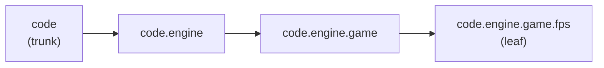
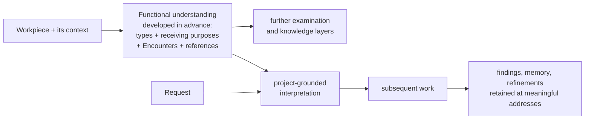

> "Empty your mind. Be formless, shapeless, like water. You put water into a cup,
> it becomes the cup. You put water into a bottle, it becomes the bottle.
> You put it in a teapot, it becomes the teapot. Water can flow, or it can crash.
> Be water, my friend."
> — Bruce Lee

---

# Inference Metaform

**Develop understanding before the work. Make that understanding available for the work that follows.**

[Documentation](docs/README.md) · [Getting started](docs/guides/getting-started.md) · [Worked project example](docs/examples/project-walkthrough.md) · [Technical](#technical)

### An Inference-First Context Management Platform for Agentic Development

**Metaform is a modular context management and orchestration platform designed to move reusable inference out of individual agent workflows and into shared, persistent infrastructure.**

Its central premise is simple: much of the reasoning required to understand a project does not need to be repeated by every agent performing work on it. A substantial portion can be performed in advance, organized into reusable context, and maintained as the project evolves.

Metaform is built around **amortizing inference**—performing the work of understanding a project once, then making that understanding available to the agents, developers, and systems that need it.

Rather than requiring agents to repeatedly reconstruct project structure, rediscover relationships, interpret prior decisions, and establish context, Metaform provides a common functional model of the project, contextual memory, and the tools needed to work within that model.

The objective is not to make an agent's decisions in advance. It is to eliminate redundant inference so the agent can devote its reasoning capacity to the decisions that actually belong to the work it is performing.

## Design Philosophy

Metaform draws a deliberate distinction between **inference that can be performed independently of a task** and **reasoning that must remain with the agent executing that task**.

Project structure, functional relationships, established conventions, existing state, prior work, and accumulated knowledge can often be understood before a particular assignment begins.

These are opportunities to amortize inference.

The system therefore favors procedures that establish, refine, and preserve reusable understanding independently of the agents consuming it.

An agent should not need to rediscover what is already known. Nor should its ability to make decisions be constrained by conclusions unnecessarily imposed in advance.

Metaform seeks to prepare the environment for reasoning, not replace reasoning itself.

## A Functional Model of the Project

At the foundation of Metaform is a structured representation of project functionality.

Rather than organizing knowledge exclusively around files, documents, or conversations, Metaform models a project in terms of its functional elements, their purposes, their relationships, and the capabilities they provide to one another.

This establishes a shared language for describing not merely *what a system contains*, but *what its components do, why they exist, and how they contribute to the larger system*.

In that language, every part of a project has an address, read from trunk to leaf, such as `code.dispatcher.task`. A receiving element (RE) has an operative purpose (OP), the why; providing elements (PE) serve it through their encounter function (EF), the how; each join records its information flow direction (IFD); and chains of purposes lead to the CQU, the party for whom the project's worth is held in trust.

The model is applicable at any stage of development:

- **Greenfield:** Understanding intended functionality, requirements, and the relationships a system is expected to establish.
- **Brownfield:** Examining an existing implementation to identify its functional structure, dependencies, and operational state.
- **Continuous evolution:** Maintaining and refining that understanding as implementation, requirements, and project knowledge change.

The resulting functional namespace provides a common frame of reference for agents, developers, and orchestration systems.

It becomes a persistent foundation upon which additional context can be organized without requiring each participant to reconstruct the project from its raw artifacts.

## Context, Memory, and Communication

Metaform is not fundamentally a retrieval-augmented generation (RAG) system.

Retrieval can provide an agent with information. Metaform is concerned with the broader problem of establishing and managing the context in which that information has meaning.

Its functional model provides the organizational foundation for persistent, contextually situated memory.

Agents can record discoveries, observations, decisions, progress, and other knowledge in association with the functionality and work they concern.

This supports continuity between agents, across sessions, and throughout the lifetime of a project.

It also gives developers, agents, and orchestration components a common language for referring to project functionality and communicating about work.

Instead of treating each agent session as an isolated encounter with a collection of documents, Metaform treats agent activity as part of a continuing process of project understanding.

**Agents consume existing context, contribute new knowledge, and leave the environment better informed for subsequent work.**

## Pipelines for Continuous Understanding

Metaform provides a foundation for procedures and workflows that build and maintain project understanding.

These include project ingestion, functional analysis, state documentation, memory management, context preparation, and orchestration.

The pipelines are intended to perform useful inference independently of individual assignments, preparing context that can be reused across agents and workflows.

As projects evolve, the platform can incorporate new observations, track changing state, and preserve relevant accumulated knowledge.

This makes context management a continuous part of the development environment rather than an operation repeated from scratch whenever an agent begins work.

## A Modular and Extensible Platform

Metaform is designed as a platform rather than a closed application or a fixed collection of agent tools.

Its architecture is a modular chassis that exposes shared capabilities to independently developed modules.

Core functionality, integrations, workflows, context services, and user-facing interfaces can be extended through a common platform architecture.

Module templates and established interfaces provide developers with a starting point for creating capabilities tailored to their own environments.

The intention is to make the platform itself a development surface—one that individuals and communities can adapt, extend, and build upon without redesigning the underlying infrastructure.

Metaform is also intended to operate across development environments, integrating with IDEs, agent harnesses, orchestration systems, and other compatible tools through established protocols and standards, while remaining usable independently.

This separates the persistent project context from any particular agent, model, interface, or development environment.

## The Larger Objective

Metaform approaches agentic development as a problem of managing and distributing understanding.

As agents become more capable, the challenge is not simply providing them with more information. It is ensuring they receive meaningful context, retain useful knowledge, communicate through a consistent representation of the work, and avoid repeating inference that has already been performed.

Metaform is designed to provide that infrastructure.

Its philosophy is to **infer what can be inferred in advance, preserve what has been learned, share what is useful, and leave the work-specific reasoning to the agents performing the work.**

The intended result is a development environment in which understanding accumulates, context becomes reusable, and each new agent can build upon the work of those that came before it.

## What is Metaform?

Metaform uses the concept of *meta* to abstract your ideas into their purest
functional form — then stores that form as a living, queryable structure your
agents navigate, recompose, and build from.

A codebase is a forest. An agent can have perfect memory of every file, every
doc, every past session — and still be lost, because memory doesn't say where
you are, what anything is for, or which direction serves the purpose. Metaform
is the view from above: the functional shape visible at once, purposes laid out
as terrain, every agent's position marked within it. And because ideas are
stored as functional forms rather than implementation descriptions, the forest
itself can be recomposed. The form is built once, before the work starts, and
amortized across every agent, every session, and every operation that follows.

The organizing question is not simply what an agent should remember. It is **what reasoning can be performed in advance to offset reasoning that would otherwise have to happen while doing the work?** Identifying a project's functional parts, understanding a dependency, interpreting a request against project terminology, and deriving the consequences of a particular realization are all reasoning tasks. Metaform retains their useful results so that subsequent work can begin from them, examine them, and extend them.

This is **advance inference amortization**. Its principal subject is reasoning effort, not a promise that every request will contain fewer tokens. A prepared input can be longer while carrying more semantic work that the executing agent no longer needs to originate.

## The name

**Meta** — showing or suggesting an explicit awareness of itself or oneself as
a member of its category : cleverly self-referential

**Form** — a type or kind of something
           to cause (something) to have a particular shape or form.
           to get, create, or develop (something) over a period of time
           to make or create (something)
           to be arranged in (a shape)

## What it does

**Orients.** Every element has an address, the purposes it serves, and a record of what
depends on it. Agents receive their position, their purpose, and exactly the
knowledge in scope — the stored functional record, not a paraphrase of last
session's chat.

**Abstracts.** The shape of your AI agent's workpiece is derived from its functionality, not
its medium, genre, style, encoding, file layout, class hierarchy, or framework.

**Recomposes.** Functional forms can be rearranged. Attach knowledge layers,
hide old ones, swap realizations under stable purposes, graft a capability from
one project into another. The addresses don't move; the purposes don't change.

**Traces.** Every layer keeps the record of how it was made — the module,
workflow, model and role behind it, and the prompt version it came from.
Refinements keep every earlier version, and variants keep each worker's files
against one origin. *Why is it like this?* is a query, not an excavation.

## How the mechanism works

### Type understanding supplies an orientation

Models already bring understanding of kinds of things to a task. Metaform engages this **primordial type understanding** through meaningful functional addresses. For example:

Each prefix is a usable type and a prompting surface. In the author's supplied address-only examples, requests for best practices at these four addresses produced distinct guidance about general code, engines, game engines, and first-person game engines. The final segment supplies specificity; the ancestry keeps the inference in the intended domain. General knowledge belongs at the parent where it applies, rather than being copied beneath every specialization.

### Relationships connect the type to this particular workpiece

A type address is not a substitute for knowing the project. The address `code.timer.kitchen` engages understanding of kitchen timers. Its recorded relationships establish what **this** kitchen timer provides, to whom, and for what purpose.

A Receiving Entity owns an **Operative Purpose**: the reason it needs something. A Providing Element supplies an **Encounter Function**: how the required effect is delivered, used, or experienced. The join retains that relationship: the receiver's purpose, the Encounter Function as an active-voice fragment in `ef`, and `ifd`, the direction of the flow. Findings and references attach to it in knowledge layers. The relationship has an identity of its own, so an agent can reason about it and attach knowledge to it. An element is only its address, `name_length` and role; its name is its address read backward through `name_length`.

**Function** concerns operative capability. **Encounter** concerns its expression or realization. The term Encounter Function deliberately accommodates both the encounter of a functionality and the functionality of an encounter. It is not restricted to a callable function in source code. Every join carries `ef`, the Encounter Function as free text: an active-voice fragment that starts with a third-person verb, such as "tells the cook when a dish is done". It is not a two-word marker.

### Understanding is selected, used, and extended

The prompt directs an operation; the Metaform supplies the semantic orientation through which it is interpreted. Selected knowledge can provide information or, when that is the layer's purpose, additional imperatives. Memory is attached to elements and joins, rather than detached from the functionality it concerns.

It also lets a critic find gaps in the design: functions and Encounters the system should have and does not. Code alone shows how a system behaves, not what it is for, so the recorded purposes are what make a missing piece visible. The critic examines the Metaform on its own, or the Metaform together with the code. Each gap becomes a blindspot challenge, which asks the project for substantive reasoning: why a concern was already considered and adds no benefit, why an unexplored concern matters, or where another part of the system already fulfills the apparent omission.

### Worker Fast mode

Ticket settings offer Project setting, On and Off when the selected agent
advertises Fast mode. Off stays explicit after reopening. Agent options in project
settings offer Default, On and Off for the same capability. Saved worker choices
apply after project defaults on startup and resume. Fast is never enabled by this
feature without a selection. Unsupported agents show an unavailable control.
