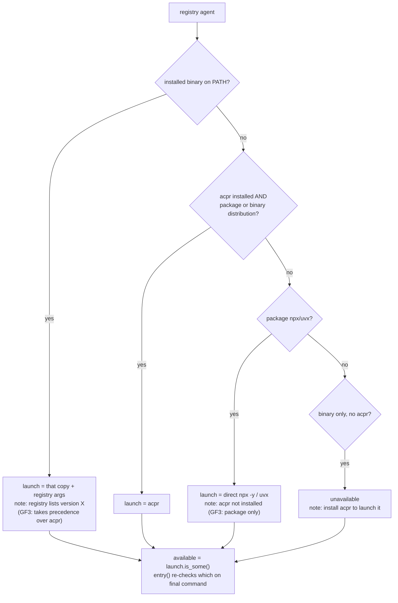
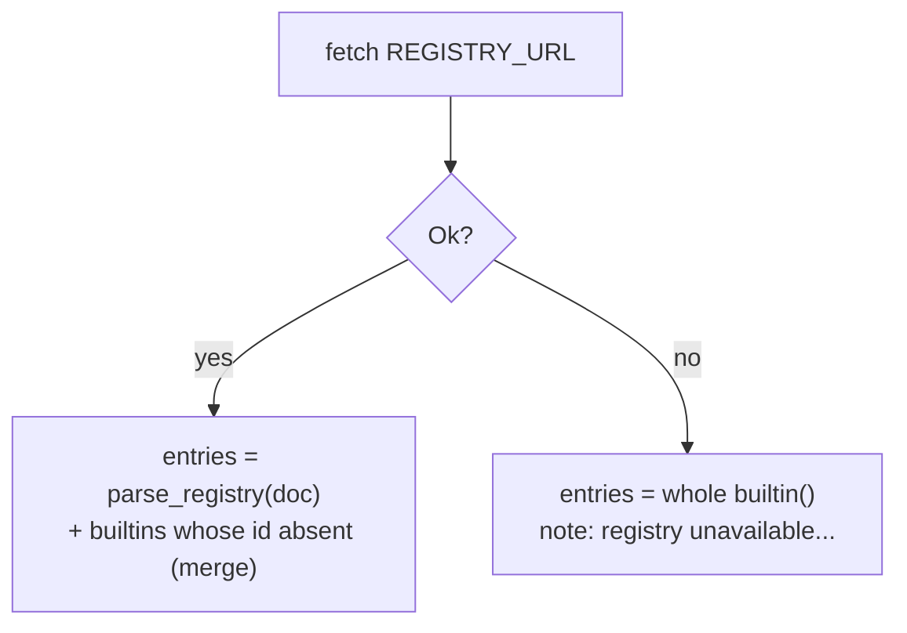

# AcuteMotor — evidence notes for ACP autoselection findings

Personal analysis artifact. Authoritative decisions are in `resolution.md`.

## Scope of the source I could verify
Only `source/crates/acp-host/src/launch.rs` is present. Findings cite
`process.rs` (GF1) and `tables.rs` (GF2); those files are NOT in the copied
source, so I cannot independently confirm their line numbers. I judge GF1/GF2
on the `launch.rs` evidence that *is* verifiable.

## Interpretation note (affects GF1, GF2, GF9)
The "What other parts rely on it for (their wants)" bullets use
`goal / Function / Intent: receive`. `Intent: receive` indicates the dependent
*receives* the `Function` from THIS element, so I read each `Function` line as
a claim about what this element does/provides. Both egm-codebase-details
findings (GF1, GF2) read it the same way, so this is the consistent reading for
the adjudication. The alternative reading (Function = the dependent's own job)
is acknowledged; under either reading the fix is the same: disambiguate so the
description does not appear to claim this element spawns/lists user commands.

## Verifiable code facts (launch.rs)
- L14-51 `LaunchSpec`: command, args, env, env_remove. No spawn, no stdio.
- L78-90 `builtin()`: 4 pinned npx entries (0.101.0 / 2.5.0 / 0.0.34 / 1.19.5).
- L96-98 `parse_registry` -> `parse_registry_with(doc, which("acpr").is_ok())`.
- L103-138 `parse_registry_with`: precedence (see diagram below).
- L12 `REGISTRY_URL` = cdn.agentclientprotocol.com/.../registry.json.
- L159-178 `package_launch`: builds npx/uvx spec, filters registry `env`.
- L181-185 `registry_env_allowed`: denies PATH, NODE_OPTIONS, NODE_PATH,
  PYTHONPATH, PYTHONSTARTUP, BASH_ENV, ENV, HOME and LD_/DYLD_/NPM_CONFIG_.
- L187-210 `entry()`: `available` = `which::which(spec.command).is_ok()`; note
  "... is not on PATH" / "no supported distribution".
- L214-232 `autoselect`: fetch -> Ok = parse_registry + append builtins not
  already present; Err = whole `builtin()` + "registry unavailable..." note.
- L235-238 `custom(id,name,command_line)` -> ONE `Source::Custom` entry.
- L240-272 `split_words`: quotes (', ") group words; unbalanced quotes -> None;
  NO escape/backslash handling.
- L1-5 module doc: "find the harnesses ... and how to launch them" and
  "not a detector of every program on the machine; a user-supplied command
  covers the rest."

## Precedence inside parse_registry_with (per registry agent)

## autoselect() aggregation

## quick fact-check per finding
- GF1 code fact TRUE (no spawn/stdio). "Find and start" (elephant.design) also loose.
- GF2 TRUE in launch.rs: autoselect never lists custom(); custom() is standalone; no "catalog aliases" concept. tables.rs specifics unverifiable.
- GF3 TRUE: installed binary precedence (117-127) and binary-only unavailable without acpr (131-133) both real; elephant.gaps overstates "npx or uvx directly".
- GF4 TRUE + genuinely security-relevant; undocumented.
- GF5 TRUE; availability logic is self-documented in code (L70-71 field comment) but absent from element.md.
- GF6 TRUE; nit.
- GF7 WEAK/WRONG: autoselect() DOES auto-select a launch path; "nothing is auto-selected" is false; "spawns" is false (contradicts GF1).
- GF8 TRUE: acpr undefined; code shows it adds binary-distribution support + uniform `acpr <id>`.
- GF9 TRUE: precedence unstated, "catalog aliases" undefined, user-command mechanism unstated.
- GF10 QUALIFIED: behavior EXISTS in code for registry fallback (230) and missing launcher (195-199) but is undocumented; spawn/handshake failure is out of scope (process.rs).
- GF11 NOT a contradiction: user-supplied != universal scanner; code L3-5 explicitly reconciles. At most one clarifying sentence.
- GF12 QUALIFIED: REGISTRY_URL undocumented; there is NO caching (fetched per call) — nothing to document as a feature, just state "no cache".
