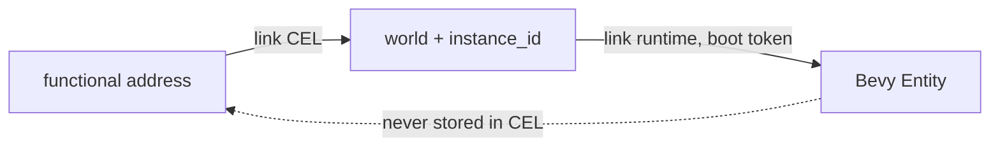

# Panel 04: Address-to-entity link CEL

Roundtable 2 of 5. Synthesis by Opus. Repo HEAD `24a72b3`, branch `intake-3.1`. Session folder uncommitted.

## Relies on

- P3 ruling: link addresses to Bevy entities; do not host the map or the MCP server inside Bevy (`panel-03-bevy-ruling.md`, Sol T133, Astra T135).
- L-1 ratified. L-2 amended: only the world link crosses. L-3 scoped to runtime component state.
- P1 authority order. P2 ECS-without-engine conclusions.

## Challenges

None. No seat challenges a P3 conclusion.

## Link CEL fields (Fable T116)

| Field | Meaning |
|---|---|
| `world` | Server identity of the world |
| `instance_id` | Persists across restart. Unique within one `world`. |
| ~~`status`~~ | **R5 (G1/L-33, Proposed):** not stored. The link runtime derives `bound`, `stale` or `unbound` from `instance_id`, object presence and the boot token (T307, T314). |

**The CEL never holds:** the Bevy `Entity` id, component data, `wants`, or the boot token.

**Binding chain:** at bind time, the link runtime resolves address → `instance_id` → `Entity`. It refuses stale IDs (L-9).

## L-6 sync cost budget (provisional, `judgment`)

- **Target:** 100 ms p95, same host, one address.
- **Endpoints:** start at map commit (R-4.10 announce). End at confirmed application in the world.
- **Correlation:** tag each write with its commit revision; the world echoes it back (Fable T130). One monotonic clock for both endpoints.
- **Report:** p95, p99, timeouts, missed updates, reconnection recovery, hardware, world load.
- **Separate measurements:** queue delay, binding availability, device response. Device response needs its own limit.
- This method also measures the P3 sync hop and defines L-4 trigger 2.

### Completeness gate (all four seats, `judgment`)

- Every tagged revision gets a confirmation or an explicit failure.
- A timeout counts as a failure, even after later recovery.
- The steady-state test passes only with zero missed applications.
- The report gives delivered and expected counts beside p95 and p99.
- Reconnection recovery is measured separately.

### Counting rules

- **T161:** an L-9 refusal of a stale `Entity` is an explicit failure, not a missed application.
- **T172 (Astra):** count refusals apart from confirmed applications. Expected refusals belong in the stale-ID tests. A correct refusal can pass a safety test but never counts as a successful application under L-6.

## Stale-ID tests (Opus T127, `judgment`)

1. **Restart.** `instance_id` persists. `status` stays `stale` until rebind, then `bound`. R5: the runtime derives both values; a restart with matching durable records creates no map write (T327).
   - T162: the test reuses the `Entity` value on purpose. Every world restart forces a fresh binding, even when `world`, `instance_id` and `Entity` all match. The link refuses writes on pre-restart bindings.
   - Boot token (Fable T170, all four seats): the world issues a new token at each process start. The new token invalidates all earlier bindings. The token lives in the link runtime, outside the CEL.
2. **Despawn.** `status` becomes `unbound` within the L-6 budget. A spawn that reuses the index with a new generation must not rebind.
3. **Multiple instances.** The link refuses a second bind of a duplicate `instance_id` in one world. The same `instance_id` in two worlds resolves by `world`. Covers L-8 (0..n instances).
4. **Prefix isolation (Opus T151, Fable T152).** Parent device context cannot replace a local binding or an enforced limit. A negated layer hides the name; enforcement persists.

L-9 refusal covers tests 1 and 2.

## Device CEL delivery under C-2 (closed for P4)

- The device CEL rides the resolver path. **R5 (F1):** `goto` delivers layer names, skill frontmatter and record counts once per context. It delivers no records from other addresses (R-5.30 `:291`).
- Parent device planning context composes through the resolver, masked per System (TOPOGEE.md `:30`, map `code.resolver.context`, R-6.4).
- Device bindings and enforced limits resolve only at the bound address (L-10a). Inheritance creates no binding, because only bindings carry `instance_id`.
- A visibility mask never disables enforcement. The prefix `-` adjusts visibility only.
- ~~C-2 does not block P4. No owner ruling is needed for delivery.~~ **Withdrawn in R5 (F2; Astra T419):** resolver-path delivery needs an owner ruling. The resolver contract is not specified (SPEC `:556`, §11). Resolver-path delivery cannot be verified until the owner specifies the resolver (review row 4).

## Ledger rows

| Row | Ruling |
|---|---|
| L-6 | Provisional: target, method, gate, T161, T172 |
| L-7 | Ratified (fields and never-held list) |
| L-8 | Ratified (0..n instances) |
| L-9 | Ratified. Note records the boot token. |
| L-10 | Amended by all four seats: records inherit and are masked per System; bindings and enforced limits stay local. Unverified until Sol's R3 L-60 checks. |
| L-10a | Ratified for bound-address enforcement (Opus, Sol, Astra). Sol and Astra reject extension to all device records. |

## Decisions Made

- Link CEL fields are `world`, `instance_id`, `status`. The never-held list is binding. **R5:** G1/L-33 proposes removing `status` from the CEL (Proposed).
- L-6 provisional budget, method and completeness gate as written.
- Refusals count apart from applications (T161, T172).
- Stale-ID tests 1–4 with T162 and the boot token.
- Device CEL delivers on the resolver path. Bindings and limits stay local. R5 (F2): blocked until the owner specifies the resolver (review row 4).

## Open Questions Handed Forward

Each item carries a recommendation (chair T125).

| Item | Recommendation | Basis | Blocks |
|---|---|---|---|
| L-60 resolver and delivery checks | Sol performs the four checks in R3. | Agreed in R2 | L-10 verification |
| C-5 storage for link CEL persistence | Settle in R3 beside L-60. Recommend storing the link CEL with other CELs in map storage, apart from world state (C-5 separation). | Fable proposal; `judgment` | `instance_id` persistence |
| L-6 target confirmation | Keep 100 ms p95 until a measured run exists; adjust only from measurement. | `judgment` | L-4 trigger 2 |
| Device response limit | Set in the R4 device panel with owner microDuck limits. | Fable proposal | Device CEL, L-25 |
| C-3 stop-as-write | Device scheduling panel. | Fable proposal | L-23, L-25 |

## R5 review response (Opus)

| Point | Result | Source |
|---|---|---|
| F1 | Accepted. `goto` delivers names and counts once per context. `goto` counts CEL records, not fields (T341). | R-5.30 `:291` |
| F2 | Accepted as amended. The resolver is not specified (SPEC `:556`); the live map reports it not built (L-60 M1). Both readings stand. | T320 |
| G1 | Proposed as L-33. `status` leaves the CEL. The P4 enum stands as runtime state. | T307–T394 |
