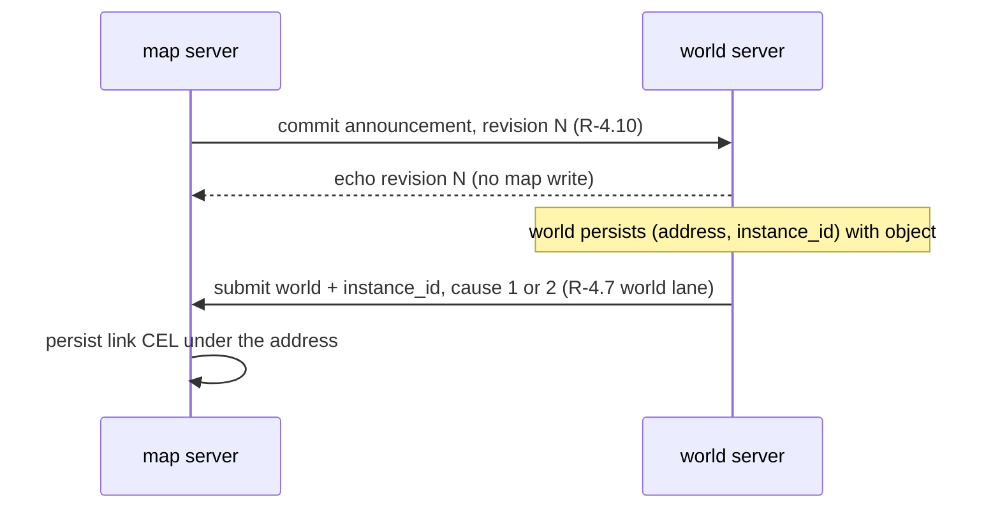

# Panel 07: Storage and the world link

Roundtable 3 of 5. Synthesis by Opus. Repo HEAD `24a72b3`, branch `intake-3.1`. No tracked differences. Untracked: `.claude/autoharness/`, `mcp-server/.claude/`, this session folder.

## Relies on

- P3: the process boundary. Link addresses to world entities; do not host the map inside the world (`panel-03-bevy-ruling.md`; Astra T243).
- P3 `:25` cites R-2.11. The `store.ts` header does not contradict P3 (Fable T253).
- P4: commit is separate from application (Astra T243). Fresh binding at every world start (`panel-04-link-cel.md:58`; Sol T270).
- P4 `status` values `bound`, `stale`, `unbound` (`panel-04-link-cel.md` fields table). **R5 (G1):** these are runtime state, derived by the link runtime and not stored.
- L-60 result: all four runtime checks untested; L-10 agreed and unverified (`l60-verification.md`; Sol T244).

## Challenges

None. No seat challenges a P3 or P4 conclusion.

## Evidence

| Claim | Source |
|---|---|
| The map is stored in LadybugDB today | `mcp-server/src/store.ts:1-9`; `package.json:11` (`@ladybugdb/core` 0.22.0) |
| This is a documented lag | SPEC `:195` "Built on Ladybug, not yet on JSON"; `:243` "Ladybug leaves it" (Opus T239) |
| All layers sit in one `layers` column, against R-4.3 | `store.ts:28` |
| JSON is the default; SQLite for tabular data; Ladybug where it fits; fair queues on every store | `DECISIONS.md:12`; R-4.1 SPEC `:188` |
| One map write queue per project | R-4.7 SPEC `:223` |
| The map server is the only writer under the home | R-4.4 SPEC `:217`; status line `:221` |
| Effect log as the commit point: Proposed, Alternative G | R-4.13 SPEC `:239`, `:241` |
| SQLite as the medium of that log | §9 SPEC `:513` only; `judgment` under the Decided SQLite permission (R5, T360) |
| ACP conversation log is a separate log | SPEC `:566` (Astra T243) |
| Ladybug fails at about 7 databases per process | `docs/world-ideas.md:124` |
| Header says the chassis takes the database later | `store.ts:7-8`, commit `71c2268` (2026-11-02); superseded by `1f9c262` (2026-11-03) (Fable T257) |

## C-5 ruling: where each store lives

**R5 correction (F3):** the map row restates an owner decision; the panel did not rule it (`DECISIONS.md:12`; R-4.1). C-5 covers world storage only. "One database per world" has no owner source and is `judgment` (review F3).

| Store | Format | Owner | Write queue | Basis |
|---|---|---|---|---|
| Map, layers, settings | JSON | map server | R-4.7 project queue | `DECISIONS.md:12`; R-4.4 |
| Link CEL | JSON layer file at its address | map server | R-4.7, world lane | R-4.3; Opus T250 |
| Effect log | SQLite (`judgment`; R-4.13 Proposed) | map server | R-4.7 project queue | §9; Astra T243 |
| World objects | Ladybug; one database per world is `judgment` | world server | world queue, separate | L-20; `world-ideas:124` |
| ACP conversation log | not ruled; SQLite recommended (tabular) | goes forward | goes forward | Opus T251; R-4.1 |

Transitions, recorded apart from the header conflict (Opus T259; Sol T256):

- The map moves from Ladybug to JSON (SPEC `:195`, `:243`).
- Layers move from one `layers` column to separate files (`store.ts:28`, R-4.3).

## World link

R5 (G2) renames this boundary "world link" (L-2). "Common navigation interface" stays the owner's unsettled term (SPEC `:558`).

- **Map to world:** commit announcements, each tagged with its revision (R-4.10; Opus T240).
- **World to map:** revision echoes and submissions of `instance_id` (R5, T308). Submissions enter R-4.7 as their own fair-queue lane, so a burst cannot starve agent writes (Opus T251; Sol T256).
- **Echo rule (`judgment`, Sol T261):** an echo acknowledges application and creates no map write. R5 (T329): the world submits the pair only for two causes: the CEL lacks the pair (cause 1), or a mismatch was explicitly reconciled (cause 2). Without this rule, announcements and echoes can form an endless commit cycle.
- **Never crosses:** device commands and telemetry stay on the world server (L-21). `Entity` ids and boot tokens never enter the map (L-7, L-9).
- **Authority:** the map owns the address. The world owns object identity (Sol T274).

## Persistence of `instance_id` across restart

`instance_id` persists in both the world store and the link CEL (`judgment`; Astra T258; Opus T268; Sol T270; Fable T272, as a foreign key on each Ladybug object).

**Order: world first, then submit.** Proposed by Astra T276. Confirmed in turns by Opus T282, Sol T283, Fable T284 and Astra T285.

1. The world mints `instance_id`, unique within one world (L-7).
2. The world persists `(address, instance_id)` with the object.
3. The world submits the pair. The map server persists the link CEL.
4. At every world start, L-9 forces a fresh binding in the link runtime. **R5 (T318, T327):** the world does not resubmit every record. It submits only where the CEL lacks the pair (cause 1). That path recovers a crash between steps 2 and 3 with the original `instance_id` (Fable T275).
5. A retry resubmits the same pair. A retry must not create another object or identity (Astra T276; Sol T283). R5 (T384, T387): the map server checks "pair absent" when it applies the retry. See `panel-10-synthesis.md` output 4.

Recovery matches `(world, instance_id)` and then checks the address. Address-only adoption is ruled out, because L-8 allows 0..n instances per address (Astra T285).

## Mismatch rule

Address authority does not prove restored object identity (Sol T274). Every seat withdrew "the CEL governs" (Opus T282, Fable T284, Astra T285).

- On a mismatch or a missing object, the link is `unbound`.
- The map server reports both records and states whether the object is missing or the identities conflict (Astra T285).
- Reconciliation precedes a fresh binding. No identity is replaced automatically (Sol T283).

## Status labels

The P4 enum stands. No state is added. **R5 (G1, T307, T314):** the link runtime derives each value from the CEL `instance_id`, object presence and the boot token. Nothing stores `status`.

| `status` | Condition | Source |
|---|---|---|
| `bound` | Object matches; binding holds the current boot token | P4 |
| `stale` | Object with the CEL `instance_id` is restored, but the binding predates the current boot token | `panel-04-link-cel.md:58` (test 1); Fable T284 |
| `unbound` | No restored object carries that `instance_id` (despawn, missing object), or the identity exists but its address conflicts with the CEL address | `panel-04-link-cel.md:61` (test 2); Sol T274; Fable T284; Astra T285, T295 |

Astra T295 withdraws the T285 evidence-only reading of `stale`, because P4 already defines that status. Sol T283 also describes `stale` as evidence of an invalid prior binding. The P4 state governs (Fable; Astra T295).

## P4 test 1 additions (test designs; none performed; no restart test exists)

| Addition | Source |
|---|---|
| ~~A persisted `bound` counts as `stale` until a rebind with a fresh boot token~~ Moot in R5: nothing persists `status` (T312) | Sol T256; `panel-04:58` |
| Restart each server alone, then both together | Astra T258; Sol T270 |
| Crash between steps 2 and 3. An incomplete pair never reports `bound`. Recovery keeps identity and requires a fresh binding. | Astra T262; Sol T270 |
| Applying revision N with unchanged link state yields one echo and no new revision | Sol T261 |
| A mismatch leaves the link `unbound`, reports both records and reconciles before binding | Sol T274 |
| A retry resubmits the same pair and creates no new object or identity | Astra T276; Sol T283 |

## Decisions Made

| Item | Ruling | Basis |
|---|---|---|
| L-20 | ratified | `DECISIONS.md:12`; R-4.1; R-4.6 |
| L-21 | ratified; the `layer` command carries world and device CELs; no tool is added | R-5.1 |
| L-22 | ratified, extended to fair queues on every store | `DECISIONS.md:12` |
| L-22a | stays Proposed | owner has not accepted it |
| C-5 | ruled as in the store table; ACP log goes forward. R5 (F3): the map store is an owner decision; C-5 covers world storage only | this panel; `DECISIONS.md:12` |
| Link writes | the world submits; only the map server persists | R-4.4 `:217`; Astra T243; Opus T250; Sol T256; Fable T253 |
| Map store ownership | stays with the map server | R-4.4; Opus T259; Sol T261; Fable T257 |
| R-2.11, narrower reading | the chassis supplies deep-integration data; the map server persists it | Fable T253; Opus T259 |
| Header `store.ts:7-8` | C-8, a scope conflict; date order resolves it; adjust the header later; not edited in R3 | Fable T257, T260; Astra T262; Sol T270 |
| Persistence order | world first, then submit; R5: submit only for cause 1 or cause 2 (T329) | Astra T276; Opus T282; Sol T283; Fable T284; Astra T285 |
| Mismatch | `unbound`, report both, reconcile before binding | Sol T274 |
| Status labels | P4 enum kept; meanings as in the table; R5: derived at runtime (G1/L-33, Proposed) | Fable T284; Sol T283; Astra T285 |

## Open Questions Handed Forward

1. **ACP conversation log store.** Recommendation: SQLite, because the log is tabular (R-4.1). Owner decides.
2. **Chassis parts list** (SPEC `:80`; `DECISIONS.md:124` against `:12`). Goes to the chassis panel.
3. **World lane on R-4.7.** Weights and limits are not set. Recommendation: one lane per world, equal share with agent lanes (`judgment`).
4. **Cross-store atomicity.** Separate queues do not make persistence atomic (Astra T262). World-first with resubmission is the proposed recovery path. It is untested.
5. **Transitions.** Ladybug to JSON for the map, and one `layers` column to separate files. Not scheduled.
6. **Runtime evidence.** No restart, crash or echo test exists. L-10 stays unverified (`l60-verification.md`).

## R5 review response (Opus)

Session 5 Part 1 ruled on the three review points against this panel. All four seats agree.

| Point | Result | Source |
|---|---|---|
| F3 | Accepted. The map store is Decided. C-5 covers world storage only. L-20 reads "moves to". "Per world" is `judgment`. | `DECISIONS.md:12`; R-4.1 |
| G1 | Proposed as L-33 (`judgment`, untested). The CEL holds `world` and `instance_id`. The link runtime derives `status`. A restart with matching durable records writes nothing. | T307–T394 |
| G2 | Accepted. "World link" replaces "common interface". | L-2; SPEC `:558` |

The edits above carry an "R5" mark. `panel-10-synthesis.md` holds the L-33 detail.
