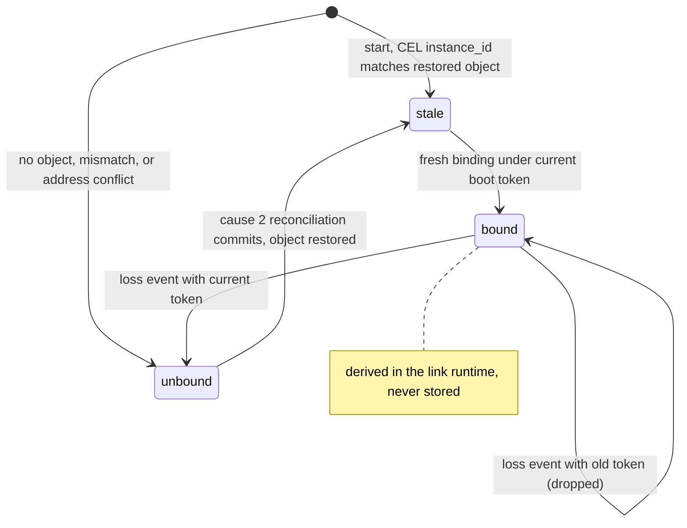
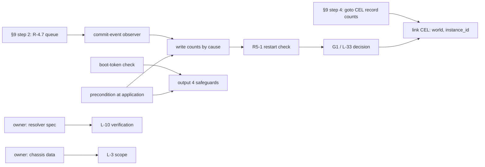

# Panel 10: Synthesis

Roundtable 5 of 5. Written by Opus (synthesis lead). Astra, Sol and Fable review it against the four statement kinds below. Repo HEAD `24a72b3`, branch `intake-3.1`. The session folder is uncommitted.

## How to read this file

Every row carries one statement kind. Placement in "Act now" or in the roadmap does not establish owner acceptance (Astra T348; Opus T354).

| Kind | Meaning | Who changes it |
|---|---|---|
| Owner decision | Decided in `DECISIONS.md`, `docs/` or a Decided R-row | Owner only |
| Panel agreement | All four seats agreed in turns | Owner accepts or rejects |
| Proposed | One or more seats proposed it; not accepted by the owner | Owner; a later panel |
| Verified | A performed check establishes it, within that check's scope | A later check |

No runtime check was performed in any session. Nothing in this file is verified behavior. Verified rows below verify citations or document structure only (Fable T359, T366; Sol's link checks).

The review (`review-session-20261104-24c67015.md`) is advisory. A proposed benefit counts only after its measure is performed (Sol T313).

## Owner brief: the open questions in plain terms

**Citation correction (chair T417):** "`:578`" means `mcp-tools.proposed.json:578`, the description of the proposed `update` command. It does not mean `TOPOGEE-SPEC.md:578`, which covers agent accolades.

### The situation (chair T437: "retry on what, success on what")

Two processes are involved. The **world server** (Rust, LadybugDB and Bevy, per the owner brief) holds simulated or physical objects. The **map server** holds the functional map and is its only writer (R-4.4).

When the world creates an object for a map address, the map must remember which object that is. The map stores a **link record** as a layer at the address. The address, layer name and values below are illustrative (`judgment`, Opus):

```json
{ "hardware.sensor.range": { "link": [ { "world": "sim-1", "instance_id": "obj-42" } ] } }
```

The panel calls `world` plus `instance_id` the **pair**. The pair is the only thing the world asks the map to store.

| Term | Meaning in this example |
|---|---|
| Write | The world server asks the map server to store the pair `sim-1`/`obj-42` at `hardware.sensor.range` |
| Success | The map server replies "stored" to the world server |
| Retry | The world server sends the same write again, because no reply arrived |
| Repair | A person or agent replaces a wrong pair, for example `obj-42` with `obj-77`, after a mismatch |

Replies can be lost. If the world never hears "stored", it cannot tell whether the write committed. It sends the write again.

**Command note:** the turns name `update` (`mcp-tools.proposed.json:578`) as the edit target. Ledger L-21 says world CELs use the `layer` command. R-5.1 (`TOPOGEE-SPEC.md:251`) lists `layer`, but `mcp-tools.proposed.json` does not define it yet (Opus, file search). The owner decides which command carries the link write. Neither command states any of the conditions below.

### The questions

| # | Question | Example | Proposal | Seat support (kept turns) |
|---|---|---|---|---|
| 1 | Should an identical retry return success with no commit? | `obj-42` is already stored; the retry carries `obj-42` again | Reply "stored", write nothing, announce nothing. A second commit adds no information and sends a needless announcement to every viewer (R-4.10). | Astra T404, T427; Sol T405; Opus T402. Fable records it in `ledger.md` |
| 2 | Should that success have its own reply type? | Same as 1 | No seat requires one. R-4.7 says a write is acknowledged only after it commits (`TOPOGEE-SPEC.md:223`), so the encoding is open. | Astra T444: not rejected; encoding open. Sol T426: unspecified; any new type is a proposal. Fable's ledger keeps a type as Fable's own proposal (T435) |
| 3 | Should a first-link write apply only if no pair is stored? | The world's retry of `obj-42` is delayed. Meanwhile a repair stores `obj-77`. The late retry arrives. | The map server checks "no pair stored" when it applies the write, inside the R-4.7 queue, and refuses the late retry. Without the check, the late retry overwrites the repair (Astra T381). | Opus T384; Astra T404, T427; Sol T405 |
| 4 | Should a repair name the pair it replaces? | Two repairs both expect `obj-42`. The first stores `obj-77`. The second arrives late. | The map server applies a repair only while its expected pair is still stored, so it refuses the late repair. | Sol T394; Opus T402; Astra T404, T427. Fable's support is only in a vetoed turn |

Questions 3 and 4 add a condition to an existing command. They add no tool. All four are Proposed and untested. They come from turns T381 to T435, after the saved turn record ends at T296. Other files: `ledger.md` (L-33 additions), `l60-verification.md:101`, `contradictions.md:232`, `r5-astra-crosswalk.md:63`.

## Relies on

- P1 authority order; P2 ECS without an engine; P3 link, not host; P4 link CEL; P7 storage and the world link.
- R5 Part 1, closed with all four seats: F1, F2 (amended), F3, F4, G2 and G3 accepted; G1 Proposed as L-33.

## Challenges

None to P1, P2 or P3. G1 challenges P4 and P7: `status` leaves the CEL (Proposed). Both panels carry R5 marks.

## Output 1: Working specification

The panel adds nothing to `TOPOGEE-SPEC.md`. The owner brief already records the world-server scope: Rust, LadybugDB and Bevy (`review-evidence.md:29`). The interface and device rows stay Proposed and outside the specification until the owner accepts them (review row 6; Sol T426).

### Effect on foundational decisions (review `:108–115`)

| # | Group | Item | Kind | Maps to |
|---|---|---|---|---|
| 1 | Act now | Keep §9 steps 1–4 as written. No panel row adjusts them (L-27). | §9 is Proposed (`:508`) | §9 steps 1–4 |
| 2a | Act now | JSON store under `~/.metaform`, written only by the map server | Owner decision (`DECISIONS.md:12`; R-4.1 `:188`) | §9 step 2 |
| 2b | Act now | Effect log as the commit point | Proposed, Alternative G (R-4.13 `:239`, `:241`) | §9 step 2 |
| 2c | Act now | SQLite as the medium of that log | `judgment` under the Decided permission (R-4.1 `:188`); joined to (2b) only at §9 `:513` (T360) | §9 step 2 |
| 2d | Act now | Fair write queues on every store, including the world store | Owner decision (`DECISIONS.md:12`) | §9 step 2 |
| 3 | Act now | Layer storage lets the `goto` summary count any CEL's records, not fields (T341). `goto` keeps once-per-context delivery (F1; R-5.30 `:291`). | Panel agreement on a review row | §9 step 4 |
| 4 | Blocked | Context resolver and its relation to `goto` and tickets | Owner decision pending (§11 `:556`; C-2; F2) | L-10 and every device delivery row |
| 5 | Blocked | Which map data the chassis controls | Owner decision pending (R-2.11 `:79`; D-9) | Chassis hook; L-3 scope |
| 6 | Proposed | World and device contract details in L-6 to L-33, including G1/L-33. Parts that restate Decided map storage and fair queues keep the owner decision (`DECISIONS.md:12`; Astra T427). | Proposed (review row 6) | Nothing in §9 steps 1–4 |

The owner can accept (2b) and reject (2c).

### G1 / L-33: runtime link status (Proposed, `judgment`, untested)

- The CEL holds `world` and `instance_id` only (T307, T318). These fields belong in the Proposed group (T341).
- The link runtime derives `status` from the CEL `instance_id`, object presence and the boot token. Nothing stores `status`.

| `status` | Condition | Source |
|---|---|---|
| `bound` | A binding exists under the current boot token | P4 |
| `stale` | The object carries the CEL `instance_id`; no binding exists under this token | T314 |
| `unbound` | No object, an identity mismatch, or an address conflict | T321 |

- **Start rule (T314):** at start, the runtime sets `stale` where the CEL `instance_id` matches a restored object. It sets `unbound` only for the three conditions.
- **Two write causes (T329):** (1) the CEL lacks the pair, as at first spawn or after a world-first crash; (2) a mismatch was explicitly reconciled. R3 forbids automatic replacement (T321).
- An echo creates no map write (T308). A restart writes nothing only when both durable records already agree (T327).



The `unbound --> stale` edge is `judgment` (Opus). No turn names the state after reconciliation.

## Output 2: Roadmap with ordering rationale

| Order | Step | Reason | Kind |
|---|---|---|---|
| 1 | §9 step 1: names and refusals | Every later step refuses through it | §9, Proposed |
| 2 | §9 step 2: JSON store, effect log, layers, R-4.7 queue | The commit-event observer and all write counts depend on the queue (T383) | §9, Proposed; store Decided |
| 3 | §9 step 3: map server, forwarder, CLI | World work starts only after step 3 (L-27) | §9; L-27 Proposed |
| 4 | §9 step 4: reads, `goto`, search | CEL record counts and once-per-context delivery (row 3) | §9, Proposed |
| 5 | Owner: resolver specification | Unblocks L-10 verification and device delivery (row 4) | Blocked |
| 6 | Owner: chassis data control | Fixes L-3 scope and the chassis hook (row 5) | Blocked |
| 7 | World link checks (output 4 table) | Each check needs the commit-event observer from step 2 | Proposed |
| 8 | P5 and P6 device panel (`topics/04.md`) | Needs owner acceptance of the world interface rows; the world-server scope is already recorded (`review-evidence.md:29`) | Open |

## Output 3: Differentiation

- **Functional map apart from world identity.** The CEL links an address to `world` and `instance_id`; no `Entity` id, boot token or `wants` enters it (P4 never-held list; L-3 scoped by F4). `judgment`: this keeps the map language-agnostic, as `TOPOGEE.md` §1 requires.
- **Delivery once per context.** `goto` delivers names and counts once per context (R-5.30; F1). Owner design, not a panel claim.
- **Restart without map traffic.** Under L-33, a matching restart creates no commit and no announcement. Proposed; the claim counts only after the R5-1 check passes (Sol T313).

## Output 4: Safeguards (Proposed, `judgment`, untested)

### Boot-token check

| Rule | Source |
|---|---|
| A loss event carries `world`, `instance_id` and the boot token. The runtime drops an event whose token is not current. | Sol T331; Fable T339 |
| A `bound` value kept through a disconnection is diagnostic only. It authorizes nothing until the runtime revalidates it. | Astra T334 |
| The world validates the boot token when it applies an action. | Sol T344 |
| A disconnection is not a loss. The runtime keeps the last derived value and reports the link unreachable. "Unreachable" is a condition, not a `status` value. | Opus T319; Fable T324 |
| A silent world must not produce `unbound`, because `unbound` starts reconciliation. | Sol T317; Opus T319 |

### Checks at application on the map server

The map server checks the write cause when it applies a submission, as the world checks the boot token (Fable T386).

| Cause | Precondition | Same pair | Different pair | Source |
|---|---|---|---|---|
| 1: pair absent | The CEL lacks the pair | No-commit response; nothing commits | L-9-style refusal; nothing commits. The world does not adopt the returned pair; it derives `unbound` and reports it. | T384, T387, T391 |
| 2: reconciliation | The submission names the pair it replaces; it applies only while that pair is current | — | Refusal; the current pair remains | Sol T394; supported by Opus T402 and Astra T404, T427. Fable's vetoed T400 is not a record |

```mermaid
sequenceDiagram
  participant W as world server
  participant Q as map server, R-4.7 queue
  W->>Q: submit (world, address, instance_id), cause 1, attempt a1
  Note over Q: commit transition: one commit event
  Q--xW: acknowledgement lost
  W->>Q: retry, cause 1, attempt a2
  Q->>Q: at application: pair present and identical
  Q-->>W: success (no commit event, no R-4.10 announcement; reply encoding unspecified)
  Note over W: retry chain ends (Proposed, judgment; vetoed T411 is not a record)
```

- R-4.7 says a write is acknowledged only after it commits (`TOPOGEE-SPEC.md:223`; Decided at `:225`). The owner's words cover the queue only; the acknowledgement detail comes from the earlier proposal (`:225`). T404 and T405 specify success with no additional commit and no refusal. They do not fix the reply encoding or the acknowledgement count; both stay unspecified (Sol T426). Opus withdraws the earlier "third response kind" wording.
- The precondition adjusts the proposed contract (`mcp-tools.proposed.json:578`). It adds no tool. It needs an owner decision.
- Superseded: the Opus T357 read-before-retry. Fable T362 found a queued-first-submission race, and Astra T381 showed the read cannot cover the reconciliation interval.

### Proposed checks (none performed)

Sol holds R5-1 to R5-9 in `l60-verification.md:90–98` (confirmed by Opus after Sol T423).

| Check | Expected result | Source |
|---|---|---|
| R5-1 matching restart (G1 decision trigger) | No committed write; no R-4.10 announcement | T313, T320, T329, T356 |
| R5-2 obsolete loss event | Event dropped; stays `bound`; no map write | T331 |
| R5-3 lost acknowledgement, retry | Count the initial write apart. During retry application: one success; zero additional commits, R-4.10 announcements and refusals. Reply encoding and acknowledgement count unspecified. | T336; Astra T404; Sol T405 |
| R5-4 delayed action after restart | World rejects the obsolete token | T344 |
| R5-5 object loss | Runtime derives `unbound` | T317, T319, T324 |
| R5-6 world-first crash | Missing pair persists with the original `instance_id` | T327 |
| R5-7 queue hold: hold, retry, release | Count commit events and emitted announcements independently. One commit event means the identical update commits nothing; two mean it commits again. Without the commit observer, the commit count is unknown (T380; Sol T426). | T362, T364 |
| R5-8 delayed retry after reconciliation | The reconciled pair remains | T381 |
| R5-9 delayed reconciliation expecting A, after A→B | B remains | T394 |

## Output 5: Architecture questions with decision triggers

| Question | Trigger | Owner of the answer |
|---|---|---|
| G1: does `status` leave the CEL? | R5-1 result: a matching restart creates no commit and no announcement (T329) | Owner |
| Does an identical update commit, and does R-4.10 announce it? A write-count question, not a correctness question (T357, T364). | R5-3 and the queue-hold variant | Owner, on `mcp-tools.proposed.json:578` |
| Cause 1 precondition "pair absent" and cause 2 expected pair on `mcp-tools.proposed.json:578` | Owner decision; then R5-3 and the T381 and T394 variants | Owner |
| How is the identical-pair success encoded, and does it count as an R-4.7 acknowledgement? Unspecified (Sol T426). | Owner decision on `mcp-tools.proposed.json:578` | Owner |
| Where does the commit-transition observer live? R-4.7 exposes none (T383). | §9 step 2 build | Build |
| Link-down signal | P5 (T319, T328) | P5 |
| Resolver contract | Owner specifies §11 resolver (F2) | Owner |
| Chassis data control | Owner decides R-2.11 parts | Owner |

## Output 6: Synergy map (`judgment`, Opus)



One build artifact, the commit-event observer, serves three needs: G1's trigger, the L-6 write categories and the T336 result.

## Output 7: Maintenance posture

- One writer per file. Each seat re-reads a file before writing it (session rule; review process item on lost edits).
- Rows keep their statement kind. Panel agreement never becomes Decided without the owner.
- Write counts use four categories, classified by cause, not by label: restart, recovery, repair and retry. A retry follows an unacknowledged earlier submission. A matching restart counts zero writes (T369, T371).
- L-6 counts: an identical-pair response is a success with no additional commit, outside the refusal budget. Only a different-pair response is a refusal (Astra T404; Sol T405).
- Count server outcomes apart from world receipts. A lost response changes receipt counts only (Sol T405).
- Log join key: `world`, address, pair, `instance_id` and an attempt label. Correlation lives in test logs, never in the CEL (T375, T388, T390).
- Known transitions: the map moves from Ladybug to JSON; layers move from one column to separate files (P7; C-5). The `store.ts:7-8` header is adjusted later (C-8).

## Output 8: Success criteria

| # | Criterion | Kind |
|---|---|---|
| 8 (restated, G3) | Measure what the build delivers: orientation tokens against a raw-source baseline, with intake, refresh and repeat costs, and first task apart from later tasks. A poor result implicates slicing, delivery or the store first. | Panel agreement (`docs/countermeasures.md:94`) |
| 9 (new) | One commit event for each committed write, acknowledged or not, observed at the queue's commit transition. Without it, the commit count is unknown, and announcements do not substitute (Sol T380; Opus T383). | Proposed build measure |
| 10 (new) | A matching restart creates zero restart writes and zero R-4.10 announcements (R5-1). | Proposed |

Criteria 1–7 stand as drafted in `ledger.md`.

## Decisions Made

- R5 Part 1: F1, F3, F4, G2, G3 accepted; F2 accepted as amended; G1 Proposed as L-33. All four seats.
- The P10 groups: Act now (rows 1–3), Proposed (row 6: world and device contract details in L-6 to L-33), Blocked (rows 4–5).
- The L-29 split: JSON store Decided; effect log Proposed; SQLite medium `judgment`.
- Precondition at application for cause 1 (T384, T387, T391). Proposed.
- Counting: identical pair is a success with no additional commit, not a refusal (Astra T404; Sol T405). Proposed.

## Open Questions Handed Forward

| Item | State | Blocks |
|---|---|---|
| Sol T394 cause 2 guard | Proposed; supported by Astra T404 | L-33; owner question on the update command |
| Owner decision on `mcp-tools.proposed.json:578` | Open | R5-3 expected result; contract |
| Commit-transition observer | Not built | R5-3; queue-hold variant |
| Link-down signal | P5 | Final safeguard text |
| Test 2 and other lane budgets | Owner or P5 | Performance criteria |
| Chassis scope | Owner (R-2.11) | L-3 and rows on R-2.11 |
| P5 and P6 device limits and leases | `topics/04.md`, unchanged | Device rows |
| P8 safeguards and P9 roadmap matters | Not reviewed in a panel; outputs 2 and 4 hold this session's items | Final P8 and P9 rows |
| ACP conversation log store | Owner; SQLite recommended (P7) | Agents module |
| Status labels across `ledger.md` and `contradictions.md` | Pending (Astra) | Folder consistency |
| Four earlier L-60 checks; L-10 | Untested at `24a72b3` | L-10 verification |
