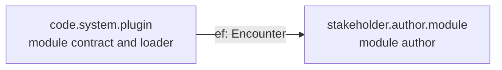
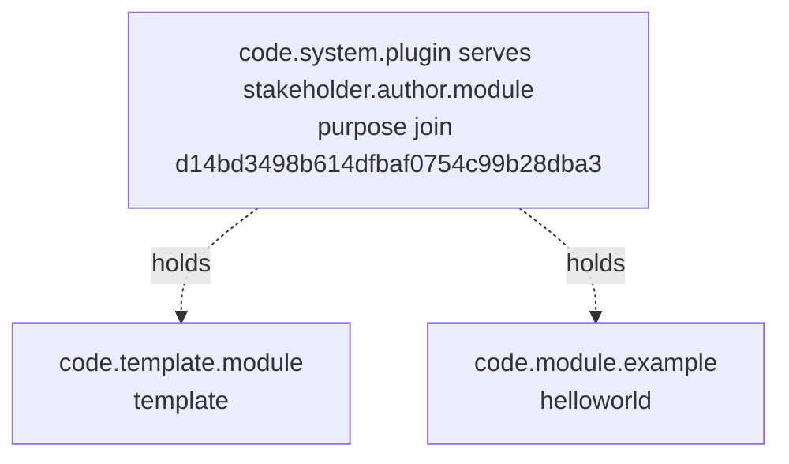
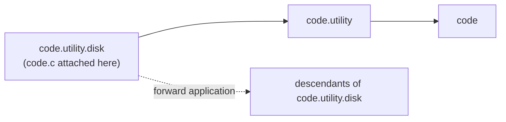

# Reading an Inference Metaform

[Documentation](../README.md) · [Operating guide](working-with-metaform.md) · [Project walkthrough](../examples/project-walkthrough.md)

An Inference Metaform is a representation of **what a workpiece is doing**. Its addresses organize functional meaning; its joins explain receiving purposes and how providers serve them. It is not a source-file hierarchy or a call graph with more descriptive labels.

This guide reads the earlier map of this repository, recorded on September 26, 2026 and kept as an [export](../examples/project-metaform.json) of an earlier version, at schema version 1. The current chassis imports schema version 5 only, so that file cannot be imported into it; the commands below are the reads that return these records from a map that holds them, and on your own map they take its addresses. The recorded map has 19 global elements, 33 purpose joins, and 26 internal subtypes. Its 86 type-prefix records are the ancestry needed for the namespace, not 86 independently represented subsystems. The [implementation map](../inference-metaform/IMPLEMENTATION_MAP.md#graph-index) contains the complete element, join, and subtype index.

The export was written by the store of that day, and three of its record shapes have changed since. The project's name for a functionality was a descriptor item at the element; it is now the join's `name`. A subtype was its own row; it is now a join of type `subtype` inside its parent join, holding an ordinary element. The condition of an object was a finding with a `flag`; it is now a work record, apart from the map. The export also predates `verb`, so its joins and subtypes record `verb` as null, and its relations are whole sentences.

The running web GUI draws a map as nodes and joins. This screenshot is the kitchen timer's map from [Getting started](getting-started.md#record-a-small-map-by-hand): elements as nodes, joins as the lines between them, colored by `ef`, the tick loop drawn inside the kitchen timer's join in the 2D map, the audible alarm red for its open `broken` work record, and the selected element's memory, knowledge and joins in the panel on the left.


## Begin with the artifact and its receivers

The exported project's Artifact Under Examination, or **AUE**, is `code.graph.knowledge`, named **Metaform**. Its outside vested receivers include:

| Address | Project name | Perspective |
|---|---|---|
| `stakeholder.orchestrator.agent` | agent orchestrator | Receives a functional map and the facilities through which agents use it. |
| `stakeholder.author.module` | module author | Receives an extension mechanism for adding a capability without changing the chassis. |

These are types of parties vested in this kind of artifact, not identifiers for the particular people reading this guide. The intake identifies vested parties through the purposes that drive improvement in the artifact. It does not simply label whoever requested the intake as the CQU.

The map names `code.chassis`, **chassis**, as its Defining Element. The represented supporting capabilities include the store, command line, plugin system, intake, map API, memory, MCP, GUI, variants, installer, builder, reports, agent instructions, and tests. This is the functional organization recorded by this intake, not a claim that every implementation component must appear as a separate global node.

Inspect the outside receiving perspective with:

```sh
metaform map element stakeholder.author.module
metaform map joins stakeholder.author.module as=receiver
```

Ask what that party receives, not just which box sits beside it in a drawing.

## Distinguish entity, element, and role

An **Entity** is a whole at the scope of examination. An **Element** is a nameable part in relation to that whole. When you examine a component's own requirements and composition, you treat it as an entity with its own elements. One identity can therefore be a provider in one join and a receiver in another.

The intake's roles distinguish contributions:

| Role | Meaning in the examined artifact |
|---|---|
| AUE | The artifact or collection under examination. |
| CQU | A vested party outside the AUE whose purpose is being served. |
| DE | The defining element whose loss would prevent the AUE from remaining the same type. |
| SE | A substantial element whose Encounter Function helps the defining element serve the vested purpose. It counts as substantial because of what it is meant to contribute to the AUE, even when that contribution is weak or replaceable. |
| NE | A notable element expressing an essential demand or requirement on the external environment. |

A **Providing Element**, or **PE**, is an endpoint role in a join, not another element-role attribute. **Parametric** qualities and quantities are tunable details, not automatically separately named elements. Something being recognizable or nameable does not make it a load-bearing independent part of this map.

“Exterior” means outside the project. “External” can mean outside the functionality being examined while still inside the repository. Ownership is not the distinction. A subsystem inside the repository can provide something that the currently examined subsystem receives from outside its own boundary.

## Read the namespace and the project name separately

For `code.system.plugin`, there are three useful readings:

| Field | Value |
|---|---|
| Address | `code.system.plugin` |
| Full type reading | plugin system code |
| Short type name | plugin system (`name_length = 2`) |
| Project name | module contract and loader |

Namespace segments reverse into a readable type name; underscores become spaces. `name_length` selects how many trailing segments participate in the short reading, and that short reading is the element's name. The current store records the project name on the join that names the functionality, as `name`, not on the element: it is how this project names the functionality, formally or informally. The export, written before that change, holds it in a descriptor item at the element.

Every prefix supplies a type perspective:

| Prefix | Type reading |
|---|---|
| `code` | code |
| `code.system` | system code |
| `code.system.plugin` | plugin system code |

The address can orient inference before the project-specific joins are read. The joins then connect that general understanding to the particular workpiece. Both are necessary to the account: the type tells an agent what kind of thing it is considering, while the receiving relationships establish what that thing is doing here.

### An address is a prompting surface

The author's address-only material contains four generated lists requested with `write 10 best practices for [address]`. The addresses were `code`, `code.engine`, `code.engine.game`, and `code.engine.game.fps`; no project description or code accompanied them. Guidance shifted from general programming concerns to engines, game engines, and first-person game engines.

The point is not to install those generated lists as universal requirements. It is that a meaningful type address engages existing understanding and supports further inference. A practice that remains applicable after removing a leaf belongs at a broader type. A specialized practice about hit registration does not become a rule about all code merely because an ancestor can see it.

Original material: [address-only examples](../../specifications/metaprompting_element_segments_example.md). Full explanation: [primordial type understanding](../inference-metaform/REFERENCE.md#type-understanding).

## Read a join as a reasoned relationship

The module author receives a capability from `code.system.plugin`. Its join is:



| Field | Value |
|---|---|
| Receiver | `stakeholder.author.module`, owns the Operative Purpose: add a capability once, as a module, with the needed surfaces |
| Provider | `code.system.plugin`, supplies the Encounter Function: a MODULE declaration and loader through which that capability becomes commands, tools, settings, events, status, and lifecycle |
| Join | `d14bd3498b614dfbaf0754c99b28dba3` |
| `ef` | Encounter |
| `relation` | The plugin system lets a module author plug a capability into Metaform with one declaration. |

This display is an abbreviated reading of the actual record. The complete purpose, function, observation, and references remain in the export. On a map that holds them, the provider's address read prints them under `provides`, and `map node` prints what the layers hold at the join:

```sh
metaform map where code.system.plugin
metaform map node join:d14bd3498b614dfbaf0754c99b28dba3
```

The **Operative Purpose** is the why, held by the receiver. The **Encounter Function** is the how, supplied by the provider for that relationship. `relation` states the connection as an active-voice fragment that starts with its third-person verb, and `verb` holds that verb; its subject is the Providing Element when `ef` is Function and the Cestui Que Use, the join's receiver, when `ef` is Encounter. The export's relations predate that form and are whole sentences. `observation` records the actual condition, form, arrangement, or limitations. References connect the record to relevant evidence or artifact-specific logic. An optional `non_goal` records a pertinent outcome the receiver does not seek; its absence is not a request to invent exclusions.

A provider can serve different purposes through different Encounter Functions. The module contract serves the command line by supplying verb declarations, the builder by identifying loaded modules and dependencies, and the module author through the declaration-and-loading encounter. Those distinctions belong in the joins, not in a single flattened element-level function description.

## Function and Encounter are not synonyms for function and file

**Function** is operative capability. **Encounter** is the form through which it is expressed, realized, used, or experienced. In the module-author join, the declaration mechanism is marked Encounter; in the command-line receiving join, supplying the declared verbs is marked Function.

The phrase **Encounter Function** has an intentional **Unloaded Definition**. It supports understanding the function of an encounter or the encounter of a function according to the artifact and relationship. Replacing it everywhere with “callable,” “API method,” or “user interface” would remove part of the method's scope.

This matters outside software as well. In the author's photograph example, a couple can be the defining subject while a tower supports the setting. What the tower contributes to the photograph is not the same question as what that structure does independently in the world. Nearby images or the folder context may support an inference about the occasion. Classifying the image as scenery does not replace the description of its particular subject.

The dotted typology expresses valid Function or Encounter types, not every convenient metadata label. Encoding alone does not make a functional type. A JPEG encoder can have an encoder-function address; simply appending a file format to a document address does not establish such a function. The [namespace account](../inference-metaform/REFERENCE.md#namespaces) covers the distinctions in depth.

## Subtype joins preserve detail without adding more global elements

The module-author join contains:



`template` contributes a contract-shaped starting point. `helloworld` demonstrates working use of the contract. Their active roles are preserved **inside the parent purpose join**, each in a subtype join, a join of type `subtype` that names the element it holds. Each stays one ordinary element record at its own address; an element whose only joins are subtype joins is no root and no node of the outer map. They do not receive independent copies of that purpose merely because they can be named.

```sh
metaform map subtypes d14bd3498b614dfbaf0754c99b28dba3
metaform map where code.module.example
```

This is the result of convergence: many implementation details are absorbed into load-bearing parent functionalities while their atomic contributions remain available in the matching relationships. Convergence is not loss of the useful detail; it is the decision about where that detail belongs.

The runtime can also create a memory holder named `code.module.hello` when the hello demo runs. That holder is not the same address as the element `code.module.example` that the intake's subtype join holds. The former is a module-created location for greeting records; the latter describes the example module's contribution to the module-author purpose. Similar names do not silently merge their identities.

## Follow Encounters through the applicable structure

Consider the author's language example. A C Encounter, `code.c`, is attached at `code.utility.disk`. The functional address remains the disk utility; the language is not appended as `code.utility.disk.c`.



Unrelated siblings do not acquire C through the common ancestor.

The relevant consequences include memory semantics, data representation, interfaces, error behavior, and operating-system interaction. An agent can examine those consequences through the disk utility's receiving purposes, not merely paste a generic C checklist beside it. A mixed-language workpiece retains the attachment points where each language actually participates.

The store's `map context <address>` separates applying properties from visible properties. This supplies scope-aware knowledge access. The general Encounter-inference producer and the full language-Encounter account extend beyond that one read operation. The served intake also includes a language-address exclusion that differs from the author's broader Encounter account. [The implementation map](../inference-metaform/IMPLEMENTATION_MAP.md#correspondence) preserves that specific boundary instead of silently changing either account.

## Identity is relational, not just a stable label

The exact semantic definition is:

```text
C(T) = { (r_i AND p_i AND e) }
```

Here `r_i` is a Receiving Entity, `p_i` its Operative Purpose, and `e` the single Encounter Function at the represented resolution. The set is exact: not a similarity score, a minimum list of attributes, or an approximate signature.

A realization can change while preserving the relevant relational identity. Changing an identity-defining relationship changes the semantic type. Keeping a useful functional address during a port does not prove that the Encounter-specific identity is unchanged; language may be materially part of that Encounter.

The exported graph's broad provider records contain receiver-specific joins. The existing `map identity` command retrieves those joins. It does not prove exact equivalence between implementations or supply an otherwise unspecified mapping from every broad provider record to the formal type `T`.

## Distinguish the representation from attached knowledge

An element or a join, a subtype join included, provides an address. Items attach local findings, observations, or other values at that address. Properties supply branch-scoped knowledge. Layers keep bodies of knowledge and their purposes distinct; selection determines which participate in an operation. Corrections retain changes to the representation through a separate stack.

```sh
metaform map node element:code.system.plugin
metaform map context code.system.plugin
metaform map layers
```

The supplied original project export contains one intake layer and no memory or property records. The store's ability to hold those records is nevertheless implemented. Later local exercises can add them without changing what the original export demonstrates.

An agent can use prepared understanding, derive another conclusion, and retain it at a meaningful location. Subsequent inference then works on that result as well as the original graph. This continuing use is why the Metaform is both **derived from inference** and **a guide for inference**.

For executable layer and memory procedures, return to [Working with Metaform](working-with-metaform.md). For the connected account of prompting, criticism, provenance, and shaping a workpiece through intent, read the [preprint](../preprint/inference-metaform.md).
