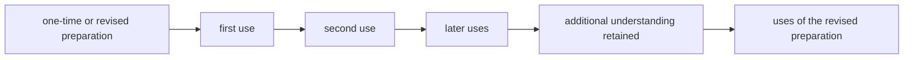

# Inference Metaform: examples and traces to collect

[Technical reference](REFERENCE.md) | [Implementation map](IMPLEMENTATION_MAP.md) | [Ideas](IDEAS.md)

The useful example is not just a good final answer. It shows **which functional understanding was established in advance, where that understanding was retained, and how a later operation used it**. A connected trace can expose the same prepared relationships serving implementation, criticism, memory, prompting, and recomposition without treating those as separate demonstrations of unrelated features.

The author has manually exercised and measured the method during its independent development. This collection organizes original material, including those measurements, around the mechanisms described in the [reference](REFERENCE.md#conception). It does not replace that history with a synthetic experiment or make collection a prerequisite for explaining or using the system.

## Contents

1. [Available material and its source role](#available)
2. [Collection targets by mechanism](#targets)
3. [Keeping a connected trace readable](#trace)
4. [Measurements that expose preparation and reuse](#measurements)
5. [Useful collection sequences](#sequences)

<a id="available"></a>
## 1. Available material and its source role

The following material was supplied with the September 26 source bundle identified in the [implementation map](IMPLEMENTATION_MAP.md#snapshot). The distinction between an original output, a fixture, a source assertion, and a derived illustration belongs beside the example, not hidden in a general disclaimer.

| Available material | What it makes visible | Source role and limits of its lineage |
|---|---|---|
| [September 26 project export](../examples/project-metaform.json) | The project's 19 global elements, 33 purpose joins, 26 internal subtypes, descriptor names, source refs, five findings, and intake provenance. | Actual stored result of the September 26, 2026 intake, an export at schema version 1 that the current store does not import; its record shapes are those of that day. The complete functional index is in the [implementation map](IMPLEMENTATION_MAP.md#graph-index). |
| The September 26 SQLite store, at the external bundle path below | Stored rows corresponding to that Metaform, with layers, records, and associated report data. | Actual stored state. It is not a later memory, criticism, or lexicalization run. |
| The September 26 intake report and process feedback, at the external paths below | The original agent's project examination, recorded tool/test observations, submission feedback, and process difficulties. | Operational accounts associated with intake layer `2f6b86ffc49c4575bfdbf0ad2ac712f7`. Reported test results remain attributed to that run. |
| Earlier report and feedback, id `70618d7651c24ba9b04219544af156d8` | An earlier examination and its process observations. | September 25 run; its Metaform was withdrawn September 26 and no export was supplied. Do not manufacture a before/after graph from the report alone. |
| [Address-only generated lists](../../specifications/metaprompting_element_segments_example.md) | Distinct guidance generated for `code`, `code.engine`, `code.engine.game`, and `code.engine.game.fps`; progression from trunk to leaf. | Original supplied example whose account states that only the addresses were prompted, without a repository or project description. Its generated practices are not universal engineering requirements. |
| September 15 knowledge-layer output, kept outside the repository | Practices attached to namespace addresses and relationship-oriented knowledge. | Historical output `kl-codex-developer-best-practices-20260915`; its named base result, `dt-codex-20260915-8d3f2c1a`, was not supplied. It does not establish a current shipped producer. |
| [Sonnet intake output](../../specifications/Sonnet_Intake.xml); a code-only intake output and an earlier sample, both kept outside the repository | Earlier functional decompositions and output shapes. | Historical results; their exact producing prompts are not recorded with them. They are not substitutes for the served Canonical Intake or current architecture. |
| [Kitchen-timer fixture](../../tests/fixtures/intake_timer.json) and [intake tests](../../src/metaform/modules/intake/tests/test_intake.py) | A small, inspectable set of recorded objects and source assertions about retained elements, joins, subtype joins, notices, and layers. | Fixture and test source, not a newly executed model intake. |
| [Layer tests](../../tests/test_store_layers.py), [memory tests](../../src/metaform/modules/memory/tests/test_memory.py), [challenge tests](../../tests/test_store_challenges.py), and [lifecycle tests](../../tests/test_lifecycle.py) | Concrete expected behavior for selection, property scope, relationship-addressed memory, challenge state, and module-owned tasks. | Inspected assertions. The documentation work did not run these tests. |
| [Worked reference illustrations](REFERENCE.md#walkthroughs) | Connected explanations of the mechanisms using the author's examples and current project names. | Derived illustrations except where explicitly grounded in a stored record or inspected source. They are not run transcripts. |

### External material paths

The source bundle places material copied from the project home under `external/`. These are collection paths, not proposed repository directories:

```text
external/metaform-home/projects/metaform/
  metaforms/6a339171fe6f44c49a40f4a270d98913/store.sqlite3
  reports/2f6b86ffc49c4575bfdbf0ad2ac712f7-report.md
  reports/2f6b86ffc49c4575bfdbf0ad2ac712f7-feedback.md
  reports/70618d7651c24ba9b04219544af156d8-report.md
  reports/70618d7651c24ba9b04219544af156d8-feedback.md
```

The bundle contains no populated prompt store or current lexicalized-prompt pairs, memory-session traces, or A/B/C response traces. Those mechanisms have different available evidence: author-described operations, supporting source, historical examples where present, and the original traces identified below. The [implementation correspondence](IMPLEMENTATION_MAP.md#correspondence) keeps those distinctions precise.

<a id="targets"></a>
## 2. Collection targets by mechanism

Each target describes material worth retaining and the relationship it would expose. Targets can be collected independently or as parts of the same working session. They do not prescribe a new mandatory workflow, output schema, experiment, or acceptance gate.

| Target | Central question |
|---|---|
| [1. Address-only inference](#address-only) | What does the functional address itself orient, and what becomes specific at each leaf? |
| [2. Survey, trace, and convergence](#convergence) | How does a complete workpiece become a map of load-bearing parent functionality? |
| [3. Project-grounded lexicalization](#lexicalization) | Which request referents are resolved before execution, without changing the requested operation? |
| [4. Information and imperatives](#information-imperatives) | Which selected contributions inform the task, and which explicitly direct it? |
| [5. Encounter and property scope](#encounter-scope) | What is visible from ancestry, what applies within a branch, and what remains outside that scope? |
| [6. Relationship-addressed memory](#relationship-memory) | Why does a remembered observation belong to this receiving-purpose relationship? |
| [7. Selection and hidden dependencies](#selection) | How does the same stored graph yield different participating knowledge? |
| [8. Three blindspot outcomes](#blindspots) | What substantive project reasoning leads to A, B, or C? |
| [9. Criticism with the actual artifact](#artifact-criticism) | How do represented purpose and inspected realization inform one another? |
| [10. Relationship-preserving mutation](#mutation) | Which identity-defining relationships remain while the realization changes? |
| [11. Intentional transformation](#transformation) | What changes because the intended purpose or Encounter changes? |
| [12. Cross-artifact and collection use](#cross-artifact) | How does receiving purpose orient work on a photograph, document, narrative, or collection? |
| [13. Community module extension](#extension) | Which shared capabilities does a module receive without changing the chassis? |
| [14. Provenance and artifact history](#provenance) | Which origin, prompt, selected knowledge, and output can actually be connected? |
| [15. Reuse across operations](#reuse) | How does one prepared understanding serve several distinct tasks? |
| [16. Original manual measurements](#manual-records) | What did the author's recorded comparisons measure, under which conditions? |

<a id="address-only"></a>
### Target 1. Address-only inference and placement of knowledge

**Mechanism.** A meaningful address engages primordial type understanding. Its ancestry orients the domain while its leaf supplies specificity. Knowledge that remains applicable when the leaf is removed can belong closer to the trunk of the type tree. See [type understanding](REFERENCE.md#type-understanding).

**Material to retain.** Preserve the original prompts and full outputs for each address in a trunk-to-leaf progression, together with whatever input and model settings were actually recorded. Keep the subsequent judgment about where a practice belongs: parent, leaf, or another branch. A project's application of one such practice can be attached as a later trace rather than retroactively added to the address-only input.

**What this exposes.** The reader can distinguish useful inference from the address alone, parent-level repetition, genuinely leaf-specific guidance, and project knowledge introduced only later. The supplied four-list example is the starting material. Its examples of memory management or concurrency remain generated guidance to reason about, not automatic prescriptions for every type named `engine`.

<a id="convergence"></a>
### Target 2. Survey, receiving-purpose trace, and convergence

**Mechanism.** Intake surveys the artifact, traces providers through receiving purposes, closes unexplained functionality, and converges compatible contributions into parent functionalities while retaining their refs and internal subtype relationships. See [Canonical Intake](REFERENCE.md#intake).

**Material to retain.** Keep the exact served prompt, original workpiece or pinned source, submitted output, resulting graph, refs, notices, and the agent's explicit explanation of grouping where one was recorded. A compact example can accompany the project's larger recorded result. Preserve a contributor that becomes internal and a contributor that remains global because the parent does not carry its separate purpose.

**What this exposes.** A reader can follow material from source location through functional contribution to its parent and containing purpose join. This distinguishes semantic convergence from file grouping, omission, or duplication at both global and internal levels. The September 26 export supplies actual convergence results; the timer fixture supplies a small record example, not the model's construction trace.

<a id="lexicalization"></a>
### Target 3. Project-grounded lexicalization without task substitution

**Mechanism.** The preprocessing agent interprets request referents against the project, substitutes the recorded project names, attaches canonical-term-to-namespace mappings and knowledge directions, and stops before performing the task. See [lexicalization](REFERENCE.md#lexicalization).

**Material to retain.** Preserve the verbatim original request, the project view available to the preprocessor, the relevant joins with the project names on them, and the complete prepared prompt. Retain the mapping from original phrase to project name and address, including an explicit account of an ambiguous resolution where the agent supplied one. Keep the later execution separate from preprocessing.

**What this exposes.** The preparation has resolved what the request concerns without changing what it asks to do. For example, a generalized reference to module discovery can be connected to the recorded `module contract and loader` at `code.system.plugin` in the September 26 map. The trace should reveal the actual resolution used, not insert that resolution into a reconstructed original prompt. There is supporting naming/context infrastructure, but no shipped lexicalization producer; see [prompt correspondence](IMPLEMENTATION_MAP.md#prompts).

<a id="information-imperatives"></a>
### Target 4. Selected information versus selected imperatives

**Mechanism.** A knowledge layer can provide information, whereas a selected imperative contribution can add concrete instructions or acceptance criteria. These contributions remain distinguishable from lexicalization's preservation of the user's operation. See [information and imperatives](REFERENCE.md#lexicalization).

**Material to retain.** Keep a task, the participating layers and items, the prepared prompt, and the resulting work. Retain the exact informational observation and imperative wording separately. Where an existing comparison changes selection, preserve both actual selections and outputs; do not manufacture a comparison merely by removing text from an already completed run.

**What this exposes.** A reader can see that a stored observation informed a decision, while a selected instruction imposed a stated obligation. A relationship-specific warning about cancellation and an explicitly selected requirement to exercise unload are different contributions. The trace also shows whether an acceptance criterion came from the user, selected knowledge, or a later proposed plan.

<a id="encounter-scope"></a>
### Target 5. Encounter visibility and branch-scoped conditioning

**Mechanism.** Encounter knowledge can be discovered through ancestry and condition inference within the appropriate functional branch. Implemented properties distinguish knowledge applying from ancestors from properties visible on descendants. Local memory items are not inherited properties. See [Encounters](REFERENCE.md#encounters) and [selection implementation](IMPLEMENTATION_MAP.md#selection).

**Material to retain.** Keep the actual type addresses, property attachments, layer selections, context reads at relevant ancestors and descendants, and the later reasoning or artifact. Include a sibling whose work is outside the attachment's scope. A mixed-realization example can show the language Encounter and functional type separately, with the actual local consequences for data, interfaces, dependencies, and errors.

**What this exposes.** The parent can discover specialized knowledge without applying it indiscriminately to every sibling. A `code.c`/`code.utility.disk` illustration can connect language-related considerations to disk-utility functions, rather than merely adding a global language label. Keep the literal served-intake language example and the broader author-described Encounter operation distinct, as recorded in [C02](IMPLEMENTATION_MAP.md#c02); a new trace documents its actual treatment rather than silently resolving that source difference.

<a id="relationship-memory"></a>
### Target 6. Memory at the relationship that gives it meaning

**Mechanism.** Elements, joins, and internal subtypes are distinct memory targets. An observation about what a provider must do for one receiver belongs to that relationship when its meaning is relationship-specific. See [addressed memory](REFERENCE.md#memory).

**Material to retain.** Preserve the target node identity, receiver, provider, purpose, original observation, write/read operations, and a later task that uses the observation. Include relevant context selection. When demonstrating an edit or deletion, keep an external before/after trace because the current memory layer updates in place and does not automatically retain a version history.

**What this exposes.** The same module facility serves the CLI, MCP, packaging, and module author for different purposes. A note about MCP tool exposure should remain distinguishable from a note about packaging a module. A later agent can recover not just a remembered sentence but the relationship in which it matters. [Memory source/tests](IMPLEMENTATION_MAP.md#memory) supply the existing operations.

<a id="selection"></a>
### Target 7. Stored knowledge, participating knowledge, and hidden sources

**Mechanism.** An incoming layer set is transformed by local masks and selections along an address path. Hiding a layer also affects dependent layers through source relationships. Corrections and named raw reads have distinct behavior. See [knowledge layers](REFERENCE.md#layers).

**Material to retain.** Preserve layer identities and kinds, source relationships, the incoming selection, relevant select/mask rows, hide state, and exact context-read results. A compact sequence can show an inherited selection, removal at a parent, and re-addition at a descendant. A separate sequence can show hidden dependency closure and a direct named read of material that does not participate in context.

**What this exposes.** Storage is not participation, and a local default is not the incoming root selection. Re-adding at one descendant need not re-add at its parent or sibling. The trace makes the blacklist-style operation visible without substituting an always-on core or default-deny starting set. The [resolver and tests](IMPLEMENTATION_MAP.md#selection) are the concrete basis.

<a id="blindspots"></a>
### Target 8. A, B, and C with their substantive reasoning

**Mechanism.** A blindspot challenge presents a gap in the design, a function or Encounter the system appears to lack, and asks what the project has done about it. It elicits already-considered/no-benefit reasoning (A), unexplored relevance (B), or an existing location where the functionality is handled (C). See [blindspot challenges](REFERENCE.md#criticism).

**Material to retain.** For each original case, keep the critic's finding, addressed element or relationship, relevant code or other workpiece, project response, and the explanation supporting the selected outcome. For C, retain the cited implementation or graph location and why it handles the function. For B, retain any later approval, plan, implementation, or decision as separate records rather than implying the answer itself performed them.

**What this exposes.** A is not dismissal without reasons, B is not an automatic order to implement, and C is not an unexplained link. The response conveys project understanding that a later critic can use. Preserve prose through an item, report, or original transcript as actually used: the current `answer` operation stores state, optional link, and time, not a rationale parameter. See [challenge correspondence](IMPLEMENTATION_MAP.md#challenges).

<a id="artifact-criticism"></a>
### Target 9. Criticism using the map and the actual artifact

**Mechanism.** The map supplies purpose and relational context while actual code or another artifact supplies the realized behavior. Criticism can also examine the Metaform alone; these are available modes, not a compulsory two-pass order. See [criticism](REFERENCE.md#criticism).

**Material to retain.** Keep the examination request, graph view, source revision or original artifact, inspected locations, finding, explicit rationale, and any resulting clarification or change. Retain whether the critic actually inspected implementation. A Metaform-only observation should keep that source scope rather than inherit evidence from a later code examination.

**What this exposes.** The current `ef` interface omission provides a concrete source-backed case: the intake and store support the field, and the map knowledge interface adds it, while its edit and correct do not read it. A connected original trace would show how the functional distinction directed source inspection and how the finding was retained. The [existing source analysis](IMPLEMENTATION_MAP.md#c01) supplies correspondence, not an invented execution of a critic module.

<a id="mutation"></a>
### Target 10. A relationship-preserving implementation change

**Mechanism.** Mutation changes the realization while retaining the relevant exact receiving-purpose/Encounter identity. It is not defined by unchanged files, names, or an approximate similarity score. See [identity and recomposition](REFERENCE.md#identity).

**Material to retain.** Keep the original request, represented resolution, before/after receiving relationships, implementation revisions, selected knowledge, produced change, and actual verification records. Retain the explicit reasoning that explains why the changed construction still supplies the same purposes through the relevant Encounter. No hidden internal reasoning transcript is needed; the recorded engineering explanation is the useful artifact.

**What this exposes.** A capability can move across functions or files without those locations becoming its identity. A refactor of module loading is a useful candidate because its consumers are already represented. The trace should preserve the real differences rather than equating an unchanged namespace string with established semantic identity. The DAO's `identity` read is a relationship retrieval operation, not a semantic equivalence proof.

<a id="transformation"></a>
### Target 11. An intentional change of purpose or Encounter

**Mechanism.** Transformation changes the relevant semantic identity because the directed new form changes a purpose, receiving relationship, or Encounter. A port can preserve an application-level function while changing a language-specific type at a finer resolution. See [resolution during a port](REFERENCE.md#identity).

**Material to retain.** Keep the user's actual intent, old and intended new relationships, the represented resolution, participating old/new knowledge, implementation or artifact variants, and the explanation of what was deliberately preserved or changed. Where a layer is masked or hidden, retain that action separately from the artifact transformation.

**What this exposes.** The system supports changing what the thing is when that is the intent; exact identity is not an instruction to refuse transformation. A change from one language Encounter to another also reveals why unchanged broad functionality and changed specialized identity can both be accurate. The example should not claim every port is a mutation at every resolution.

<a id="cross-artifact"></a>
### Target 12. Photographs, documents, narratives, and collections

**Mechanism.** Receiving-purpose reasoning is not tied to source code. A photograph can be improved toward a seller's purpose or a blogger's purpose; the artifact's useful formation depends on that receiving relationship. Collections add relations between members and collection-level intent. See [formation through intent](REFERENCE.md#formation).

**Material to retain.** Keep the original artifact, operative intake, vested perspective, resulting map, requested operation, selected knowledge, and produced version. For a collection, retain both member-specific observations and the purpose served by the collection. A narrative example can preserve the relevant passage and relational explanation rather than importing a code-based interpretation of its parts.

**What this exposes.** The same representational operation can direct materially different improvements to the same kind of artifact. The current served prompt contains photograph-oriented vested-entity examples; the supplied bundle does not contain usable original photograph assets for the named photo directory. Collect original images and outputs rather than treating filesystem stubs or derived descriptions as a visual demonstration.

<a id="extension"></a>
### Target 13. One module contribution through several shared surfaces

**Mechanism.** A community module supplies its capability through the common contract and receives settings, context, store access, task ownership, events, CLI/MCP exposure, and live instruction composition. See [community extensibility](REFERENCE.md#extensibility).

**Material to retain.** Keep the module directory, declarations, enable/disable settings, discovery result, generated help/tool description, representative calls, and actual lifecycle outcomes. A useful run can show the same declared capability through CLI and MCP. When demonstrating events, retain handler outcomes and the timing/order actually observed; distinguish awaited delivery from separately spawned work.

**What this exposes.** A capability declared once can serve several receivers without duplicating a chassis-specific implementation for each surface. [Template and helloworld](IMPLEMENTATION_MAP.md#extensions) are concrete starting implementations. A small number of current users does not make a shared capability absent, and a broad functional map does not establish scheduling semantics without the corresponding source or trace.

<a id="provenance"></a>
### Target 14. A connected provenance and realization-history example

**Mechanism.** Layer provenance, prompt versions and use records, corrections, mutable memory, and artifact origin/variant history retain different things. Their relationships make a contribution's context inspectable without claiming one universal history model. See [provenance](REFERENCE.md#provenance).

**Material to retain.** Keep the available origin or source identity, variant, layer provenance, original and prepared prompt versions, use links, selected context, result, and subsequent correction or change. Record absent links as absent rather than reconstructing a fictitious exact prompt from current text. For mutable memory, capture the relevant state at use time separately when a historical account is desired.

**What this exposes.** A reader can follow which recorded input informed a result, where an implementation changed, and which later reads see corrections. The current intake supplies actual layer provenance but does not populate a prompt version. The [prompt](IMPLEMENTATION_MAP.md#prompts), [correction](IMPLEMENTATION_MAP.md#corrections), and [history](IMPLEMENTATION_MAP.md#supporting) facilities should appear with their real boundaries.

<a id="reuse"></a>
### Target 15. One preparation reused across several operations

**Mechanism.** Advance inference amortization is visible when several tasks start from an already established functional understanding and add to it. See [conception](REFERENCE.md#conception).

**Material to retain.** Keep one prepared map and a real sequence of later tasks, their context reads, selected knowledge, produced artifacts, and newly retained observations. The sequence can include explanation, implementation, criticism, and recomposition in the order work actually occurred. Preserve task-specific source inspection rather than pretending reuse eliminates all further discovery.

**What this exposes.** The same module-author purpose can guide documentation, extension work, a review of surface consistency, and a later refactor. A new observation from one task can become useful input to another. The case's organizing thread is reused understanding, not repeated copies of a large prompt or a final token total detached from the work.

<a id="manual-records"></a>
### Target 16. The author's original measurements and working records

**Mechanism.** The author's hands-on development includes measured behavior. Those records can show the practical development and use of advance inference amortization in the conditions where it was exercised.

**Material to retain.** Preserve original measurement files, prompts, outputs, notebooks, scripts, timing or usage records, and descriptions of the compared work as they exist. Associate records with their actual method version, model/harness, task, source material, and date wherever those were recorded. Retain earlier terminology with an explanatory mapping rather than silently rewriting old records into current ones.

**What this exposes.** Readers can see what was measured, what the comparison held constant, which preparation was reused, and which interpretation belongs to the author's recorded analysis. Missing fields remain missing; the original evidence is not replaced with invented numbers or a new benchmark claimed to be the old experiment.

<a id="trace"></a>
## 3. Keeping a connected trace readable

A trace needs enough association to follow the work, not a new universal schema. Existing exports, reports, transcripts, source references, and measurement files can remain in their native forms. A small accompanying index can connect them.

The most useful associations are the **original intent**, the **subject actually examined**, the **prepared understanding available at the time**, the **operation performed**, and the **result retained**. Where available, record the project and Metaform ids, node and layer ids, prompt version, source revision or variant, timestamps, and the model/harness identifier as recorded. Preserve the difference between an identifier copied from an operational record and a fact independently verified elsewhere.

For a lexicalization trace, the original request, referent mapping, and prepared prompt should be adjacent. For a layer trace, the incoming set, local select/mask changes, and returned context should be adjacent. For a blindspot trace, the finding, project explanation, state, and cited location should be adjacent. For a mutation trace, the receiving-purpose relationships and before/after realization should be adjacent.

Explicit working explanations, rationale items, reports, and tool results make reasoning inspectable. Collection does not depend on access to a model's private internal chain of thought. Nor should a polished retrospective replace the original record: keep commentary distinguishable from what was available to the agent when it acted.

Original material should retain its actual status. A source test can explain expected operation; an executed test log can record an outcome; a generated example can illustrate an inference result; a documentation example can explain an intended mechanism. Combining these into one case study is useful when their roles remain visible.

<a id="measurements"></a>
## 4. Measurements that expose preparation and reuse

### Identify what was done in advance

The central object of inspection is prepared functional understanding: the receiving relationship identified, the purpose resolved, the project name located, the Encounter implications developed, or the relationship-specific observation retained. Name that contribution and show where later work receives it.

A prompt can be shorter yet still force the executing agent to reconstruct the project. Another prompt can be longer because it carries already resolved relationships and thereby avoid that reconstruction. Prompt size alone therefore does not describe advance inference amortization. The [reference's conception](REFERENCE.md#conception) concerns work moved out of later inference, not a promise that every request contains fewer tokens.

### Separate preparation cost from later uses

Where timing or usage records exist, keep preparation and each later operation separate. One useful accounting arrangement is:



The record can show how many operations reused a particular contribution and where it was revised. Do not charge preparation repeatedly when it was performed once, or call reused material free when it required a recorded refresh. This is an accounting view of actual work, not a prescribed performance model.

### Keep outcome and effort together

Useful recorded outcomes include correct resolution of request referents, retained receiving purposes after a change, discovery of a real interface omission, a challenge resolved to an existing implementation, and later use of a local observation at the correct relationship. These can be paired with elapsed time, tool calls, recorded usage, repeated source inspections, retries, or manual correction where those measures were actually captured.

The explanations and artifact differences matter. A faster result that changes the user's operation is not the same work completed faster. A longer first preparation that supports several later tasks is not accurately represented by its first-request cost alone. Preserve the actual conditions rather than forcing unlike operations into a single comparison.

### Attribute numbers to their records

Every reported number should point to its original run or measurement record and retain its unit, scope, and aggregation. A token count is a recorded usage measure. A tool-call count is an observed interaction count. Neither is a direct measurement of a model's internal reasoning capacity. An engineering report's claimed test result remains that report's observation unless independently rerun and recorded as a separate execution.

No numerical performance table is introduced here because this file identifies original material to collect, not a new experiment's results. The author's measurements should enter the collection as original records with their accompanying explanation.

<a id="sequences"></a>
## 5. Useful collection sequences

### The strongest current project thread

Start from the September 26 project export and its module-author receiving purpose. Associate that intake and its report, then retain a real task that resolves a generalized request to the module contract, uses selected knowledge, and produces a module or source examination. A later critique or refactor can reuse the same relationship and a newly retained observation.

That sequence joins [convergence](#convergence), [lexicalization](#lexicalization), [memory](#relationship-memory), [extension](#extension), and [reuse](#reuse) around one functional understanding. It does not require inventing a completed sequence from the recorded material; each original task can be added as it occurs.

### A compact propagation thread

Use the supplied address-only example alongside a small actual property/selection trace, then a later task that uses the resulting knowledge. This puts type-level inference, correct placement, participation, and downstream use in one readable case. Keep the generated type practices separate from project-specific conclusions.

### A cross-artifact thread

Use an original photograph or narrative, its vested perspective, map, requested change, and produced version. A second task concerning the same artifact or collection can show whether the prepared understanding remains useful outside its first operation. This thread makes the system's generality concrete without presenting a code-only workflow as its definition.

These are collection opportunities, not a prescribed sequence for operating the Inference Metaform. The purpose is to make the already described mechanisms and their connected use visible in original work.

---

[Technical reference](REFERENCE.md) | [Implementation map](IMPLEMENTATION_MAP.md) | [Ideas](IDEAS.md)
