# Inference Metaform

## Technical reference and internal disclosure

The **Inference Metaform** makes inferred functional understanding available for further inference. It establishes what a workpiece is, what its parts provide, which entities receive those effects, why those relationships exist, and how the effects are realized or encountered. That understanding supplies the starting material for later implementation, examination, prompting, memory, criticism, and formation of the workpiece.

Its organizing question is: **what reasoning can be performed in advance to offset the reasoning an agent would otherwise have to perform while doing the work?** The typology, receiving-purpose relationships, Encounter propagation, knowledge layers, and project-grounded prompt lexicalization are connected answers to that question.

This reference describes the whole system, including functionality described for construction as well as facilities already implemented. The [implementation map](IMPLEMENTATION_MAP.md) identifies the exact correspondence to the source on the `chassis` branch. [Examples to collect](EXAMPLES_TO_COLLECT.md) identifies original traces that would make the mechanisms inspectable. [Ideas](IDEAS.md) contains separate proposals, not additions to the established design.

## Contents

1. [Conception and advance inference amortization](#conception)
2. [Primordial type understanding](#type-understanding)
3. [Semantic structure and perspectives](#semantic-structure)
4. [Namespaces, proper nouns, and project names](#namespaces)
5. [Canonical Intake and construction of the form](#intake)
6. [Function, Encounter, and scoped propagation](#encounters)
7. [Exact relational identity and recomposition](#identity)
8. [Addressed memory and relationship knowledge](#memory)
9. [Knowledge layers and selected participation](#layers)
10. [Project-grounded prompt lexicalization](#lexicalization)
11. [Higher-order reasoning, criticism, and blindspot challenges](#criticism)
12. [Community-extensible modular architecture](#extensibility)
13. [Provenance and the lifecycles of understanding](#provenance)
14. [Formation through intent and cross-artifact use](#formation)
15. [Connected worked walkthroughs](#walkthroughs)
16. [Functional commitments](#commitments)
17. [Terminology index](#terminology)

<a id="conception"></a>
## 1. Conception and advance inference amortization

### What is prepared

An agent entering a project has to establish more than the contents of its files. It needs to understand what the project does, how its capabilities relate, what a requested change concerns, and which consequences matter to the entities served. An agent can remember every file and still have to reconstruct these relationships while implementing a change.

The Inference Metaform performs useful parts of that reasoning ahead of execution and retains their results. Preparation determines functional types, identifies receiving purposes, records how providers satisfy them, and establishes meaningful locations for further knowledge. Subsequent work starts with these connections available rather than having to originate each connection inside the same episode as the work itself.

The principal cost being amortized is **inferential effort**. Resolving a project's terminology, separating a function from its current construction, tracing why a dependency exists, and deriving the consequences of an Encounter all require reasoning. Token expenditure is a different accounting dimension. A longer prepared input can contain substantially more completed semantic work than a short request that leaves the agent to reconstruct everything.

Preparation is itself productive inference. The graph is therefore more than an arrangement of source material: it contains conclusions about what the material is doing. Those conclusions become objects of later reasoning. A review can produce a further relationship, a prompt can select another perspective, and a change can expose a previously unrecognized purpose. Their results can enter knowledge layers and participate in subsequent operations.

### Why these mechanisms belong together

The typology engages existing understanding of functional kinds. The joins connect that understanding to this particular artifact. Encounters make realization-specific consequences available through the relevant functional structure. Memory gives working agents places to retain local findings. Knowledge selection supplies the material appropriate to an operation. Lexicalization performs the project-specific interpretation of a request before its execution. Criticism examines both the prepared understanding and the actual realization, then retains the project's response.

Together they create a continuing circuit:

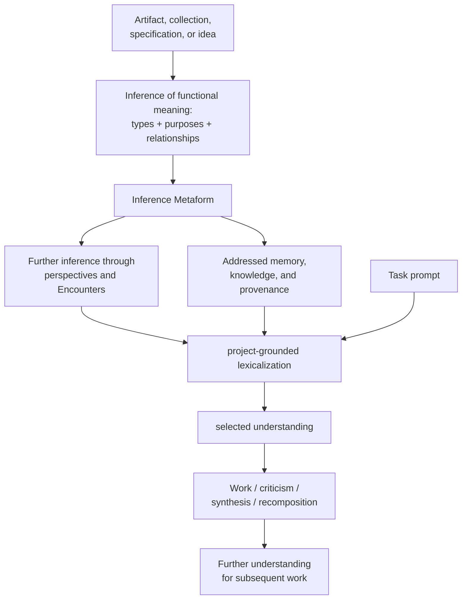

This diagram describes how the mechanisms contribute to one another. An individual operation can enter through the part it needs; it does not have to execute every operation in the diagram.

### Independent development

The author developed the method independently through six years of hands-on work with AI models, including self-authored context-management and semantic rules predating GPT-3's completions API. He manually exercised and measured its behavior, then spent six months refining and encoding the expression described here. Later comparisons with research are comparisons to independently developed work, not its derivation.

The name is singular: **Inference Metaform**. It is derived from inference and guides inference. Generalized type understanding and particular project understanding coexist within that account; they are not separate mandatory systems called Native, Latent, or Contextual Metaforms.

<a id="type-understanding"></a>
## 2. Primordial type understanding

### Addresses engage understanding already available to the model

A model comes to a task with an understanding of kinds of things: code, engines, interfaces, queues, documents, photographs, and the relationships and consequences associated with them. The Inference Metaform calls on that primordial type understanding through meaningful functional addresses.

Consider the author's address-only example:

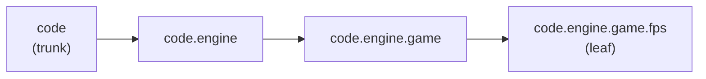

The author supplied four generated lists, each produced by a prompt of the form `write 10 best practices for [address]`. No repository, code, or project description accompanied those prompts. Each prefix produced a distinct level of guidance:

| Address | Orientation supplied by the type | Examples of the resulting subject matter |
|---|---|---|
| `code` | Program code generally | Input validation and general engineering practice. |
| `code.engine` | An engine as a functional mechanism | Memory, hardware interaction, and concurrency. |
| `code.engine.game` | The runtime of a game | Simulation and game-engine responsibilities. |
| `code.engine.game.fps` | A first-person game engine | Aim, input latency, and hit registration. |

The terminal distinction supplies much of the specificity. The preceding segments keep that inference in the intended domain. `fps` in the context of a game engine supplies a different orientation from the same letters presented without a functional ancestry.

The [original address-only material](../../specifications/metaprompting_element_segments_example.md) is an example of inference through addresses. Its generated practices are example content, not requirements imposed on every engine.

### Every prefix contributes a usable perspective

Each prefix is a complete type. An operation can ask about the whole domain, the parent functionality, or a particular specialization. This is also a rule for placing knowledge. A practice that remains applicable after removing the leaf belongs at the broader type rather than being duplicated beneath every leaf.

For example, a general practice about validating untrusted input can be placed at `code`. A practice about resolving hits against historical opponent positions belongs to the relevant specialized functionality, not to code generally. Parent-level knowledge can apply toward the leaves; a specialized observation does not become a universal rule merely because it is visible when inspecting a broader scope.

This gives the address two simultaneous uses. It is a stable, meaningful location in a typology, and it is a prompting surface through which inference can be requested. The system can prepare reusable type knowledge before a particular implementation task and then connect it to the particular workpiece through its joins.

### Type understanding and project understanding work together

A type address alone does not say everything about the project. `code.system.plugin` orients inference toward a plugin system. The project's joins explain why this plugin system exists here, what it gives the command line and MCP server, what a module author receives, and which implementation presently supplies those effects.

The typology supplies the kind of understanding to engage. The relational data supplies the artifact-specific content through which to engage it. That combination is how a local task can be considered in the context of the whole without treating the current file arrangement as the whole's meaning.

This is an operational account of inputs, represented understanding, and subsequent inference. It does not depend on naming internal neurons or assigning addresses to a model's internal activations.

<a id="semantic-structure"></a>
## 3. Semantic structure and perspectives

### Artifact, Entity, and Element

The **Artifact Under Examination**, or **AUE**, is the thing or collection being examined, created, or used. AUEs include codebases, documents, contracts, photographs, stories, data collections, and assets. Whether something is an asset depends on how it is being used in the current context.

An **Entity** is a whole at the scope being examined. An **Element** is a nameable part considered relative to that whole. The distinction is perspectival: when the examination moves into an element's internal composition and requirements, that element is treated as an entity with its own elements.

A subsystem can therefore be a Providing Element in one relationship and a Receiving Entity in another. No duplicate identity is needed merely because the perspective changes.

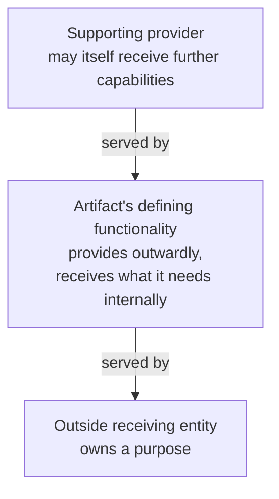

The method uses functionality in this cross-artifact sense. A function can be an interface, a mechanism, a representation, or an experienced effect. It need not be a callable in a programming language.

### Receiving Entity, Cestui Que Use, and Providing Element

A **Receiving Entity** holds the **Operative Purpose**: the active reason why the relationship is needed. The **Providing Element** supplies the **Encounter Function** through which that purpose is served.

The Canonical Intake uses **Cestui Que Use**, or **CQU**, for the purpose-bearing party relevant to the type of artifact. Its external vested perspective concerns the type of party whose purpose drives improvement in that kind of artifact. Inside the receiving-purpose trace, an encountered component with requirements is also examined as the receiving entity for what it needs.

The roles in one join are:

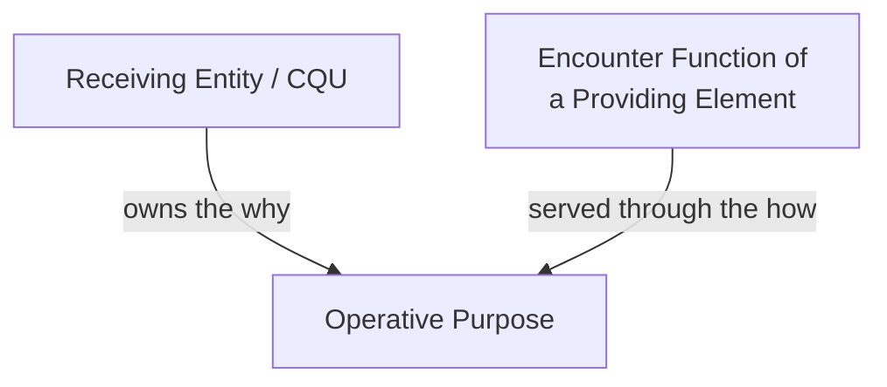

The purpose belongs to the receiver. The EF belongs to the provider. Their particular relationship is recorded in the receiver-owned join.

### A join records why a connection exists

A join carries the receiving relationship's meaning, not merely two connected names. It is held by its receiver and holds the elements that serve its purpose:

| Field | Meaning |
|---|---|
| Receiver | The element that holds the join and whose purpose is served; implicit in the containing element in intake XML and explicit in stored joins. |
| Elements | The Providing Elements whose EF serves the purpose, held in order by the join. One purpose can be served by several elements, and recording the join again with more elements adds them. |
| `type` | `purpose`. |
| `purpose` | The receiver's active Operative Purpose. |
| `ef` | The Encounter Function, how the held elements serve the purpose, an active-voice fragment that starts with its third-person verb. |
| `ifd` | The information flow direction, the primary flow of information: `sends` from the Operative Purpose to the Encounter Function, `receives` from the Encounter Function to the Operative Purpose, `both` for equal need. |

That is the whole of a join, in the shape Rich restored on 2026-10-04. The project's own name for a functionality is the element's `name`. References are items of a knowledge layer named `sources`. Anything else, such as an observation or a note about what a join does not seek, is an item of a knowledge layer at the element or the join. The September 26 snapshot had more fields on a join (`function`, `relation`, `verb`, `observation`, `non_goal`, `refs`, a `name`, a one-word `ef` and a `provider`) and had subtype joins. The store upgrade moves what those fields held into the `sources` layer and a layer named `intake details`.

A dependency between a command line and a plugin system can mean many things. Here the command line receives declarations so that it can parse operations, expose the right settings, generate help, and run enabled module verbs. That reason determines what a proposed declaration change must be examined against.

The literal storage column `op` means a record operation such as `add`; it is not the stored Operative Purpose. The purpose is in `purpose`.

### Functional roles within the artifact

The current intake distinguishes:

| Role | Functional significance |
|---|---|
| Defining Element, DE | Its loss would prevent the AUE from remaining the same type. It supplies the defining function that serves the relevant outside CQU. |
| Substantial Element, SE | Its EF helps the DE serve the CQU's OP. It counts as substantial because of what it is meant to contribute to this AUE, even when that contribution is subversive, weak, replaceable, or should be improved. |
| Notable Element, NE | It expresses an essential demand, interface, specification, or requirement needed to understand what the system expects or depends on. |
| Parametric | A tunable quality or quantity without its own functional name at this scope. It is not given a namespace node by this intake. |

DE, SE, and NE classify contributions to this artifact. They do not classify what a depicted object independently does in the outside world. A tower in a photograph can establish setting; it does not become a communications-system provider because the real tower supports antennas.

An outside CQU is represented with the role `CQU`. Being a provider is a join role, not an additional `PE` role attribute. The current resource's separate treatment of `AUE` in its illustrative schema is recorded in the [source correspondence](IMPLEMENTATION_MAP.md#correspondence).

### External and exterior

**External** means outside the functionality currently being examined but still inside the project or repository. **Exterior** means outside the project. Ownership or administrative control does not determine this boundary.

An exterior entity can receive what the artifact provides, or provide an EF that satisfies an internal purpose. An internal module can be external to the subsystem under examination while remaining part of the same project. Keeping these scopes explicit avoids turning every dependency into an outside stakeholder or treating everything in one repository as one undifferentiated function.

### Reified relationships and graphs of knowledge graphs

The Inference Metaform uses reified knowledge hypergraph semantics: a relationship can itself become an object of examination and a place to address further knowledge. Participants, purposes, conditions, evidence, procedures, and other relationships can be associated with it.

This is the practical meaning of a knowledge graph of knowledge graphs. The shape contains functional relationships, and additional knowledge can express relationships about those relationships. A note about why one declaration must satisfy an MCP schema belongs at that receiving join, not necessarily on the plugin system globally.

The implementation provides identities for elements and joins and lets items target them. This realizes relationship addressability without requiring a particular graph-database technology. The [storage correspondence](IMPLEMENTATION_MAP.md#records) explains the concrete records.

<a id="namespaces"></a>
## 4. Namespaces, proper nouns, and project names

### The namespace names the type

A namespace address names a functional type at its most specific reusable level. The joins refine it with the particulars of the AUE. Every prefix must itself express a valid type or a functionality within its parent, and the path narrows from trunk to leaf.

The currently served intake supplies five roots: `code`, `document`, `media`, `data`, and `stakeholder`.

It does not insert filler levels such as `domain` or `class`, and it prescribes no arbitrary minimum or maximum depth. A longer path is justified by additional functional distinctions, not by a desire to make all addresses the same length.

The address reverses into a readable functional name. Variant functionalities stay separate when each intermediate prefix is meaningful:

| Address | Readable functional name |
|---|---|
| `code.engine.game` | game engine code |
| `code.engine.physics` | physics engine code |
| `code.queue.dead_letter` | dead letter queue code |

The underscore in `dead_letter` holds a multiword unit where splitting the words would not produce the intended valid intermediate types. Underscores are not a shortcut for collapsing a meaningful type ancestry into one leaf.

The live examples distinguish `code.engine.game`, a functional game runtime, from `code.game.engine`, which reverses into a different and invalid reading in that example. They distinguish a functional first-person engine specialization from a genre label used as though it were functionality. Similarly, `media.photo.id` names an identification photograph, while the resource treats adding `passport` there as a purpose distinction rather than a new function. Encoding alone is not a functional subtype: `media.photo.jpg` does not express a further photographic functionality. The broader role of a language as an Encounter is described in [section 6](#encounters), with its exact intake-stage correspondence kept in the implementation map.

### Three names with different jobs

The system retains both functional naming and the terminology used by the project:

| Representation | Example from the project | Job |
|---|---|---|
| Namespace address | `code.system.plugin` | Type identity and addressable orientation. |
| Readable proper noun | `plugin system code`; short name `plugin system` | A functional reading of the address. |
| Project `name`, on the join | `module contract and loader` | The project's official or informal name for this functionality, carried by the join that names it. |

`name_length` is a **lookback segment count**, not a character count and not the number of words in the project name. With `code.system.plugin` and `name_length=2`, the last two segments reverse to `plugin system`. With `code.interface.command_line` and `name_length=2`, they yield `command line interface`, which has three words because an underscore expands to a space.

An element's short name is its reading, and the project's name for it is its `name`; neither replaces a namespace reference. An intake join naming another element uses that element's exact address, not its readable label. The store also assigns stable identifiers so that records, joins, and corrections can be addressed independently of a displayed name.

### Three structures that must remain distinguishable

The **type tree**, the **purpose graph**, and **held elements** express different relationships.

The type tree says how a functional type is situated among broader and narrower types. The purpose graph says who receives what and why. A join's held elements say which specific functional contributions serve one purpose, including those annealed into the join during convergence.

For example, the September 26 snapshot of this project retains `code.bus.event` as an internal subtype in the join through which the plugin system serves the chassis; the current shape holds it as an element of that join. Its functional address is not rewritten into a fabricated lexical child of `code.system.plugin`. Being held by a join and dotted namespace ancestry are different kinds of structure.

Sources: [name readings](../../src/metaform/data/names.py), [namespace rules](../../src/metaform/modules/intake/resources/Intake_2.1.md), and the [project graph index](IMPLEMENTATION_MAP.md#graph-index).

<a id="intake"></a>
## 5. Canonical Intake and construction of the form

### Unloaded Definition is deliberate

The intake's wording is selected to elicit the right relationship without loading it in advance with a single medium's interpretation. **Receiving Entity** does not presuppose a caller. **Encounter Function** accommodates both the encounter of functionality and the functionality of an encounter.

This **Unloaded Definition** is deliberate semantic breadth. The prompt's definitions, examples, constraints, and recursive questions lead the model to identify a particular relationship in the artifact. The breadth is in the elicitation language; the resulting join supplies a concrete purpose, EF, relation, and observation.

A downstream agent uses the collected understanding. It does not have to reenact the intake's wording to make use of a recorded join. Construction language, model inference, resulting data, and recording/storage are separate parts of the mechanism:

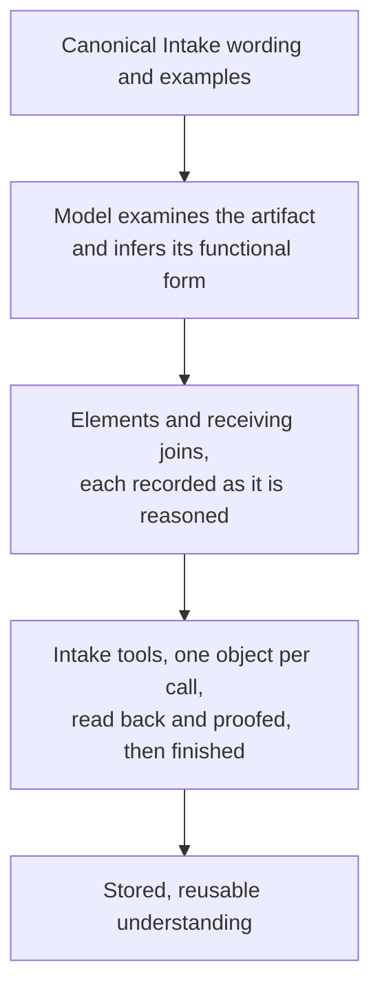

Replacing the operative language with a superficially tidier definition can change what is elicited. Its precision lies in the relationships it produces, not in narrowing every term to the medium of the artifact.

### Survey and selection of a vested perspective

The served process is `digital-typology`, version `1.1`. It begins with the AUE or collection, identifies Artifact Type groups, and asks which purpose-bearing type of party is vested in improving each kind of artifact.

For a collection, the survey observes every member before grouping is finalized. It considers each member's type, DE, SEs, NEs, and distinguishing OP/EF relationships. Members belong in the same group when their shared functionality supports the same useful Artifact Type-level imperative. References retain member identity where needed.

The vested perspective is intentionally type-specific. The current procedure explicitly excludes the generic intake requester, end user, operator, or developer as the answer simply because those parties can be named for every artifact. It asks for the role whose purpose drives improvement in this type of thing. One person can occupy several roles; the relevant role is the one that changes the artifact in that capacity.

Its photo examples include a seller who improves the presentation of a sale photograph, or a blogger or social-media poster whose use drives changes to an image. A generic asset owner does not make the same distinction, and a buyer who only judges the image does not occupy the same improving role in that example. In the project's own map, **module author** is the specific vested role receiving the extension contract, rather than an undifferentiated developer label.

### Receiving-purpose recursion

After the initial survey and grouping, the intake traces what the defining functionality needs in order to supply its EF. The DE remains a provider to the outside CQU while becoming a receiver for its own requirements.

For each such requirement, the procedure identifies the providing elements and records a purpose join held by the receiver. When that provider has requirements of its own, the examination continues from its receiving perspective. Every OP traces back through receiving relationships to the purpose served outside the artifact.

The join records the active OP in `purpose`, the EF in `ef` as an active-voice fragment, the information flow direction in `ifd`, and the namespaces of the elements that serve it. Refs go in the `sources` layer, and anything else that contributes meaning goes in a knowledge layer.

The trace continues until there are no further unsatisfied OPs or NEs needed to understand the artifact. Parametrics are not enumerated as independent functional elements merely because many tunable values exist.

### Closure makes the survey and trace complementary

A trace through one receiving purpose can miss functionality discovered during the initial survey. The closure pass returns to that survey and accounts for functionality the trace did not reach. For each such contribution, it identifies the receiving purpose and records the relationship. When the contribution is already part of a named functionality, that parent's join states it.

This is how the procedure pursues a complete functional account without making the graph an inventory of everything that can be named. Its completeness concerns the AUE's functionality. Its selectivity concerns the level and form at which that functionality is represented.

### Convergence into load-bearing parent functionalities

The intake then anneals and combines elements where a larger functionality can carry their contributions in the same purpose relationship. A subpart is absorbed only when the parent's purpose join already states its purpose. A subpart with an objective purpose that the parent cannot carry remains its own element.

Combining does not optimize functionality away. It changes the level at which the functionality is represented. The absorbed subpart is placed in the matching parent join as one more element it holds; the subpart itself stays one element record at its own address and does not move. Before 2026-10-04 the store kept such a part as a subtype join inside the parent join, with its own EF fields. The current shape has no subtype joins.

A join has one purpose, carried by the join. This preserves the reason for convergence instead of hiding an independent requirement inside a parent that cannot express it.

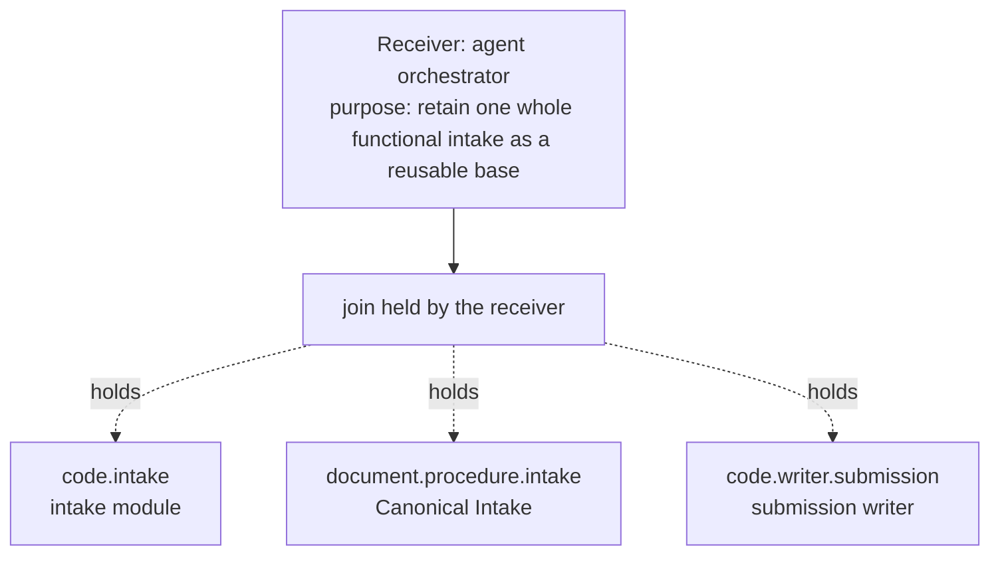

The September 26 snapshot of this project uses this arrangement as subtype joins, recorded when the intake was still submitted whole. `document.procedure.intake` and `code.writer.submission` are internal subtypes under the orchestrator's receiving join with `code.intake`. Their representation preserves distinct contributions while the parent functionality carries the receiving purpose.

### Result shape

The operative resource asks for a `result` root with its own generated id, a list of final elements, and receiver-owned joins. The result id supports later linkage to expansion material. The file does not require an internal self-reference to that id.

The following is a **derived XML illustration using the September 26 snapshot's names and relationship shape**, written in the schema of the Canonical Intake of that day, with its nested subtype join, `function`, one-word `ef`, `relation`, `verb` and `observation`. The current store does not hold those fields. It is kept to show how the Canonical Intake asked an agent to nest a contribution inside the join that carries its purpose. Its shortened field content explains the nesting; it is not a claim of a newly executed intake or a replacement for the complete served prompt.

```xml
<result id="illustration-intake-relationship">
  <elements>
    <element namespace_address="stakeholder.orchestrator.agent"
             name_length="2" role="CQU">
      <name>agent orchestrator</name>
      <joins>
        <join type="purpose" provider="code.intake"
              purpose="Retain the project's functional map as a whole base."
              function="Serve the intake and record the map as it is reasoned."
              ef="Function"
              relation="gives the orchestrator a stored functional map"
              verb="gives"
              observation="The module serves a resource and writes an intake layer.">
          <join provider="document.procedure.intake"
                function="Direct the agent's functional examination."
                ef="Function"
                relation="instructs the intake agent in the functional examination"
                verb="instructs"
                observation="The procedure is a packaged XML resource.">
            <element namespace_address="document.procedure.intake"
                     name_length="2" role="NE">
              <name>Canonical Intake</name>
              <refs>
                <ref key="path"
                     value="src/metaform/modules/intake/resources/Canonical_Intake.xml" />
              </refs>
            </element>
          </join>
        </join>
      </joins>
    </element>
    <element namespace_address="code.intake" name_length="1" role="SE">
      <name>intake module</name>
      <joins />
    </element>
  </elements>
</result>
```

The global list does not repeat `document.procedure.intake`. The join's provider reference and its contained subtype element use the same namespace value. The recorded project name remains distinct from that address.

The agent records the current shape with the intake tools, one object per call: `intake_element` for each element, with its `namespace_address`, `name_length`, `name` and `role`, and `intake_join` for each join, with its `receiver`, the `elements` that serve it as a list of addresses, and its `purpose`, `ef` and `ifd`. To place a contribution in the join that already carries its purpose, the agent records that join again with the element added. The store holds a join's elements as `join_elements` rows in order. The agent's refs go in the `sources` layer, while `intake_sources` is on.

### Elicitation, recording, and preservation

The current module serves the stored intake text, Intake 2.1, with its prompt slot and target filled and nothing added beside it. The intake is the instruction, and anything added competes with it. An explicit `intake_file` setting can select another file.

The intake is recorded as it is reasoned. The agent starts it, then records each element and each join in its own tool call as soon as it has reasoned that object, so it never has to hold the whole map in its context; it anneals by recording a join again with an element it holds and the elements to add, which adds them to that join. Once everything is recorded it performs the proofing pass of step 12: it reads the recorded map back, whole or one receiver at a time, checks it against the artifact and the procedure, corrects it, anneals it and completes it, then finishes the intake. The resource's XML schema defines each object's fields; the module never parses XML.

Each call stores its object in a building intake layer, retaining content with notices where fields do not fit; nothing is refused for its content. The `condition` and `note` an `intake_element` or `intake_join` call takes are not fields of the map: what the agent finds in the specifications and not built, broken, or exclude it writes as a work record, apart from the map. While the layer is building, no context read sees it and the web GUI draws it as it grows. The procedure says intake is not gated or judged; the resulting map can be graded and the intake refined contextually afterward. Storage preserves the supplied result rather than silently treating every semantic rule as an enforced validator.

A finished intake layer is immutable and nonhideable. A subsequent intake is recorded in a new Metaform rather than overwriting the previous base. The author's intention to lock in the operative method on release concerns preservation of its behavior. The current preservation mechanism is exact resource text and controlled substitution; the [implementation map](IMPLEMENTATION_MAP.md#correspondence) records the boundary of the separately discussed encoding idea.

Sources: [served Intake 2.1](../../src/metaform/modules/intake/resources/Intake_2.1.md) and [serving and recording](../../src/metaform/modules/intake/__init__.py).

<a id="encounters"></a>
## 6. Function, Encounter, and scoped propagation

### The two readings of Encounter Function

**Function** concerns operative capability. **Encounter** concerns the form through which something is expressed, experienced, or encountered. Encounter Function spans both the **encounter of functionality** and the **functionality of an encounter**.

For a timer, counting down a named dish supplies an operative capability. An audible alarm supplies the encounter through which the cook's attention is obtained. For the Inference Metaform itself, a stored map is made available through command-line tools, MCP, or a visual interface. Those interfaces affect how the functionality is encountered and used.

The September 26 snapshot wrote the descriptive EF in `function` and a categorical word in `ef`, `Function` or `Encounter`. The current join has one field, `ef`, the Encounter Function written out as an active-voice fragment, with `ifd` saying which way the information flows. The distinction between the two readings still holds in how an agent reasons about an EF, and it exists on joins. It is not a universal temporal state in which every node must switch from a dormant function to a running encounter. An Encounter includes forms of representation and realization, not only an event happening at a moment in time.

### A language Encounter conditions functional reasoning

The author's example joins `code.c` as an Encounter at `code.utility.disk`. The disk utility keeps its functional address. Its realization in C is expressed relationally rather than being flattened into `code.utility.disk.c`.

The Encounter becomes available through the functional ancestry:

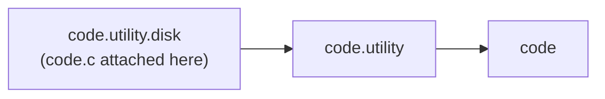

From its attachment point, the Encounter conditions inference through the functional elements toward the leaves from that branch:

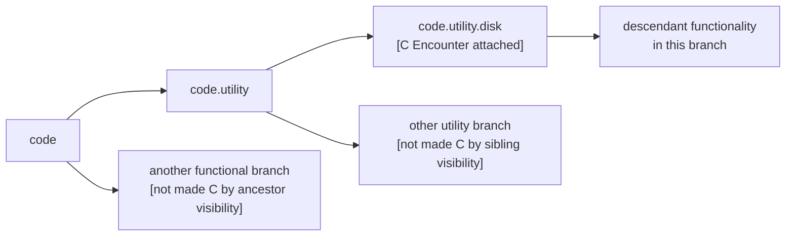

Backward visibility and forward application have different jobs. At `code`, the agent can understand that part of the system is realized in C. That observation does not become a global C assumption for every branch toward the leaves from `code`.

In a mixed-language project, language Encounters attach where those realizations occur. The agent can reason about the composition at a broad scope while retaining the distinction between the affected branches.

### What propagates into the reasoning

The consequence is more substantial than adding a list of C tips beside one node. A realization affects what the functionality means in operation. For a disk utility, the agent can examine how the Encounter bears on data representation, allocation and ownership, interfaces, dependencies, error handling, operating-system interaction, and the resources needed to deliver each purpose.

These consequences are themselves available to receiving-purpose reasoning. A buffer-management concern matters through the functionality that receives the buffer and the purpose it needs to satisfy. An error-reporting concern matters through the entity that must recover, diagnose, or communicate the failure. The Encounter conditions examination of those relationships rather than becoming a detached programming-language lecture.

The same account works for other forms. An interface, a document presentation, or a medium of delivery can change how an effect is encountered. Medium and encoding are not indiscriminately turned into functional types, but a form that changes the relevant reasoning can be represented as an Encounter. An encoder is separately a Function when encoding is what it actually does.

### Connection to implemented property scope

The store implements a concrete scope distinction in `context(address)`: **applying** properties from represented elements on the prefix chain, and **visible** properties attached to descendants. Its source tests attach C++ to an engine branch and Bash to an installer branch. Both are visible from the broad `code` scope, while Bash applies to the installer and C++ does not leak into it.

A local item, including a memory observation, has different behavior: it stays at its addressed node. An inherited property and a local item are not interchangeable merely because both contain text.

This property mechanism is part of the implemented support for scoped knowledge. The full language-Encounter construction and inference account, including its relation to one literal exclusion in the served intake, is mapped separately in [implementation correspondence](IMPLEMENTATION_MAP.md#correspondence). The semantic mechanism remains the attachment, ancestral visibility, and branch-specific conditioning described above.

<a id="identity"></a>
## 7. Exact relational identity and recomposition

### Identity is a set of receiving-purpose/Encounter conjunctions

For a Type `T`, the identity is the exact set:

```text
C(T) = { (r_i AND p_i AND e) }
```

Each conjunction binds:

| Symbol | Meaning |
|---|---|
| `r_i` | The Receiving Entity: who or what receives the effect. |
| `p_i` | That receiver's Operative Purpose: why the effect is required. |
| `e` | The Type's single Encounter Function at the represented resolution: the how through which the effect is realized or encountered. |

`C(T)` is exact. It is not a score, a lower bound, a partial signature, or a similarity threshold. A Type has one EF at its represented resolution. A materially different Encounter requires a different Type or variant at the relevant distinction rather than a second EF silently added to the same Type.

The current store's `identity` operation retrieves provider-side joins. The formal correspondence between a broadly represented provider with receiver-specific descriptions and a resolution-specific semantic Type is identified in the [implementation map](IMPLEMENTATION_MAP.md#correspondence). The equation here states the semantic identity; the API name does not turn its read operation into a semantic equivalence prover.

### Mutation and transformation

**Mutation** changes a realization while preserving the relevant identity-defining relationships. **Transformation** changes those relationships and therefore changes what the thing is at the represented resolution.

This places the invariant in meaning rather than requiring an arbitrary piece of implementation to remain frozen. A functionality distributed across several files can be reorganized, consolidated, or replaced while continuing to supply the same effects to the same purposes. The old file arrangement is not the definition of the functionality.

Conversely, a user can intend to change the purpose or functionality. The Inference Metaform supports that transformation; it does not make preservation of every current relationship the permanent objective of the project.

### Resolution matters during a port

A port can preserve a functional purpose while changing the Encounter through which it is realized. At the functional perspective, a component still supplies the same receiving purpose. At the realization-specific perspective, the changed Encounter is a meaningful distinction and is represented accordingly.

Thus stable functional addresses during a port do not assert that every semantic Type at every resolution is unchanged. The retained functional relationship and the changed realization-specific identity must both remain intelligible. The target language is used to reason about a new realization of the function, not simply to translate syntax.

The author's C++-to-Rust illustration places porting knowledge alongside existing functional locations, selects the target knowledge for the operation, and later retains the earlier knowledge without making it participate in future tasks. That illustrates semantic continuity and a change of realization. The actual persistence and mutability of each kind of layer follow the lifecycles in [section 9](#layers), rather than a blanket assertion that everything ever stored is permanently immutable.

### Reasoning about a proposed new form

A proposed refactor can be examined against receiving purposes: which providers continue to satisfy them, which relationships move, and which consequences change? The author supplied the exploratory possibility of representing a comparison as a planning layer named `refactor_planning`. That is a possible use of the layer mechanism, not a required schema already built into the system.

The exact identity account directs this reasoning. It does not add an automatic approval gate or claim a runtime proof of every behavior. Its benefit is the ability to distinguish preservation of the thing from preservation of its current construction.

<a id="memory"></a>
## 8. Addressed memory and relationship knowledge

### Functional locations for what agents learn

The graph's elements are distinct nodes at which agents can attach memory traces. A finding about a plugin contract can be stored at `code.system.plugin`; a finding specific to the way the contract serves MCP can be stored at that join. An observation about a contribution held by a join can be stored at the element it is.

These are meaningful locations because the prior inference has already established what the nodes and relationships are for. The next agent can arrive through a task's referent, through an affected receiving purpose, or through an Encounter and find the associated knowledge there.

A functional element holds:

- its address, `name_length` and role, read as its short name
- locally addressed memory
- selected knowledge
- receiving joins, each holding:
  - purpose, EF and the elements it holds
  - relation-specific knowledge
- provider-side relationships

Memory is therefore one use of the Inference Metaform's functional addressability, not the entire definition of the system.

### Element and join targets

The implementation supports two node kinds for memory: `element` and `join`. Elements can be addressed by namespace or identifier; joins have identifiers. An absorbed subpart is an element the join holds. A memory observation is an item at its target. A memory relation is an item at the from-node with a link to the to-node and a relation value.

The memory module keeps a graph of its own, the MCP reference memory server's, and exposes its nine operations with the reference's names: `create_entities`, `create_relations`, `add_observations`, `delete_entities`, `delete_observations`, `delete_relations`, `read_graph`, `search_nodes` and `open_nodes`. Given a node, each acts on the memories joined to that node; a memory entity is never an element of the Metaform, and deleting one never removes a functional identity.

A new memory entity can establish an element that the map did not already contain. That element belongs to the memory layer and follows its selection. This permits agents to note previously unrepresented functionality without pretending that the original immutable intake already contained it.

### Knowledge about a relationship belongs at that relationship

**Derived illustration using a current relationship:** the MCP server receives module declarations in order to expose tools. A note that a declaration field is missing from the generated input schema is specific to that receiving relationship. Attaching it only to a general module node loses the distinction between a correct Python operation and an incomplete tool surface.

In the September 26 map, the MCP/plugin join is `894f333275494a01be94259971de55c1`. An item can target that join and retain the explanation and source references. Later reasoning about MCP can encounter the note through the relationship. Reasoning about package construction need not treat it as a defect in a different receiving contract.

This is how reification helps work remain precise: the thing remembered is not just a sentence about a subsystem but a sentence placed at the functional relationship it explains.

### Local memory and inherited knowledge

A local observation remains local. A statement that one handler failed in one situation does not automatically become a rule for every descendant of the broader type.

Properties provide a separate mechanism for knowledge intended to apply through type ancestry. The placement decision therefore expresses meaning: is this content a local observation, a relationship-specific fact, or a property that applies to a functional branch? The same words stored in the wrong kind of record would carry the wrong scope.

The current shared memory layer is created on first write, is mutable and hideable, and changes in place without its own history or provenance. The system also supports other knowledge layers and versioned prompt records for content with different retention needs. Their existence does not retroactively version a memory edit.

Sources: [memory module](../../src/metaform/modules/memory/__init__.py), [node and item records](../../src/metaform/data/records.py), and [memory correspondence](IMPLEMENTATION_MAP.md#memory).

<a id="layers"></a>
## 9. Knowledge layers and selected participation

### One structure, different bodies of knowledge

The Inference Metaform is a multidimensional metaprompting surface. An operation can reason through types, receiving entities, purposes, Encounters, relationships, or combinations of those perspectives. The results can be retained as layers attached to the existing structure.

A layer identifies the knowledge it carries through its `variable`, the question or dimension it answers. Its declaration can include fields, sources, tags, producer information, and mutability and visibility characteristics. Subsequent operations select the layers appropriate to their purpose.

A correctness review and a porting operation can use the same functional base with different prepared knowledge. The representation is reused; the selected understanding changes.

### Storage is separate from participation

A layer can remain stored while not participating in a particular context. Selection and masking determine which knowledge reaches a functional address. Hiding withdraws a hideable layer from ordinary context and also withdraws layers that were built from it through recorded source dependencies. Building layers do not participate in ordinary context until finished.

These operations have distinct meanings:

| Operation or state | Meaning |
|---|---|
| Select | Add a layer to the inherited selection at an address. |
| Mask | Remove a layer from the inherited selection at an address. |
| Clear | Remove local selection/mask settings so inheritance resumes. |
| Hide | Exclude a hideable layer from context, including its dependency closure. |
| Unhide | Remove that hide state; other scope and dependency rules still apply. |
| Building | Content is being assembled and is not yet an ordinary participating layer. |
| Finish | Make the assembled layer ready. |
| Discard | Delete a discardable layer's stored content, subject to its actual lifecycle. |

Hidden is not deleted. A direct named layer read can inspect content that a context read excludes. A raw read is another explicit view. Selection is a semantic participation mechanism, not a claim that the stored information is inaccessible through every interface.

### Exact local selection rule

The author's all-ones layer-select mask and all-zeroes local select correspond to the implemented rule:

```text
effective = (incoming & mask) | select
```

The store represents it with sparse rows rather than fixed bit positions:

```text
effective = (incoming minus layers locally masked)
            union layers locally selected
```

The resolver walks prefixes from trunk to leaf. With no local rows, the incoming set passes through unchanged. A mask at a parent removes a layer from that branch; a selection at a descendant can add it back at that descendant. Selection at a child does not turn the layer on at the parent or an unrelated sibling.

The starting selection is a separate input. An explicitly supplied root selection is used as given after resolving valid selectable layers. Otherwise, nonempty call/folder toggles are used. With neither, the current resolver starts from finished, nonhidden, selectable layers. Local select=0 therefore does not mean the project starts with an empty knowledge set.

The intake layer is not selected or masked like a knowledge layer; it is the metaform every read starts from. An all-ones default mask is not an always-on core, and these defaults do not prescribe a fixed table of reserved layer bits.

### Derived selection example

Suppose the starting set contains `general-practice`, `cpp-practice`, and `migration-notes`:

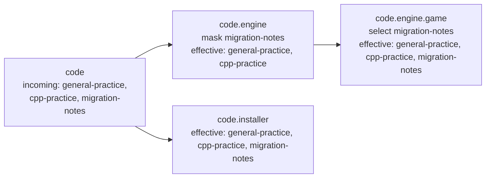

This illustration concerns layer participation only. Whether a selected layer has a property that applies at an address is a separate question. Selection does not manufacture an applicable property where none is attached, and a local item does not acquire inheritance by being in a selected layer.

### Properties applying from ancestors, properties visible from descendants

The context view keeps two results separate. `applying` contains selected properties attached on the queried address's prefix chain. `visible` contains selected properties on descendants, resolved at their attachment locations and shown when inspecting the broader scope.

That distinction supports broad understanding of a mixed realization while preserving local application. It also allows the agent to see that different parts of the system need different knowledge without flattening all of those requirements into one global instruction set.

### Actual lifecycles

| Content | Lifecycle in the implementation |
|---|---|
| Intake | Nonhideable base layer, named `intake`, which is the metaform itself. It changes only by refining, which writes a new version of one thing and keeps every earlier one; it also takes additions with `layer=intake`. Repeat intake creates another Metaform rather than overwriting it. |
| General knowledge layer | Created, populated, and finished; ordinary knowledge records remain editable through their supported operations. Its declared characteristics and layer rules govern its use. |
| Memory | One ready, mutable, hideable layer created on first write; items change or are deleted in place; no own memory history or provenance. |
| Refinement | Not a layer. A new version of one thing in the `intake` layer, with its reason and evidence; every earlier version is kept and read with `metaform map history <id>`. |
| Prompt version | A saved text version with a parent; earlier text is retained unchanged. |
| Origin/variant material | File-state history tied to an origin, separate from refinements of the graph and from memory. |
| Work record | The condition of an element or a join, apart from the map and from every layer: open until its task is done, then done with its resolution kept; it follows its object through every version and survives a layer's discard. |

A refinement changes the current graph view while retaining every earlier version of the thing. An element cannot be moved, since its address is its identity; a join can be moved to another receiver, keeping its identity and its attached items, and the elements it holds can be replaced. A knowledge layer built on what a refinement changed is marked for re-examination. The source's exact marking and orphan behavior are described in the [implementation map](IMPLEMENTATION_MAP.md#corrections).

This separation lets an agent reason about what is stored, what currently applies, what has changed, and what a previous operation used without treating those as the same question.

Sources: [selection resolver](../../src/metaform/data/selection.py), [context reads](../../src/metaform/data/reads.py#L257-L291), [layer operations](../../src/metaform/data/layering.py), and [source lifecycle tests](../../tests/test_store_layers.py).

<a id="lexicalization"></a>
## 10. Project-grounded prompt lexicalization

### Interpret the request's referents before executing it

A task can be well expressed yet unrefined to the project's vocabulary. Its terms may be general, or simply different from the names the project uses. Project-grounded prompt lexicalization performs the interpretation that a working agent would otherwise perform at the start of the task.

The preprocessing agent infers what the request refers to against the project, identifies the corresponding functional elements, and substitutes their recorded project names for those terms. It attaches canonical-term-to-namespace mappings and directions to the relevant knowledge and memory. It **stops short of doing the requested work**.

The requested operation and its meaning remain intact. Lexicalization resolves reference; it does not paraphrase the request, narrow its scope, insert an execution roadmap, or convert open-ended reasoning into a predetermined answer.

### Why both names are necessary

The type proper noun engages the functional understanding. The recorded project name identifies how this project calls the functionality. The namespace connects the two to the graph, its joins, and its addressed knowledge.

A preprocessing agent can therefore recognize that a request about the plugin system concerns what this project names `module contract and loader`, without treating a class name or file path as the entire referent.

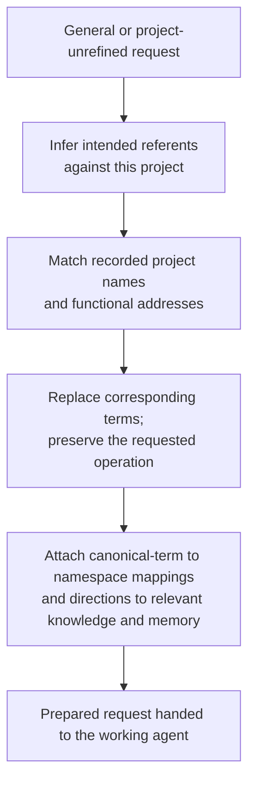

### Derived example using a recorded project name

Original request:

```text
Review error handling in the plugin system.
```

Lexicalized task text:

```text
Review error handling in the module contract and loader.
```

Attached orientation:

```text
Canonical/project term -> namespace
module contract and loader -> code.system.plugin

Use this namespace and its receiving/provider relationships to locate
information and memories related to this task. Relation-specific knowledge
is addressed at the relevant join; local knowledge is addressed at its node.
```

Only the referent has been replaced in the task sentence. The preprocessing agent has not performed an error-handling review, asserted that an error exists, or selected a remedy. The orientation tells the working agent where the prepared understanding lives.

This is a derived example of the described operation using a name/address pair present in the project export. It is not an observed output from a shipped lexicalization producer; that implementation boundary is recorded in [the implementation map](IMPLEMENTATION_MAP.md#prompts).

### Information and additional imperatives remain distinguishable

Selected knowledge can participate in two ways. **Informational layers** supply facts, explanations, prior decisions, and relevant relationships. **Imperative layers** supply concrete instructions, including additional acceptance criteria, when selected for the operation.

For example, an informational note might explain how the plugin declaration currently reaches both CLI and MCP. A selected best-practice layer might separately instruct a future implementation to preserve both surfaces. The task text remains the user's requested operation; the additional instruction is visibly contributed by that selected layer.

The following is an illustration of the separation, not a newly adopted project requirement:

```text
Task:
Review error handling in the module contract and loader.

Orientation:
module contract and loader -> code.system.plugin

Selected information:
[Recorded explanation of declaration consumers and lifecycle behavior.]

Selected imperative layer:
[Concrete instructions from the layer selected for this operation.]
```

The preprocessing agent does not invent acceptance criteria under the guise of clarifying a noun. Additional imperatives come from identified selected knowledge.

### Another amortization step

The prompt and the Metaform are separately reusable. A prompt expresses an operation; the Metaform supplies the semantic orientation through which it is interpreted. Lexicalization joins them for a particular project before execution.

This amortizes the interpretation connecting the task to its referents and associated knowledge. The working agent starts with the project grounding already established and can spend its next reasoning on the operation itself. More elaborate work can still require additional inference; that work proceeds from the prepared interpretation rather than replacing it with another reconstruction.

<a id="criticism"></a>
## 11. Higher-order reasoning, criticism, and blindspot challenges

### Prepared relationships become objects of further reasoning

Higher-order reasoning follows from having prior abstractions and connections available as material. An agent can examine a relationship between a receiving purpose and a provider, then examine how that relationship interacts with another relationship or a changed Encounter. It need not originate every intermediate connection while also carrying out the implementation or review.

For example, the plugin contract is not only related to the command line. Its declaration also affects MCP tools, packaging, lifecycle, and composed instructions. With these receiving purposes already represented, a proposed change to the declaration can be examined through all of them. The agent reasons about the consequences among prepared relationships rather than relying only on the locally visible caller.

The reduced-hallucination mechanism is the same preparation viewed from another consequence. Project names, functions, reasons, and prior conclusions are provided rather than left for the working agent to invent or reconstruct. The author's measured experience underlies this account; the mechanism is described here without substituting fabricated rates or numerical guarantees.

### Blind spot analysis finds gaps in the design

Blind spot analysis looks for gaps in the design of the system: functions and Encounters it should have and does not. Code records how a system behaves, not what it is for, so a critic reading code alone can check what is written but can rarely see what is missing. The Inference Metaform records the purposes, and a purpose with nothing serving it, or an Encounter the artifact's type calls for and the map lacks, becomes visible. The Inference Metaform grounds the critic in functionality so that it can separate what the system serves from how the existing code happens to be arranged.

There is one metaform and two types of blind spot analysis over it, each producing its own layer, neither prescribed as a mandatory first pass:

- **Metaform-only:** examine the represented functionality and Encounters without the realization. Like a critic of a specification, it finds omissions in the design, because what the artifact is tells it what should exist. Some of what it raises will already be handled in the implementation. The map can have been derived from code, a specification, or another artifact.
- **Metaform plus code:** examine the code or other artifact together with the functional map. Its findings are specific to real mechanisms, their dependencies, and their receiving purposes, and directly actionable, though the code anchors it and it seldom sees that a whole approach is wrong.

The system does not require withholding code before permitting either type.

### The blindspot challenge elicits the project's reasoning

A blindspot challenge presents one gap the critic found, a function or Encounter the design appears to lack, to the agents working in the project. Their answer must resolve its relationship to existing project understanding, not merely mark it accepted or rejected.

| Response | Substantive meaning | What the exchange adds |
|---|---|---|
| A | This has already been considered and adds no benefit here, with the reasons why. | A retained rationale that another agent need not rediscover. |
| B | This has not been considered and may be relevant; it should be explored. | A newly recognized consideration and its project relevance. |
| C | This is already handled elsewhere, identifying where and how. | A connection to the functionality that already supplies it. |

The challenge can therefore uncover a gap, recover a prior decision, or correct a critic's incomplete view. All three produce useful understanding. The value is in the explanation and its relation to the project, not in treating B as the only productive outcome.

A C response should identify the actual functional location and explain how it serves the purpose. An A response should explain the lack of benefit, rather than saying only that someone thought about it. A B response should state the relevance to be examined, rather than assuming a solution has already been chosen.

### Derived challenge illustrations

**A: an already considered concern.** A critic proposes retaining every shared-memory edit as immutable history. The project could explain that this memory layer is intentionally mutable working memory, while prompt versions, the versions a refinement keeps, and other knowledge records have separate retention roles. That answer would need the project's actual rationale for choosing this division. The example illustrates a possible A exchange; it does not claim that this rationale has already been recorded as an answer.

**B: an unexplored interface concern.** A critic examining the September 26 code found that joins had `ef` and `verb` fields in intake and storage, but the map knowledge interface's edit and refine read `ef` and did not read `verb`. A B response could identify the effect on changing the Function/Encounter distinction through that surface and explore the interface change. The interface omission was source-observed on that date; the challenge response here is a derived illustration, not a stored project response. The omission no longer exists: the metaform has no `verb`, and edit and refine read `ef`.

**C: functionality handled elsewhere.** A critic asks how asynchronous tasks are owned and cleaned up when a module is unloaded. A project response can point to `Context.spawn` and the loader's task ownership and unload behavior, explaining that the capability is shared rather than reimplemented in each module. A complete C response connects those source locations to the concern instead of relying on the absence or presence of a separately named runtime node.

### Findings, answers, plans, and retained knowledge

The critic's finding is one object; a critic can record each gap it finds as a work record on the element or join it concerns, apart from the map. The project's answer is another contribution. A plan is a subsequent work object. The current implementation stores A/B/C state beside the critic's layer, an optional C link, and answer time. It provides a B-approval route to planning and also a direct plan-creation operation.

The answer-state operation does not itself accept a prose rationale. The conceptual exchange includes that rationale, while items and layers provide places to retain it. Their current integration is documented in [implementation correspondence](IMPLEMENTATION_MAP.md#challenges). This distinction keeps the full reasoning process visible instead of reducing it to the state table.

Blindspot reasoning is not a subtraction of visited edges from possible edges. It concerns the purposes, existing mechanisms, omitted considerations, and reasons exposed by substantive examination of the project.

<a id="extensibility"></a>
## 12. Community-extensible modular architecture

### The chassis supplies shared capabilities

Metaform implements a community-extensible architecture. A module adds an operation through a declaration, while the chassis supplies the common context and interfaces through which it participates. Extension is an existing capability, not a future capability inferred from the current number of modules.

The module author receives a contract that allows a capability to be declared once in its own folder and exposed as commands and MCP tools, with settings, events, status, and lifecycle. The September 26 map of this project represents it by:

```text
Receiver: stakeholder.author.module
Project name: module author

Provider: code.system.plugin
Project name: module contract and loader

Purpose:
Add a capability without changing the chassis, using one module declaration
for commands, tools, settings, events, status, and lifecycle.
```

The same provider serves other receivers for different reasons:

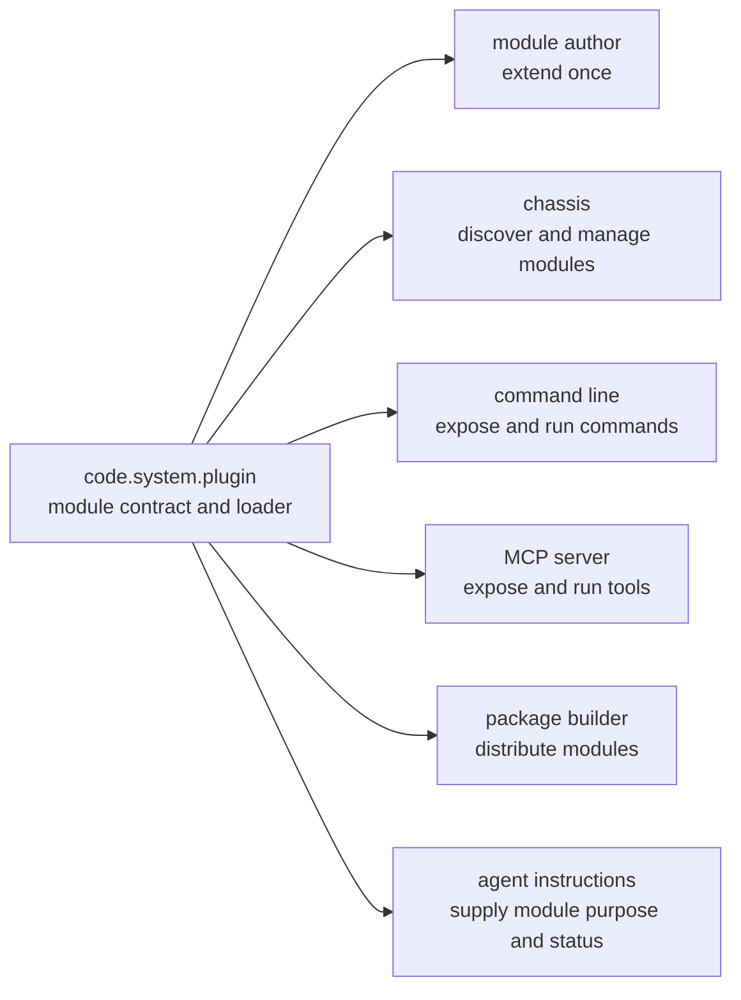

The diagram reads from provider toward recipients for exposition. Stored purpose joins are owned by their receivers. The complete receiving relationships are indexed in the [implementation map](IMPLEMENTATION_MAP.md#graph-index).

### Declaration and generated surfaces

A `Module` declares an id, summary, purpose, verbs, subscriptions, lifecycle hooks, status, and optional default verb. A `Verb` declares its operation, nouns, settings switches, supported surfaces and systems, help details, and operation-specific caution where applicable.

The command-line and MCP surfaces are built from this shared declaration. A module operation need not maintain one unrelated command implementation and another unrelated tool schema. The current source still allows an operation to choose which surfaces it supports.

The module's purpose and status also supply live instructions. The chassis composes its base instructions with surfaced modules' purposes and available status notices. It does not have to hardcode each community module's purpose into a central narrative.

The `template` module is an empty starting declaration. `helloworld` demonstrates settings, ordinary and asynchronous verbs, event publication/subscription, and retained data. Both ship disabled while remaining available implementations and examples. `helloworld` also writes and resolves a work record, and its greeting appears on an open web GUI through the chassis's `map.changed`.

### Per-call context and shared facilities

A module operation receives a `Context` containing the current module, folder, resolved project/store, nouns, switches, surface, and output facility. Through it, the operation can use settings, publish events, and spawn module-owned tasks. This keeps a call's context explicit instead of using one undifferentiated project context for all work.

Discovery covers system modules, the user's home modules, and installed entry points. The loader respects persisted enablement and declared compatibility and dependencies, imports enabled modules, manages startup, and withdraws their registrations and tasks during unload or reload. Stored data remains separate from whether a module is currently loaded.

The separation matters for future producers. A lexicalization module or critic module would be a producer of a particular kind of inference. Its absence from the current shipped set does not mean that modules lack store access, events, task ownership, settings, tools, or instructions.

### Events and task ownership

The event bus delivers matching topics to loaded subscribers with a subscriber-specific Context and a copied payload. It records each delivery's result, failure, or cancellation separately. The synchronous publishing path processes subscriptions in sequence. The asynchronous path awaits a coroutine subscriber or offloads and awaits a synchronous subscriber before advancing.

The chassis publishes one topic itself: after any command that changes a project's map, on the command line or over MCP, it fires `map.changed` with the project and the metaform's id, so a module does nothing to announce its writes; the web server does the same after the page's own writes. The web module subscribes and its server pushes each event to every open page; nothing polls.

This gives attribution and failure separation while keeping synchronous handler work off the async event-loop thread. The publisher receives its outcomes after the awaited deliveries; module-owned spawned work is a separate capability supplied by `Context.spawn` and the loader.

The earlier author-provided bus/runtime illustration expressed a receiving purpose of attributable, nonblocking handler execution. That functional illustration and the current delivery scheduling are distinguished in the [implementation map](IMPLEMENTATION_MAP.md#events). The source, not the absence of a separate graph node, establishes current behavior.

### Packaging and integration

The package builder carries loaded modules and their declared dependencies into a wheel, vendors pure-Python dependencies where supported, and identifies compiled dependencies that remain external requirements. The installer uses the running or built wheel to register the MCP server and skill for supported hosts and checks the registered server command. The web module supplies another encounter with the same stored map: graph inspection, layers, provenance, prompt versions, each object's work records, clearing a project, and the implemented editing operations, redrawn as each change is pushed.

These capabilities let the functional form and its knowledge be reached through different working environments while preserving the same project meaning. They are part of the implementation's means of making prepared understanding reusable across agents and sessions.

Sources: [module contract](../../src/metaform/module.py), [loader](../../src/metaform/loader.py), [events](../../src/metaform/events.py), [instructions](../../src/metaform/instructions.py), and [extension correspondence](IMPLEMENTATION_MAP.md#extensions).

<a id="provenance"></a>
## 13. Provenance and the lifecycles of understanding

### Retain the origin of a contribution

Provenance keeps retained understanding connected to the operation that produced it. A later agent can distinguish a base intake, a subsequent knowledge contribution, a critic's finding, a refinement, and a local memory note. It can also distinguish the text used for one prompt version from text edited later.

The source supports layer provenance fields for module, workflow, prompt, model, role, and blinded status, together with a layer's identity, timestamps, result id, declared variable, and source-layer dependencies. Those fields describe a contribution at the layer level; individual refs, observations, reasons, and evidence can provide more specific grounding.

A source dependency records that one layer was built from another. It is used in contextual hiding and supports examination of how a conclusion depended on earlier material. A prompt-use record can connect a specific prompt version to a project, Metaform, and resulting layer.

### Prompt history is distinct from memory

The prompt store retains immutable text versions with parent links. Saving changed text makes a new version; saving text equal to its parent returns the existing version with a notice. A layer linked through `record_use` remains associated with the version used to produce it.

This supports the author's point that an earlier prompt can remain as issued while later operations use changed knowledge. It does not mean the present system automatically snapshots every selected memory item into every prompt. In particular, the current intake deliberately records `prompt=null` in its provenance and serves its resource without writing a prompt-store copy. Shared memory likewise has no own provenance or revision history in this build.

These boundaries are part of understanding the actual lifecycles, not reasons to weaken the role of provenance. The [implementation map](IMPLEMENTATION_MAP.md#prompts) identifies the facilities and their existing uses.

### Graph refinement and artifact history are different histories

Graph refinements record changes to the represented form as versions in the `intake` layer and support current views and history. Artifact origins and variants preserve workpiece file states against a baseline. An origin can be based on repository state or a plain-folder copy; variants retain their differences from that origin and can be reconstructed with recorded hash checks.

Together these facilities support questions such as: what form was represented, what knowledge was selected, what contribution changed the map, and what artifact realization resulted? They remain separate records whose actual links must be used. A file variant is not automatically a graph refinement, and a provenance row is not automatically a complete prompt-to-code-diff trace.

The underlying aim is that previously performed reasoning remains intelligible and useful. Retaining an answer without its purpose, or a result without the source understanding it used, makes later agents repeat the interpretive work that the Inference Metaform is designed to amortize.

<a id="formation"></a>
## 14. Formation through intent and cross-artifact use

> "Be water, my friend." -- Bruce Lee

### The formboard analogy

A wiring-harness formboard supplies meaningful positions and relationships while the harness is assembled. The Inference Metaform similarly supplies functional locations through which agents can work, attach knowledge, and understand how one part serves another.

The analogy concerns orientation and formation, not a frozen template. The user can ask to improve, refactor, port, expand, or transform the workpiece. The prepared form lets that intent be considered through functions and receiving purposes instead of being limited to the present arrangement of files or parts.

The water image emphasizes this formability: the same prepared understanding can guide a new realization, and a new intention can change the relationships that define the form. It is an explanatory analogy, not evidence for an internal model mechanism.

### Photographs and contextual purpose

In the author's photograph example, a couple at the Eiffel Tower can be the Defining Element while the tower supports the setting. In a scenery photograph, the scene can be defining while a hawk, donkey, or other salient subject contributes differently. The classification `media.photo.scenery` does not replace the description of this image's particular subject and setting.

Surrounding context can contribute to the understanding. A sequence of Paris photographs near wedding photographs can suggest an occasion. That is a contextual inference about the supplied collection, not an observation of something visible in one isolated image. The inference can inform what the image is doing while retaining the distinction between what is seen and what its context suggests.

A photograph can also be an asset serving a larger artifact. Its function in a sale listing, narrative, or document depends on that receiving purpose. The same physical image can therefore occupy different functional relationships without pretending its pixels have changed.

### Documents and narratives

A document element is represented by what it does in the document. In a contract, a notice provision can establish how a party is informed of an action; in a narrative, a conflict can create the pressure that drives the represented events. Their purposes and effects are described within the AUE.

**Derived narrative illustration:** a letter that reveals a character's deception functions as a revelation within the story. Its operative contribution is not the general real-world function of postal communication. A supporting scene might establish why the revelation changes the protagonist's action. The joins explain those contributions to the narrative rather than replacing them with a genre label or a list of depicted objects.

**Derived document illustration:** two repeated explanatory sections can be combined when one parent explanation carries both purposes. A section that establishes a separate obligation or serves a different receiving purpose remains distinct. This carries the intake's convergence rule across media without turning a document into a software call graph.

### Collections and transferable knowledge

A collection is surveyed member by member before final functional grouping. The grouped type provides a location for knowledge that genuinely applies across those members; refs preserve particular identities and relationships where they matter.

This gives a basis for transferring type-level understanding between workpieces while preserving project-specific knowledge at its proper scope. Shared type knowledge can orient a new artifact. A local observation from one artifact remains local until further inference establishes its relevance elsewhere.

### Across-the-board benefit

The same prepared form improves the starting material for prompting, whole-system understanding, memory placement, criticism, coordination, and formation through intent. These are not separate claims attached to unrelated features. They follow from repeatedly using the same inferred understanding through different operations.

<a id="walkthroughs"></a>
## 15. Connected worked walkthroughs

### Walkthrough 1: extend Metaform without reconstructing the whole chassis

**Basis: the September 26 map of this project and inspected source, with a derived future work request.**

A module author wants to add a new operation. The functional entry is the receiving join from `stakeholder.author.module` to `code.system.plugin`. It establishes the purpose: declare a capability once and receive commands, tools, settings, events, status, and lifecycle without editing the chassis.

The author or agent opens the recorded `module contract and loader` functionality rather than treating a guessed file path as its entire meaning. Provider-side joins show the other recipients of that declaration: the chassis, command line, MCP server, package builder, and agent instructions. The template and helloworld elements, held by the module author's join, show where the project already supplies a starting declaration and a working example.

A task such as `Review the plugin system for the new operation` can be lexicalized against the recorded name. Its namespace mapping leads to the same functional node and its relationship-specific knowledge. Selected informational layers can explain existing design choices. Any selected imperative layer remains separately identified.

The implementation work then uses the declared facilities. A new verb supplies its nouns and supported surfaces; module settings are declared through the settings mechanism; asynchronous work can use the provided context and task ownership. Examination follows the actual recipients of the change, rather than assuming that a successful Python call proves every generated surface is correct.

A discovered detail can be retained at the relationship it concerns. A help-generation issue belongs to the CLI receiving relationship; a tool-schema issue belongs to the MCP relationship; a packaging issue belongs to the builder's purpose. The next operation arrives at the relevant place with that understanding already available.

This walkthrough reuses one prepared interpretation of the plugin system across implementation, review, memory placement, and later work. It does not require a separate conceptual re-intake for each operation.

### Walkthrough 2: examine a real interface discrepancy

**Basis: a source-observed discrepancy of September 26, since resolved, and a derived challenge exchange.**

The functional map describes the map API as the agent-facing encounter with stored elements, joins, and layers. The critic examines the actual implementation with that receiving purpose in view.

On September 26 the intake tools, store APIs, and record schema supported `ef` and `verb`, and the knowledge interface wrote them when it added a join or a subtype join. Its edit and refine read `ef` but omitted `verb` from the fields they read, so a `verb` given there was named in a notice and ignored rather than reaching its dedicated field. Since 2026-10-04 a join has no `verb`, so the case is closed, and the walkthrough stands as an example of the method.

The issue was not that the entire graph lacked Function/Encounter semantics. It was that one interface did not carry an existing semantic field through to its implemented destination. The functional description allows the critic to locate the mismatch precisely: agents using this encounter should be able to supply the distinction supported by the underlying records.

A blindspot challenge can present that finding with the source locations and affected receiving purpose. The project's response can say whether it was already considered, whether it should be explored, or whether another interface already handles the intended use and why that matters. A substantive response is retained separately from its A/B/C state.

Any ensuing implementation change can be examined through both the underlying storage semantics and the generated CLI/MCP surfaces. The graph, criticism, and retained explanation together make the next review start from a known functional issue rather than rediscovering it.

### Walkthrough 3: reshape a realization while retaining the intended function

**Basis: the author's porting and recomposition mechanisms; derived work sequence.**

An agent is asked to port a disk utility to another language while preserving its functional service. It begins with the utility's receiving relationships: who receives its effects and why. It examines the current language Encounter at the functional branch and reasons through memory, data, interfaces, dependencies, errors, and operating-system interactions relevant to those purposes.

The target Encounter supplies another orientation for those same functions. Target-language knowledge can participate while source-language operational guidance is masked where it would no longer serve the task. The agent derives function-specific considerations rather than applying a universal syntactic translation recipe.

The functional address continues to locate the disk-utility role. The realization-specific Type or variant changes where its Encounter changes. Comparing the old and proposed form therefore distinguishes preserved receiving purposes from intentionally changed realization and from any changed purpose that would constitute a transformation.

The resulting reasoning can be retained in a knowledge layer, while an artifact variant preserves the concrete output against its origin. Existing provenance facilities can associate the producing material where used. No fabricated automatic pipeline between all these records is needed to explain their contribution.

### Walkthrough 4: examine a photograph in a collection

**Basis: the author's photograph examples; derived application.**

An intake receives a folder of photographs. It surveys each image before grouping. One image centers a couple at a landmark; another centers scenery with a smaller human or animal subject. The scene, focal subject, and contextual purpose determine which elements define each image and which support it.

The surrounding sequence suggests that some images belong to a wedding trip. That inference contributes context while the individual joins retain what each image actually shows and what role it plays. A shared type can support an imperative for the group only where that functionality is genuinely shared.

Later, one image is used in a larger document. The image becomes a provider to that document's receiving purpose. Its prior description and relevant memory remain useful, while the new relationship explains why it is used here. A criticism can question its contribution to the document without replacing its image-level meaning or treating every visible object as a separate engineering subsystem.

The same mechanisms have now supplied type understanding, artifact-specific relations, collection grouping, contextual inference, and a new receiving perspective across two kinds of workpiece.

### Walkthrough 5: read the earlier event-bus illustration at the right level

**Basis: an author-provided functional illustration, not the current repository's literal component inventory.**

The author illustrated a stored receiving purpose using `code.bus.data.event` and `code.runtime.execution`: run each subscriber's handler as attributable work so slow or failing handlers are attributed to that handler rather than blocking the publisher or another module.

The illustration demonstrates why a stored purpose matters across sessions and agents. A future agent touching the bus should receive the reason for that execution relationship, not just the fact that two components are connected.

The September 26 map of this project instead represents an event-bus contribution as `code.bus.event` within a plugin-system join. That different decomposition does not by itself prove a different architecture. Inspecting `events.py` establishes its actual delivery loop; inspecting `Context.spawn` and the loader establishes the separate owned-task facility. The [implementation map](IMPLEMENTATION_MAP.md#events) preserves both the author's illustrative purpose and the observed source behavior without using one to erase the other.

<a id="commitments"></a>
## 16. Functional commitments

These commitments express what the described mechanisms mean and what must remain present for those mechanisms to be preserved. They are not additional approval gates or new interface specifications. Current implementation correspondence is in the companion map.

| ID | Commitment | Explanation |
|---|---|---|
| F01 | Preparation performs and retains semantic reasoning for reuse. | [Conception](#conception) |
| F02 | Functional types engage primordial type understanding; joins ground it in the workpiece. | [Type understanding](#type-understanding) |
| F03 | The representation concerns cross-artifact functionality, with Entity/Element perspective changes preserved. | [Semantic structure](#semantic-structure) |
| F04 | The receiver owns the purpose; the provider supplies the EF; the join records the specific relationship. | [Join semantics](#semantic-structure) |
| F05 | Namespace identity stays type-level while joins carry artifact-specific purposes, effects, and observations. | [Namespaces](#namespaces) |
| F06 | Functional proper noun, project name, and namespace reference retain their different jobs. | [Names](#namespaces) |
| F07 | The intake's Unloaded Definition retains both readings of Encounter Function. | [Intake](#intake) |
| F08 | Survey, recursion, closure, and convergence preserve the functionality represented. | [Construction](#intake) |
| F09 | Absorbed subparts remain elements held by the parent's join rather than duplicate joins of their own. | [Convergence](#intake) |
| F10 | Function and Encounter retain their breadth and explicit representation. | [Encounters](#encounters) |
| F11 | Encounter visibility through ancestors does not apply it to unrelated sibling branches. | [Scoped propagation](#encounters) |
| F12 | `C(T)` is exact, with one EF per Type at the represented resolution. | [Identity](#identity) |
| F13 | Mutation and transformation distinguish preserving identity from intentionally changing it. | [Recomposition](#identity) |
| F14 | Elements and joins provide meaningful locations for memory and knowledge. | [Addressability](#memory) |
| F15 | Local items and inherited properties have distinct scopes. | [Memory](#memory), [layers](#layers) |
| F16 | Knowledge participation is separate from storage; starting selection and local select/mask are distinct. | [Selection](#layers) |
| F17 | Lexicalization resolves project referents, preserves the requested operation, and stops before executing it. | [Lexicalization](#lexicalization) |
| F18 | Additional imperative-layer instructions remain identifiable contributions, not silent task rewrites. | [Prompt preparation](#lexicalization) |
| F19 | Criticism can examine actual code or the Metaform alone without a compulsory two-pass pipeline. | [Criticism](#criticism) |
| F20 | Blindspot responses carry reasons, unexplored relevance, or a located existing handling, not merely states. | [Challenges](#criticism) |
| F21 | Community modules receive the implemented shared context, store, settings, events, lifecycle, tools, and instruction facilities. | [Extensibility](#extensibility) |
| F22 | A shared facility and a producer that uses it remain distinguishable. | [Module architecture](#extensibility) |
| F23 | Provenance, prompt versions, refinements, memory, and artifact variants retain their actual lifecycles. | [Provenance](#provenance) |
| F24 | User intent can shape and transform work across artifact types through the represented relationships. | [Formation](#formation) |

<a id="terminology"></a>
## 17. Terminology index

| Term | Location |
|---|---|
| Advance inference amortization | [1](#conception) |
| Applying property / visible property | [6](#encounters), [9](#layers) |
| Artifact Under Examination / AUE | [3](#semantic-structure), [5](#intake) |
| Artifact Type / AT | [5](#intake) |
| Blindspot challenge / A, B, C | [11](#criticism) |
| Canonical Intake | [5](#intake) |
| Refinement | [9](#layers), [13](#provenance) |
| Defining Element / DE | [3](#semantic-structure) |
| Encounter / Encounter Function / EF | [6](#encounters) |
| Entity / Element | [3](#semantic-structure) |
| Exact identity / C(T) | [7](#identity) |
| External / exterior | [3](#semantic-structure) |
| Formboard / formation | [14](#formation) |
| Function | [3](#semantic-structure), [6](#encounters) |
| Held element, formerly internal subtype | [4](#namespaces), [5](#intake) |
| Join / reified relationship | [3](#semantic-structure), [8](#memory) |
| Layer / variable / sources | [9](#layers), [13](#provenance) |
| Lexicalization | [10](#lexicalization) |
| Memory item / relation | [8](#memory) |
| Module / Context / Verb | [12](#extensibility) |
| Mutation / transformation | [7](#identity) |
| Namespace / name_length / proper noun | [4](#namespaces) |
| Notable Element / NE | [3](#semantic-structure) |
| Operative Purpose / OP | [3](#semantic-structure) |
| Parametric | [3](#semantic-structure), [5](#intake) |
| Primordial type understanding | [2](#type-understanding) |
| Prompt version / prompt use | [13](#provenance) |
| Providing Element / PE | [3](#semantic-structure) |
| Receiving Entity / RE | [3](#semantic-structure) |
| Select / mask / incoming selection | [9](#layers) |
| Substantial Element / SE | [3](#semantic-structure) |
| Unloaded Definition | [5](#intake) |
| Cestui Que Use / CQU | [3](#semantic-structure), [5](#intake) |
| Work record | [5](#intake), [9](#layers), [11](#criticism) |

---

[Implementation map](IMPLEMENTATION_MAP.md) | [Examples to collect](EXAMPLES_TO_COLLECT.md) | [Ideas](IDEAS.md)
