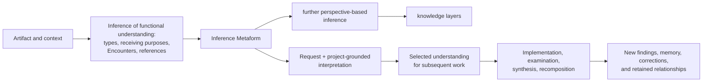
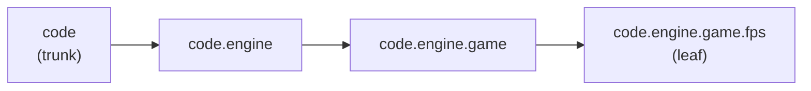
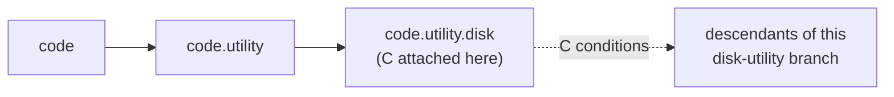

# Inference Metaform

## Advance Inference Amortization through Functional Understanding

**Rich** · Independent developer  
Preprint, version 1.0 · September 26, 2026

[Typeset PDF](inference-metaform.pdf) · [Citation information](CITATION.md) · [Documentation](../README.md)

## Abstract

The Inference Metaform develops substantive understanding before work and makes that understanding available for subsequent inference. It represents a workpiece through functional types, receiving purposes, and Encounter Functions rather than treating its current arrangement as its identity. Meaningful namespace addresses engage a model's existing, primordial type understanding; reified relationships connect that orientation to the particular artifact. The same representation supplies prompting surfaces, meaningful memory addresses, selectable knowledge layers, and perspectives from which to examine or reshape the workpiece. Project-grounded lexicalization performs the referential interpretation of a request before execution while preserving the requested operation. Blindspot challenges connect criticism to the project's reasons, unexplored concerns, and functionality already realized elsewhere. Exact relational identity distinguishes changing a realization from changing what the thing is. These mechanisms form a continuing process in which inferred understanding becomes material for further reasoning. The paper explains the independently developed design, its modular implementation, and its use across software and other artifacts. The supplied project map provides a concrete case; derived illustrations explain uses not recorded as completed runs. Implementation boundaries are localized: the chassis, store, layers, memory, interfaces, and extension facilities exist, while several inference-producing operations remain to be constructed as integrated producers.

**Keywords:** inference amortization; functional understanding; semantic typology; prompting; addressable memory; knowledge layers; provenance; agent systems.

## 1. Conception and independent origin

The Inference Metaform is organized around a practical question: **what reasoning can be performed in advance to offset reasoning that an agent would otherwise have to perform while doing the work?** The answer is not limited to retrieving previously encountered text. It includes developing an understanding of what the workpiece is, distinguishing its functional parts, establishing who receives their effects and why, and making those relationships available before an implementation, review, or synthesis task begins.

An agent can possess extensive information about a project while still lacking this orientation. A file may be known without its contribution being understood. A dependency may be visible without its reason being retained. A request may be grammatically clear while its referents remain unaligned with the project's names and functional organization. Those are inferential obligations. When they are repeatedly left to the executing agent, each work episode reconstructs some of the same understanding, with the particular session's attention determining which relationships become available.

The Inference Metaform performs useful portions of that reasoning in advance and retains their results in a representation that subsequent inference can examine. The emphasis is **amortization of inferential effort**. Token volume is a separate accounting dimension. A larger prepared input can carry more completed semantic work than a shorter input that leaves the agent to originate the relevant connections. The design therefore does not define success as making every context shorter.

The method was developed independently by Rich through six years of hands-on work with AI models. That work included self-authored context management and semantic rules for inference predating GPT-3's completions API, manual exercise and measurement of the method, and six months refining and encoding the present expression. The research connections discussed later in this paper are subsequent comparisons; they are not a claimed derivation of the design.

The name is singular: **Inference Metaform**. It is derived from inference and guides inference. Generalized type understanding and particular project understanding participate in the same system. They are not mandatory separate systems with different Metaform names.

## 2. What preparation produces

Preparation produces more than a stored description of source material. It produces conclusions about what that material is doing. A representation of a plugin system, for example, can identify the module author as a receiving party, the ability to add a capability as that party's purpose, and the module declaration and loading mechanism as the encounter through which the purpose is served. That relationship is already inferential work. Later reasoning can operate on it directly.

The distinction is important because a current implementation is only one arrangement through which a purpose is served. A useful functional account must be grounded in the actual workpiece without treating its filenames, class boundaries, or existing composition as the definition of what it is. Otherwise a refactor merely reorganizes the representation's supposed identity, and a critic remains confined to the same arrangement it is meant to examine.

Metaform retains both functional understanding and the references and observations that connect it to the artifact. Subsequent work can move between them: a receiver's purpose directs examination of relevant source; an implementation observation exposes another relationship; a criticism identifies a missing or unnecessary contribution; the result becomes knowledge that another task can use.



This is a connected account of the mechanisms, not a mandatory pipeline that every operation must traverse in full. A task can enter through a node, a relationship, a knowledge layer, or a broader type perspective. Nor does preparation replace the executing model's inference with stored answers. It changes the material on which that inference operates.

The resulting higher-order reasoning is concrete. Instead of spending the work episode merely discovering that two components interact, an agent can reason about whether the interaction still serves its recorded receiving purpose, how a different Encounter would affect it, or whether another part already fulfills the same need. The abstraction and relationship are available as objects of thought.

## 3. Primordial type understanding and prompting surfaces

### 3.1 Meaningful addresses engage existing understanding

A model enters a task with understanding of kinds of things: code, engines, interfaces, documents, photographs, queues, and the relationships associated with them. Metaform calls this **primordial type understanding**. The term identifies the understanding engaged by meaningful types; it is not a claim that namespace segments address particular neurons or internal model activations.

The author's supplied address-only example uses four prompts of the form `write 10 best practices for [address]`, with no repository, code, or project description. The addresses are:



The recorded responses distinguish general code practices, engine concerns such as memory and concurrency, game-engine responsibilities, and first-person game-engine concerns such as input latency and hit registration. The last segment supplies much of the specific orientation, while the preceding segments establish the domain in which that specificity should be understood. The example demonstrates the address as an input for inference, rather than only a key for retrieving a record. The generated practices remain example content, not requirements imposed on every artifact of the type. The original material is retained in the [address-only example file](../../specifications/metaprompting_element_segments_example.md).

### 3.2 Every prefix provides a perspective

Every prefix is itself a usable type. An operation can ask about `code`, `code.engine`, or a more specialized descendant. This also establishes where knowledge belongs. A practice that would remain applicable after a leaf is removed belongs at a more general level, not as repeated copies beneath every specialization.

Direction matters. A general principle about handling untrusted input can apply to descendants of `code`. A specialized concern about reconstructing historical opponent positions for hit resolution does not become a principle about all code simply because it is visible while examining a broader scope. Ancestry supplies reusable context without erasing the specificity of the knowledge.

This makes the namespace a multidimensional prompting surface. An inference operation can approach the workpiece through a type, a receiver, a purpose, an Encounter, or a relationship among them. The prompt describes what to do; the prepared representation supplies the orientation through which to do it.

### 3.3 Functional names and project names have different jobs

The namespace supplies a functional proper noun, while a descriptor retains the project's own name for that functionality. In the actual project export, `code.system.plugin` reads as plugin system code; with `name_length = 2`, its short type name is plugin system. The project name is **module contract and loader**.

The distinction makes the representation useful to both inference and navigation. The functional type engages general understanding. The project name resolves how this artifact refers to that functionality. The address connects both to receiving relationships, references, memory, and knowledge.

A dotted address is therefore not a convenient container for arbitrary properties. Every prefix must express a valid Function or Encounter type. Encoding alone does not justify a functional distinction: appending a document encoding to a document address differs from naming an encoder whose function is to produce that encoding. Medium matters when it changes the relevant functional reasoning, rather than automatically defining the artifact.

## 4. Functional relationships and the shape of the workpiece

### 4.1 Entity, element, and vested perspective

The **Artifact Under Examination**, or AUE, is the thing or collection being examined, created, or used. It can be a codebase, document, narrative, photograph, data collection, specification, or an idea being formed. Whether an artifact serves as an asset depends on its relationship to the current work.

An **Entity** is a whole at the scope of examination. An **Element** is a part in relation to that whole. When attention moves into an element's own composition and requirements, that element is considered an entity with subordinate elements. The distinction is perspectival rather than a requirement for duplicate records.

A **Receiving Entity** owns an **Operative Purpose**: the active reason for needing a contribution. A **Providing Element** supplies the **Encounter Function** through which that purpose is served. The Canonical Intake identifies an outside **Vested Entity** through the type of party whose purpose drives improvement in that kind of artifact. It does not identify the vested party simply as whoever requested the intake. Within the receiving-purpose trace, a component's own requirements supply a further receiving perspective.

The same component can therefore be a provider outwardly and a receiver internally. A module system supplies a contribution to an agent interface and receives facilities from its own environment. Following these relationships explains what the system needs without confusing the direction of a source-code call with the ownership of a purpose.

### 4.2 Joins retain the reason, not only the connection

A join belongs to its receiver and records the provider, Operative Purpose, Encounter Function, active-voice relation, observation, and relevant references. An optional non-goal identifies a pertinent outcome the receiver does not seek when that distinction is meaningful. The relationship is a first-class object with its own identity, so it can be examined and can receive attached knowledge.

This reification is the basis for the account's knowledge-graph-of-knowledge-graphs, or reified knowledge hypergraph, semantics. The significance is not a claim about a particular graph database. A relation is no longer merely a binary adjacency: inference can consider its participants, roles, purpose, observations, references, and further knowledge. A later observation can concern the relationship itself rather than one endpoint in isolation.

For the actual module-author relationship, the provider is `code.system.plugin` and the receiver is `stakeholder.author.module`. The stored purpose is to add a capability once as a module, with command and MCP surfaces, settings, events, status, and lifecycle, without changing the chassis. The relationship records how the declaration and loader provide that encounter. It does not merely record that a module author is connected to a plugin system.

### 4.3 Convergence preserves load-bearing structure

The intake distinguishes defining, supportive, and notable elements. A Defining Element supplies the functionality whose loss would prevent the artifact from remaining the same type. Supportive Elements contribute to its service of the vested purpose. Notable Elements express essential demands or requirements on the external environment. Parametric qualities are tunable details rather than automatically named independent functionalities.

The method surveys the artifact, recursively examines receiving purposes and their providers, and anneals and converges the resulting structure. Subparts absorbed into a load-bearing parent are not repeated as an inflated global list. Their active contributions are preserved as internal subtypes within the parent's matching purpose joins.

In Metaform's own map, the module-author join contains `code.template.module`, named template, and `code.module.example`, named helloworld. Each retains its own encounter, relation, observations, and references. Neither acquires an independent copy of the parent's purpose. The representation thus keeps a coarse global shape while preserving the atomic contributions needed to understand a specific relationship.

The operative [Canonical Intake](../../src/metaform/modules/intake/resources/Canonical_Intake.xml) is the elicitation method. The resulting data, rather than repeated exposure to the procedure's wording, is what later operations use. The method's deliberately chosen language and examples guide inference toward functional meaning; replacing them with generic software-analysis terminology would change that operation.

## 5. Function, Encounter, and scoped propagation

### 5.1 The deliberate Unloaded Definition

**Function** concerns operative capability. **Encounter** concerns the form through which something is expressed, realized, used, or experienced. **Encounter Function** deliberately accommodates both the encounter of a functionality and the functionality of an encounter. This **Unloaded Definition** allows the contextual relationship to resolve the appropriate sense without prematurely restricting the artifact to a programming-language function, an interface widget, or a momentary event.

A timer's countdown and the audible encounter that gains a cook's attention illustrate the distinction. In Metaform's own implementation, a declaration is an encounter through which a module author adds a capability, while supplying verb definitions to the command line is a functional contribution to that receiver. The same broad provider can participate differently in different joins.

The stored record separates descriptive text in `function` from the categorical `ef` value, Function or Encounter. This distinction belongs to purpose joins and internal subtype contributions. It does not require every element to change from a dormant Function state into an active Encounter state over time.

### 5.2 A language Encounter changes reasoning through the type structure

The author's example attaches `code.c` as an Encounter at `code.utility.disk`. The disk utility retains its functional address rather than being flattened into `code.utility.disk.c`. Its C realization becomes available while reasoning through the functional ancestry:



An ancestor can see the Encounter without its sibling branches becoming C.

Backward visibility and forward application have different roles. At a broad scope, an agent can understand the composition of a mixed-language workpiece. At the attachment point and its descendants, the Encounter conditions the relevant reasoning. Visibility at the shared ancestor does not carry the language into every unrelated branch toward the leaves.

The consequences extend beyond a language-specific checklist. The realization affects memory semantics, data representation, interfaces, dependencies, error behavior, and interaction with the operating system. Those consequences can themselves be examined through Receiving Entities and Operative Purposes. A buffer-management concern matters through the functionality receiving the buffer and the reason it needs it; an error-reporting concern matters through the receiver's need to diagnose, recover, or communicate.

This is another opportunity for inference amortization. Realization-specific understanding can be developed before a local implementation task and then made available through the appropriate scope. Subsequent work need not originate every consequence of the Encounter in the same episode as the change.

### 5.3 Current scope support and the specific construction boundary

The store implements scoped properties and separates applying knowledge from visible knowledge in its context reads. Node-local items do not inherit. Those facilities support the attachment and selection of scoped understanding; they do not themselves implement a producer that infers all Encounter consequences.

The live intake also contains a language-address exclusion that differs from the author's broader language-Encounter account. That is a localized source/intent correspondence issue. The design account and the operative text remain intact rather than being silently reconciled by changing either. The exact paths and effects are recorded in the [implementation map](../inference-metaform/IMPLEMENTATION_MAP.md#correspondence).

## 6. Exact relational identity and change

For a Type $T$, the semantic identity is the exact set:

$$
C(T) = \{(r_i \land p_i \land e)\}.
$$

Each conjunction binds a Receiving Entity $r_i$, its Operative Purpose $p_i$, and the Type's single Encounter Function $e$ at the represented resolution. The definition identifies who or what receives the effect, why that receiver needs it, and how the effect is realized or encountered.

The set is exact. It is not a lower bound, partial signature, similarity measure, confidence score, or candidate projection. A materially different Encounter yields a different Type or variant through an additional typological distinction, rather than adding another EF to the same exact Type. The definition guides semantic reasoning; it does not prescribe an approval gate or a runtime check.

This distinguishes **mutation** from **transformation**. Mutation changes the realization while preserving the relevant semantic identity. Transformation changes what the thing is in that relational sense. The invariant need not be an arbitrary piece of frozen implementation content: it can be the relationship through which the effect is provided to its receivers.

A refactor can therefore reconsider arrangement without treating the existing file or class structure as the definition of the subsystem. A port can use the current realization as one Encounter and the target realization as another, examining how the required function and receiving purposes are served. Keeping the same broad functional address does not establish that every Encounter-specific identity is unchanged. The distinction must be made at the semantic resolution actually being discussed.

The store represents broad Providing Elements with receiver-specific joins. Its `identity` read returns current joins in which an element is provider. That is useful evidence for reasoning about identity, but it is not an equivalence prover, and the supplied implementation does not establish a formal resolution mapping from every broad provider record to the exact $T$ above. Preserving the exact definition and explaining the actual read are compatible; weakening the former to fit the latter is unnecessary.

## 7. Addressable memory and bodies of knowledge

### 7.1 Memory has a functional location

An agent's finding can concern an element, a purpose join, or an internal subtype. Metaform uses those same objects as memory addresses. A note about the plugin system generally belongs at its element; a note about why the module author needs a particular encounter belongs at that receiving relationship. This is more informative than associating every finding with a project-wide conversation or a nearby file.

The location contributes meaning. A later agent entering through the receiver can encounter the stored rationale where it becomes relevant, while an agent entering through the provider can inspect the different purposes it serves. A relation is therefore both an object of inference and a place to retain the result of that inference.

The current memory module implements entity and relation creation, observation addition, the corresponding deletions, graph reading, search, and named-node opening. A memory relation is a linked item between graph nodes, not a substitute for the full receiving-purpose join. The memory layer is created on the first write. It is mutable, and its writes do not create a separate memory revision history or provenance record. These are the actual lifecycle semantics of [the memory module](../../src/metaform/modules/memory/__init__.py).

### 7.2 Layers retain distinct questions and perspectives

An Inference Metaform can be used as the subject of further inference. An operation might examine error behavior, alternative Encounters, missing capabilities, or consequences for a particular receiver. Its result can be retained in a knowledge layer whose variable identifies the question it answers.

Layers make these bodies of knowledge distinct without requiring unrelated representations of the underlying project. They can hold local items, scoped properties, references, and explicitly recorded source/provenance associations. The same element can therefore be considered through several relevant perspectives, with the contributions selected for the current operation.

Preparation can accumulate. The base representation establishes a functional relationship. A criticism contributes a reasoned concern. A project response locates an existing mechanism. A later task can use the relationship and the response without repeating the whole exchange. That is further inference amortization, not merely the accumulation of longer notes.

The purpose of selected material remains important. **Informational** knowledge supplies observations, explanations, decisions, and relationships. **Imperative** knowledge supplies additional instructions or acceptance criteria when selected for that role. An observation does not silently become an instruction. Conversely, an explicitly selected imperative layer is more than inert background text.

### 7.3 Participation is separate from retention

The design describes local selection with an all-ones mask and an all-zeroes select as the transparent defaults. In that expression:

```text
outgoing = (incoming & mask) | select
```

The starting selection is established separately. The implemented resolver uses an explicit starting selection when supplied, otherwise nonempty toggled names/tags, otherwise the selectable finished nonhidden layers. Local mask rows remove membership and select rows add it as the namespace is traversed. An element toward the leaves can restore a layer masked toward the trunk from it without restoring that layer in unrelated siblings.

This is not an invented always-on core, a fixed-width bit layout, or a default-deny architecture. Local absence of a selection row preserves the incoming choice. An explicitly empty starting selection and an unspecified starting selection are distinct inputs at the API level.

Hidden layers remain stored. The resolver also excludes layers whose explicitly recorded sources depend transitively on hidden layers. That is a defined source-dependency closure, not a claim that every semantic association causes automatic invalidation. Direct named or raw reads remain different from participation in the current view. Corrections apply through their own stack rather than ordinary selectable-layer membership. These behaviors are implemented in [selection.py](../../src/metaform/data/selection.py) and [layering.py](../../src/metaform/data/layering.py).

Scope-aware selection is necessary to make prepared understanding useful across different operations. A layer relevant to a review need not become a perpetual instruction for every future task. A specialized Encounter can be visible to broad reasoning without becoming a sibling's assumption. The retained knowledge remains available for the operation to which it belongs.

## 8. Project-grounded prompt lexicalization

### 8.1 Perform referential interpretation before execution

A reusable prompt expresses an operation. The Metaform supplies the project's functional orientation. **Project-grounded lexicalization** joins them by performing the interpretation of the request's referents before the requested work is executed.

The preprocessing agent infers which functional elements the request concerns, resolves the corresponding recorded project names, and replaces those terms in the request. It attaches canonical-term-to-namespace mappings and directions to the relevant knowledge and memory. It stops short of doing the task. The operation and meaning of the request are preserved rather than paraphrased, narrowed, or supplemented with an invented execution plan.

A derived illustration uses the recorded plugin-system name:

```text
Original request:
Review error handling in the plugin system.

Lexicalized request:
Review error handling in the module contract and loader.

Orientation:
module contract and loader -> code.system.plugin
```

The name substitution is supported by the actual project map. Associated directions identify the element's receiving/provider relationships and selected node or join knowledge. The preprocessing has not decided that error handling is defective, chosen a remedy, or performed the review.

### 8.2 Preserve the separation between task and selected imperatives

The operation has three distinguishable contributions: the user's request, the project-grounded orientation, and selected knowledge. An informational layer may explain how a declaration reaches CLI and MCP. An imperative layer selected for the operation may separately require particular practices or acceptance criteria. Those additional imperatives come from the identified layer's purpose, not from changing the request under the guise of resolving a noun.

This separation preserves both reuse and intent. The same review prompt can be grounded in another project without carrying this project's names. The same Metaform can orient implementation, criticism, decomposition, or synthesis without containing a new custom prompt for every operation. A given task can receive the subset of prepared understanding relevant to its work while the underlying representation remains reusable.

Lexicalization is therefore an additional amortization step. The semantic work of interpreting the user's general terms against the project is performed before execution and made available to the executing agent. The task begins with resolved referents and locations for relevant understanding rather than leaving all of that orientation implicit.

### 8.3 Implementation correspondence

The current source supplies project names, addresses, joins, node/context reads, memory, layer selection, and prompt-version/use storage. The GUI can inspect and version existing prompt records. Those are implemented facilities. A shipped producer that performs the described project-grounded lexicalization is not present in this snapshot.

This distinction keeps the design usable as a construction account without inventing an API. A module implementing the operation can use the common facilities, but a prompt-storage command should not be represented as though it already performs the inference. Likewise, the current intake records provenance fields but does not populate the prompt-version store with a copy of each served Canonical Intake.

## 9. Perspectival reasoning and blindspot challenges

### 9.1 Functional grounding and implementation inspection cooperate

Blind spot analysis looks for gaps in the design of the system: functions and Encounters it should have and does not. Code records how a system behaves, not what it is for, so the purposes the Metaform records are what let a critic see what is missing. A critic can examine the Metaform alone, or inspect the actual artifact together with its Metaform. Giving the critic source code does not, by itself, prevent independent examination. The critic's role is to analyze the technical design; the functional representation supplies a perspective separable from the implementation arrangement.

That combination supports specific criticism. An agent can ask whether an actual mechanism satisfies a receiver's purpose, whether a dependency is necessary for the function it serves, or whether a proposed improvement concerns the function itself or only its current realization. The represented purposes make those questions more precise without forcing a specification-only-first sequence.

The perspectives are not a closed menu of permitted reasoning. Diagnosis, foresight, implementation, testing, synthesis, and ideation can all operate through the relationships differently. A type-level understanding can expose a consequence overlooked in a local file, while an artifact-specific observation can challenge a broad assumption. The Metaform makes the prepared material available for this examination; it does not predetermine the conclusion.

### 9.2 The blindspot challenge elicits project reasoning

A **blindspot challenge** presents a gap the critic found in the design, a function or Encounter the system appears to lack, and asks the project to respond substantively. Three responses distinguish materially different situations:

| Response | Reasoning supplied by the project |
|---|---|
| A | The concern was already considered and adds no benefit, with the reason why. |
| B | The concern has not been considered and has relevant consequences that should be explored. |
| C | The concern is already handled elsewhere, identifying the location and the functional relationship that fulfills it. |

The letters are not the reasoning itself. In particular, a C response explains how another part provides the allegedly missing effect. This prevents a critic's local view from turning an existing distributed capability into a proposed duplicate. An A response retains why a superficially attractive change is unnecessary. A B response identifies an actual opening for further work rather than treating novelty alone as relevance.

This exchange cannot be reduced to unvisited nodes, missing edges, or a difference between sets of items already inspected. A graph can contain a node while its consequences remain unexplored; an apparent absence can be fulfilled through another relationship. The required contribution is the project's substantive explanation.

### 9.3 A derived challenge grounded in actual implementation

Consider an agent adding a module that inspects attached knowledge. A critic asks whether the module needs a separate settings-persistence implementation. A C response identifies the existing chassis settings and home storage, explains that the module declares settings in code, and points to the contract through which those settings appear in configuration and remain stored when the module is disabled.

The reply is grounded in the actual [settings](../../src/metaform/settings.py), [home](../../src/metaform/home.py), and [module](../../src/metaform/module.py) facilities. It is a derived illustration of a challenge exchange, not a recorded dialogue from the supplied project. It shows what distinguishes a useful “already handled elsewhere” answer from merely rejecting the concern.

The source implements challenge states and plans. Its `answer` operation records a state, optional link, and time, but has no rationale parameter. Items and layers can retain the explanation; a fully integrated producer that automatically couples the critique, rationale, state, and subsequent work is separate construction. The existing CLI-only approval operation for a B challenge belongs to that operation; direct plan creation does not acquire an additional invented prerequisite from it.

## 10. Provenance and the lifecycles of understanding

The useful question is not only what knowledge is available, but how it came to exist and what it was used to produce. Layer provenance can identify the producing module, workflow, prompt reference, model, role, and blinded status. Source-layer associations can identify the understanding from which another layer was derived. References can tie statements to artifact locations or other evidence.

Different records have different lifecycles:

| Record | Present lifecycle |
|---|---|
| Intake | Immutable, nonhideable base layer; another intake is retained in a new Metaform. |
| General knowledge | Declared layer with building/finished state, mutability, visibility, and optional source/provenance associations. |
| Memory | Mutable node-addressed items, without a separate memory revision/provenance history. |
| Corrections | Recorded changes with reasons and evidence, applied through an ordered correction stack. |
| Prompts | Separate version and use records; current intake does not populate them. |
| Artifact history | Origins, variants, reconstruction, and extraction, distinct from the map's own records. |

Conflating these lifecycles would obscure actual behavior. Hidden knowledge is not deleted. Immutable intake is not mutable memory with automatic versioning. A prompt-version facility does not establish that every producer records every prompt. A retained artifact variant does not automatically identify every knowledge layer considered in creating it.

The implementation provides mechanisms for a connected history, and the producer records the actual associations. The design's provenance account concerns making the origin and participation of understanding available for later examination; it is not a claim that this snapshot already captures a universal automatic ledger.

Artifact histories also make the distinction between understanding and realization practical. A project can retain an origin and sibling variants, reconstruct the content, and compare that content with the represented purposes and Encounters. The functional representation can continue to orient examination across arrangements rather than becoming only an index of the latest files. Source implementations are in [the data package](../../src/metaform/data/store.py), [prompt records](../../src/metaform/data/prompts.py), and [artifact history](../../src/metaform/data/history.py).

## 11. A modular realization of the design

### 11.1 The chassis exposes common facilities

The current implementation is a Python chassis with community-extensible modules. A module declares its purpose, verbs, input nouns, setting use, event subscriptions, lifecycle hooks, and status contribution. The chassis derives CLI commands, MCP tools, help, settings surfaces, and agent instructions from those declarations.

Discovery covers bundled modules, modules under the user's Metaform home, and installed entry points. Metadata describing supported systems, dependencies, and disabled-by-default status is read before importing module code. Enabled, successfully loaded modules provide operations; a folder-level surface can narrow which are exposed without changing their persistent enablement.

Each invocation receives a context containing its folder, selected project/store, nouns, settings overrides, and output facilities. A module can use the common data API to contribute a layer or inspect a relationship without building its own persistence mechanism. Start and stop operate at the module lifetime; per-call project context is resolved for the operation that needs it.

The current operating modules implement intake, map operations, memory, MCP, and the web interface. Template supplies the empty contract; helloworld demonstrates its facilities, including event publication and project-layer storage. A capability remains implemented and available even when only the example module currently exercises it. The number of current consumers is not a test of whether the shared facility exists.

### 11.2 Execution behavior comes from the source, not a graph label

The event bus attributes subscriber outcomes and supplies each handler with its own context and copied payload. Synchronous publication waits for handlers in sequence. Async publication also processes deliveries in sequence, awaiting asynchronous handlers and using a worker thread for synchronous ones. It keeps those synchronous handlers off the event loop; it does not make publication detached or concurrent fan-out.

Separately, module-owned asynchronous tasks can be spawned on an active loop and are tracked for cleanup during unload or shutdown. A one-shot CLI invocation has a different lifetime from a long-running MCP server. The source distinguishes these facilities; the functional graph's label for an event bus is not an exhaustive scheduler specification.

This illustrates the importance of source correspondence. A represented function explains the receiving purpose. The operative source establishes how it is currently delivered. A documentation account can preserve both without inferring an unobserved execution architecture from a missing node or a broad name. Source: [module contract](../../src/metaform/module.py), [loader](../../src/metaform/loader.py), [event delivery](../../src/metaform/events.py), and [MCP service](../../src/metaform/modules/mcp/server.py).

### 11.3 Implemented facilities and inference producers

| Mechanism | Current realization and boundary |
|---|---|
| Canonical Intake | Serves the operative resource and stores the agent's submitted array atomically as an intake layer. The agent performs the inference. |
| Functional records | Elements, receiver-owned joins, internal subtypes, descriptors, and references are stored and queryable. |
| Knowledge participation | Layer selection, local masks/selects, scoped properties, hidden-source closure, and corrections are implemented. |
| Addressed memory | Implemented at elements, joins, and subtypes. |
| Project lexicalization | Name/address, context, memory, and prompt facilities exist; the integrated preprocessing producer is not shipped. |
| Blindspot exchange | State/plan storage exists; producing and coupling the substantive rationale remains distinct. |
| Encounter reasoning | Function/Encounter fields and scoped context support exist; a complete consequence-generating producer is not shipped. |
| Intent-driven recomposition | The functional account and artifact-history facilities support the described work; no universal automatic recomposition engine is claimed. |

The current map knowledge interface omits `ef`, although the store and intake support it. That is a local interface discrepancy, not evidence that the Function/Encounter distinction is absent from the system. The [implementation map](../inference-metaform/IMPLEMENTATION_MAP.md) records these correspondences at their source locations.

## 12. Forming the workpiece through intent

### 12.1 A formboard, not a frozen implementation

The author's formboard analogy describes meaningful positions through which work can be organized and findings attached. Like a wiring-harness formboard, the representation supplies a functional arrangement for constructing something. The point is not to freeze the current material or require every future realization to occupy the same files.

User intent can preserve relevant receiving purposes while changing the realization, or deliberately transform the relationships that define the artifact. The Metaform provides an explicit subject for those decisions. A proposed change can be examined through who receives its effects, why those effects matter, and how the chosen Encounter supplies them.

Prepared understanding also supports coordination. Different tasks can approach the same functional location, use relevant knowledge, and retain their results there. Coordination follows meaningful work locations rather than depending entirely on a shared conversation history. The representation can be used to reason about alternatives and consequences, not only to remember what already happened.

### 12.2 Refactoring and porting

For a capability spread across several files, a functional provider can retain the relationship it serves while references identify the present locations. A refactor can consider a new arrangement through that purpose. The representation's usefulness comes from separating what must continue to be provided from the incidental placement through which it is provided now.

In a port, a current-language Encounter and a target-language Encounter condition different reasoning. Knowledge about ownership, data representation, interfaces, and errors can be developed for the target and selected for the relevant branch. The objective is to reason through how the target realization serves the required function, not to equate a syntactic translation with preserved behavior.

This is a derived use of the described mechanism, not a supplied completed port. Functional addresses and receiving purposes can remain useful across the work, while an Encounter-specific identity changes where the realization is materially different. Layer visibility, artifact variants, and provenance supply complementary records; none alone substitutes for the semantic judgment.

### 12.3 Documents, narratives, and images

The method's breadth follows from treating function as contribution rather than as a programming callable. In a derived document example, an argument section receives evidence from another section for the purpose of supporting a claim. Reorganizing the document can preserve that receiving relationship without preserving the old page order. A criticism can identify an unsupported purpose or show that a different part already supplies the evidence.

In a derived narrative example, a resolution receives earlier events or information that make its effect coherent. Moving a scene changes its placement; changing what the scene contributes can change the narrative's relational identity. The functional account does not replace the text with a generic plot label. It identifies how this particular work's parts support the intended result and supplies locations for further examination.

In the author's photograph example, a couple at a tower can be the defining subject and supportive setting. Neighboring images and folder context can support an inference about the occasion. The contribution is the tower's role in this photograph, not its independent real-world function. The general classification of an image cannot replace its specific subject, setting, and contextual description.

An image may also be an asset in another artifact. Its receiving relationship changes with that use. The same applies to a document, code component, or collection. Medium matters where it changes the reasoning, while the receiving-purpose structure connects generalized understanding to the particular workpiece being shaped.

## 13. Supplied evidence and a connected project case

### 13.1 The source edition and recorded representation

This paper describes the supplied `chassis` source snapshot identified as commit `ce9062bdec9398ca1f23ac60684bd3cc7e37f23c`. The bundle provides the source bytes and commit attribution; it does not include a Git checkout from which a newer state was fetched. The accompanying project Metaform, named `main`, was recorded on September 26, 2026 at 19:28:40 UTC.

The recorded [project export](../examples/project-metaform.json) contains:

| Stored material | Count |
|---|---:|
| Global elements | 19 |
| Purpose joins | 33 |
| Internal subtypes | 26 |
| Type-prefix records | 86 |
| Descriptor items | 19 |
| References | 98 |
| Intake layers / provenance records | 1 / 1 |
| Properties / challenge states / plans | 0 / 0 / 0 |
| Findings | 5 |

These are counts of supplied stored material, not measures of inference quality or runtime speed. The absence of property or challenge records in this export does not negate their implemented storage facilities.

The author has manually exercised and measured the method during its independent development. The supplied materials contain the address-only generated examples, the current project representation, operative resources, source tests, and historical outputs; they do not contain a numerical dataset from those manual measurements. This paper therefore presents the supplied evidence without inventing benchmark values or substituting unrelated command checks for model-performance measurements.

### 13.2 A prepared relationship used for later work

The module-author join supplies a compact connected case. Preparation has already identified the plugin-system provider, its project name, the receiving purpose of community extension, the template and example contributions, and the related consumers of the declaration.

A later agent can inspect:

```text
map element code.system.plugin
map joins code.system.plugin as=provider
map where code.template.module
```

Through the actual CLI, these follow the `metaform` command; through MCP, they are declared tools such as `map_element` and `map_joins`. The provider-side read exposes the module author, chassis, CLI, MCP server, builder, and agent instructions. An extension task can use those purposes to understand the shared contract before writing a module.

A review request can be lexicalized to the recorded project name without changing the operation. A criticism can be answered by identifying settings facilities already supplied by the chassis. A new finding can be retained at the module-author join for another task. The source records and reads are actual; this connected task sequence is a derived illustration rather than an original execution transcript. The [worked example](../examples/project-walkthrough.md) provides the full distinction and executable inspections.

### 13.3 Inspectability without invented outcomes

A useful record of reuse would connect the original request, the prepared context, the operation performed, the resulting work, and the knowledge made available afterward. The companion [examples collection document](../inference-metaform/EXAMPLES_TO_COLLECT.md) identifies original traces that would make those connections inspectable. It is a collection plan, not a new condition that blocks use of the design.

The documentation's isolated CLI exercises check operational instructions such as import, relationship reads, memory writes, selection, and module invocation. They are identified separately in the [edition notes](../EDITION.md). They establish that those exercised interfaces behave as described in that environment; they do not claim a new model intake, installed-client certification, or an inference-amortization benchmark.

## 14. Connections to other work

These connections locate useful conceptual neighbors. They are subsequent comparisons to an independently developed design, not claims that Metaform originated by combining the cited systems.

**Structured prompting.** Zhang, Yuan, and Yao's *Meta Prompting for AI Systems* emphasizes formal task structure and typed transformations between tasks and prompts [1]. That is a substantive structural account, not merely elaborate role assignment. The connection is that prompting can be organized around structure. Metaform's emphasis is the reusable functional understanding of a particular workpiece: types, receiving purposes, Encounters, and addressed knowledge through which an operation is interpreted. The comparison does not make the two systems' transformations identical.

**Prepared graph understanding.** Edge and colleagues' GraphRAG approach constructs an entity graph from a document collection and pregenerates community summaries, then uses them to form and combine responses to global questions [2]. It therefore already includes inference before query time; describing all retrieval-based work as devoid of semantic preparation would be inaccurate. Metaform uses a different represented subject: the functional relationships of a workpiece and their participation in subsequent implementation, criticism, and formation. The common point is reuse of prior inferential work, not equivalence of data models or tasks.

**Reflection retained for later action.** Shinn and colleagues' Reflexion retains linguistic reflections on feedback in episodic memory to inform subsequent trials without updating model weights [3]. That gives a concrete research connection for conclusions from one episode participating in another. Metaform places such understanding at functional nodes and reified relationships and distinguishes information, selected imperatives, and knowledge layers. The connection does not establish shared performance results or make addressable memory the complete definition of Metaform.

**Provenance.** W3C PROV-DM describes provenance through entities, activities, agents, and relations such as derivation [4]. That vocabulary clarifies why a result, its production, and its inputs are different things to record. Metaform's layer provenance, sources, prompt records, and artifact history address related questions in its own implementation. This paper does not claim PROV conformance or an implemented mapping to that standard.

## 15. Conclusion

The Inference Metaform develops functional understanding before work and supplies that understanding to later reasoning. Primordial type understanding gives meaningful addresses their inferential use. Receiving purposes and Encounter Functions connect those types to the particular artifact. Reified relationships become subjects of further inference and locations for memory. Knowledge layers preserve distinct perspectives and select their participation. Lexicalization resolves a request against project names before execution, while criticism connects apparent omissions to substantive project reasoning.

Exact relational identity makes the distinction between preserving a thing and preserving its current construction explicit. User intent can reshape a realization or transform the relationships defining the artifact. Provenance and artifact histories retain different parts of that work, while the modular implementation supplies common facilities through which additional inference producers can be built.

The central contribution is the connection among these mechanisms. Previously inferred understanding becomes usable material for further inference, and the results of that work can become the next preparation. Memory, context, graphs, and prompts participate in that account; none alone replaces it.

## References

[1] Yifan Zhang, Yang Yuan, and Andrew Chi-Chih Yao. **Meta Prompting for AI Systems.** arXiv:2311.11482, first submitted 2023; version 10, August 3, 2026. [Version-specific record](https://arxiv.org/abs/2311.11482v10). The comparison in this paper uses the cited version's structural account.

[2] Darren Edge, Ha Trinh, Newman Cheng, Joshua Bradley, Alex Chao, Apurva Mody, Steven Truitt, Dasha Metropolitansky, Robert Osazuwa Ness, and Jonathan Larson. **From Local to Global: A Graph RAG Approach to Query-Focused Summarization.** arXiv:2404.16130, first submitted 2024; version 2, February 19, 2025. [Version-specific record](https://arxiv.org/abs/2404.16130v2).

[3] Noah Shinn, Federico Cassano, Edward Berman, Ashwin Gopinath, Karthik Narasimhan, and Shunyu Yao. **Reflexion: Language Agents with Verbal Reinforcement Learning.** arXiv:2303.11366, version 4, October 10, 2023. [Version-specific record](https://arxiv.org/abs/2303.11366v4).

[4] Luc Moreau and Paolo Missier, editors. **PROV-DM: The PROV Data Model.** W3C Recommendation, April 30, 2013. [Dated Recommendation](https://www.w3.org/TR/2013/REC-prov-dm-20130430/).

## Source and citation information

The system account is grounded in the author's explanations and the operative source, not derived from the papers above. Public source correspondence is provided by the [technical reference](../inference-metaform/REFERENCE.md) and [implementation map](../inference-metaform/IMPLEMENTATION_MAP.md). The current example is the recorded [project export](../examples/project-metaform.json). The full record identifiers and verification scope appear in the [edition notes](../EDITION.md).

This document is a standalone preprint, not a claim of journal publication or peer review. [CITATION.md](CITATION.md) provides the citation for this edition; [references.bib](references.bib) contains its bibliographic records. Source-relative links resolve when the documentation is placed in the repository layout.
