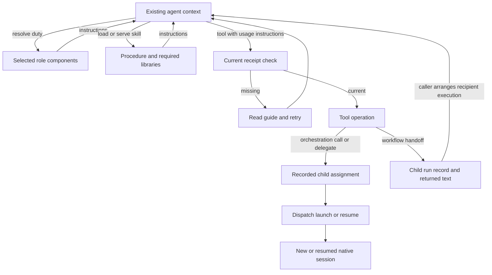

# Context-management continuation: handoff to the existing Pro context

## Status and assignment

The prior assignment was completed and committed. The native ACP efficiency investigation is in 29cd88bd, and the purpose-context / tool-instruction prerequisite work is in f63cc2e5. Those deliveries are real, but they did not complete the broader context-management objective. The last task ignored the systematic migration of existing prompting and the cost of using separate roles/contexts for work that could remain in an already informed agent. This continuation corrects the demonstrably stale prompts and hands the larger reorganization to the user's existing Pro web conversation.

Do not treat this as permission to replace Metaform's architecture from scratch. Reuse its map, role registry, skills, assignments, ACP episodes, versioned prompts, delivery receipts and event system. The user's intended result is lower inference cost per useful completed outcome while preserving purpose and exact intent.

This preparation does not implement the role-to-skill reorganization. Proposed classifications below and in the execution appendix are decisions for Pro. Prompt corrections are implemented against current behavior and are recorded separately from proposals.

## Exact current user direction

> Ok, well I think the number of roles and specialists need reorganization where the roles become skills and other things become specialists and skills need to be defined properly, like the facilitation should likely be a skill   and some of those need to be collapsed or removed and some need to be converted into skills.   This is critical for context management because it is cheaper to use a skill than start a role..   role spinup is single purpose where a skill can benefit from existing context and all of this needs sorted out..

The user identified the single entry point behind which specialties should sit:

> this is called the facilitator

The preparation request is:

> What I want to do is use pro for this I already have an existing context chat in the web that has access to github, so you can can do some investigation if you want but do it towards creating a handoff to this pro context and be thorough this includes fixing the prompts you missed and treat this as a continuation of the context management task.  State that the prior assignment was completed but there is still much to be addressed which was ignored by the last task.  (continue)

The preceding discussion also establishes these requirements:

- Use skills as a discovery/activation format for applicable existing responsibilities. Do not add a duplicate mandatory skill layer on top of unchanged role launches.
- Use the existing Facilitator responsibility as the specialist entry skill. Do not invent another selector/coordinator or publish every specialty into the native skill catalog.
- Combine, retire or reclassify responsibilities where the evidence supports it. The user has not approved a final replacement taxonomy.
- Preserve the current agent's useful context for routine procedural work. Separate execution must have a reason, such as useful parallelism, requested independence or actual isolation needs.
- Functional orientation is prepared understanding: why functionality exists, whose purpose it serves and the providing encounter. Do not replace that orientation with pointers that make each agent reconstruct it.
- Record intended functionality during planning. Proposals and unresolved detail belong in a named CEL, within its declared question or variable.
- The base namespace grammar and valid/invalid distinctions stand. Canonical Intake and immutable semantic definitions are unchanged.
- The owner rejected blanket verification after every edit, compulsory agent stages and arbitrary role-based work restrictions. Preserve meaningful requested/configured checks and actual user controls.
- Tools with specific usage instructions require prior delivery of those instructions. That is observable receipt, not a claim of comprehension or semantic compliance.

## Repository, revisions and portable access

Repository: RchGrav/metaform, private, default branch main.

Preparation started at f63cc2e55a9f5416abc20dc0d66413055f53d551. The local working checkout is shared with other work; re-read the final handoff commit and its changed-file list before acting.

An authenticated GitHub connector read on 2026-10-23 could read the repository and its default-branch README, but fetching a file at f63cc2e55a9f5416abc20dc0d66413055f53d551 returned 404, “No commit found for the ref”. This proves that exact ref was unavailable through that connection at observation time. Do not silently analyze main as if it contains this implementation. No remote publication is implied by a local commit.

Use the supplied portable snapshot if the handoff commit is still unavailable to the Pro context. Its manifest identifies each included file and digest. It contains scoped current source, prompts, specifications, evidence and handoff documents, without credentials, local databases or private native logs. GitHub availability and archive source provenance are separate from model-context observations.

GitHub access does not imply a shell, an authenticated native harness or access to a live Metaform server. Exported registry/source snapshots stand in for otherwise inaccessible local project data. If Pro cannot execute checks, use the existing local Codex context for execution and return its evidence to this same Pro conversation. Do not claim Metaform URI reads or native tests from GitHub file access alone.

Read in this order:

1. This handoff.
2. [Execution investigation and proposed classifications](context-management-pro-execution.md).
3. [Frozen live inventory](context-management-role-inventory.json): 6 execution roles, 23 authored framework responsibilities and 39 specialties in this project at 2026-10-23T16:29:36Z.
4. [Sampled before-state role resolutions](context-management-role-samples.json) and [all 62 current duty resolutions](context-management-current-duty-sources.json): source identities, selected versions and exact body fingerprints. Shared bodies are stored once. The body_lines index supports selective retrieval; do not load every body merely to read the inventory. These are definition/source-resolution snapshots, not receipts from a running assigned agent.
5. [Prior implementation and verification report](acp-context-implementation.md), especially its native follow-up and subsequent purpose/tool-instruction section.
6. [Current planned intent](context-management-planning-intent.json), including the Facilitator/skill proposal as ordinary named-layer knowledge, not executable work.
7. Current source and governing specification records. Read AGENTS.md and CLAUDE.md in full, and preserve their immutable definitions exactly.

## What the completed work actually established

The earlier actual Codex adapter runs established native thread/history reuse across related work, not persistent operating-system processes. Under the measured settings, each of three cards started a new execution runner/adapter/native app-server lifetime; episode arms resumed one native thread twice. Process counts alone did not describe useful-context continuity.

The matched final sample used 37 successful native model responses and 78,562 uncached input tokens, compared with 55 and 100,739 on prior 8df925ee. All three corresponding artifacts matched. Cached input, output, settings, provenance, failed optimization candidates and automatic harness injection are recorded in the linked report and native JSON artifacts. Billing was unavailable. These are bounded observations, not a general cost estimate.

The later f63cc2e5 changes were not measured in a new native comparison. They:

- Put the existing direct functional region, Mermaid rendering and stable addresses on the actual first worker assignment turn and related-card transition, through accepted-component receipts.
- Put planning-intent capture into shared guidance and recorded seven initial planning intentions in the named planned_capabilities layer.
- Restored public no-task unbuilt/under-construction states as visible non-executable records.
- Added intake-derived existing-map construction guidance, leaving canonical sources unchanged.
- Required applicable MCP tool usage, shared module rules, contributed instructions and canonical schemas before execution; added exact-content/context receipts and stable logical handles.
- Covered initial intake procedure receipt as well as map construction, including custom-file and error-path boundaries.
- Updated the module template and focused fixtures. CLI and arbitrary filesystem operations remain outside this MCP prerequisite.

The implementation is not a completed prompt migration or role/skill execution redesign. Those omissions are the subject of this continuation.

## Current concepts that must be separated

| Concept | Current meaning | Question for Pro |
| --- | --- | --- |
| Execution role | Dispatch lifecycle mode such as system, worker, intake, talk, sentinel or prep | Which runtime identities remain necessary regardless of how instructions are packaged? The runner also has an internal helper branch. |
| Authored responsibility | Versioned prompt components such as Planner, Implementer or Facilitator | Which become same-context skills, combine, remain independently invoked, or are retained only for compatibility? |
| Specialty | Reusable domain expertise, currently expressed through an authored role and selected duty | Which remain expertise records behind Facilitator, and which are merely procedures or excessively narrow variants? |
| Skill | Discoverable instructions/procedure with optional libraries/resources | How can it activate in the current context without a new assignment/session and without replaying large shared libraries? |
| Assignment | Durable ownership, return routes, sources, candidates and user direction | How can the same agent apply a skill while retaining correct identity and provenance? |
| Native context | The harness's actual model history and compaction state | Which operations really create/continue/replace it, and how is that verified? |
| Tool guide | Applicable operation instructions/schema with prior-delivery receipts | How are roles and skills kept free of duplicated recipes while preserving goals and functional context? |

A role label by itself does not prove a process or model request. A workflow child record by itself does not prove a native child agent. Conversely, putting role instructions into SKILL.md does not by itself eliminate delegation, mandatory preparation, authenticated assignment requirements or duplicate library injection.

The observed paths can be read as follows. No arrow is a count of model requests:

## What the investigation found

The execution appendix gives exact source locations and qualifications. Important findings to carry forward:

- The existing skill-serving path can return instructions to an already connected agent without creating a workflow run. This is a usable foundation, not a missing skills system.
- Existing orchestration delegate/call, Fac commissioning, transport drain and dispatch launch paths create or schedule separate contributions. Changing their prompt packaging alone does not remove those boundaries.
- Some APIs check recorded Facilitator/GC/creator assignment ownership. Loading a skill currently changes none of those records. An inline Facilitator design must reconcile the actual checks rather than pretend skill activation grants identity.
- Workflow fresh-call/handoff/assign producers create run/handoff records and returned text. Those producers alone do not establish an automatic native dispatch binding. Prompts that promised that binding were misleading.
- Skills can carry substantial context. Isolated rendered shipped-source measurements include workflow-builder at 29,344 bytes with 24,080 library bytes, write-workflow at 41,764 with 24,080 library bytes, and workflow-efficiency at 41,112 with 34,979 library bytes. These are snapshot text bytes, not model token usage, accepted native payloads or cost.
- The skill index is already separate from full procedures. Canonical native deployment and fallback MCP discovery exist. Native metadata discovery, skill activation and actual body delivery are different observations.
- The nine canonical procedural skills are separate from the Metaform bootstrap skill. Current MCP access uses the custom metaform_skills tool and fallback index; those features alone do not establish support for the separately standardized MCP Skills extension. Verify actual capabilities before selecting a transport for the redesign.
- The previous system prompt categorically described native subagents as invisible despite implemented child observation/message support. This preparation corrects that false blanket explanation and follows user delegation preferences while retaining accountable results. Adapter coverage and stop/cost/assignment parity remain for Pro to investigate before choosing execution defaults.
- Generated specialist definitions and current selected edits live in local project/home storage. GitHub source alone does not enumerate their current contents. The exported inventory and sampled source resolutions address that handoff gap.
- A proven legacy-source bug also prevented older generated specialists from independently refreshing corrected shipped common prompts. A read-time normalization now refreshes canonical sources while preserving selected user edits, pinned snapshots and exact existing receipts; no stored definitions/history were rewritten.
- Old historical specification entries still describe universal builder routing and test-or-fresh-evaluator proof per modifying pass. Current owner instructions supersede those blanket requirements; the corresponding records are amended in this preparation rather than silently left as competing authority.

## Prompt corrections included in this preparation

See the continuation section of the implementation report for exact files, addresses, checks and remaining limits. Corrections address current behavior, without implementing the future taxonomy.

- Replace claims that all tool instructions are already in context with the current direct-tool/gateway discovery and MCP prerequisite flow.
- Describe guides as current applicable instructions, not a blanket once-per-session after-success delivery.
- Use exact pinned duty components already delivered; read role sources when absent or relevant, instead of unconditional duplicate URI reads.
- Preserve no-task planning stages rather than forcing every such record into executable work.
- Remove blanket verification-per-edit prompting and prescribed narration for every routine check. Preserve appropriate acceptance evidence and requested independence.
- Restore truthful workflow handoff/resume instructions. A run id or returned text does not itself start a native recipient.
- Treat live command declarations as authoritative rather than treating a copied tool library as an exhaustive allowlist.
- Correct the unsupported blanket native-subagent invisibility/prohibition wording while preserving user preferences and accountable work/results; complete control parity is not claimed.
- Correct optional skill descriptions and compact shared navigation. Do not remove required functional orientation, exact source wording or map grammar.

The [source-state record](context-management-source-state.json) distinguishes six current selected skill procedures, a fresh generated-role resolution after correction, and two known native base-skill files. The two native files initially contained the older per-module-tool/already-loaded-instructions wording and exactly matched shipped revision c7ca35b5. After verifying that equality, this preparation backed up and refreshed only those two pristine files. The record preserves before/after hashes and backup paths. Broader deployed skill libraries, customized copies and harness registration were not changed.

Source corrections do not establish delivery to existing agents. Selected edits, trials, fallback versions, pinned assignments, installed native skill files and current sessions require their own source/delivery reconciliation. Do not overwrite user edits merely to make the shipped prompt current.

## Decisions and deliverables requested from Pro

1. Define skills, specialties, responsibilities, assignments and execution modes in terms of behavior and context lifetime. Establish the few boundaries that actually need separate execution.
2. Review every one of the 23 authored responsibilities and 39 current specialties. Produce a table with keep/merge/retire/convert, target representation, rationale, compatibility and execution implications. Do not treat names as evidence that a fresh process is necessary.
3. Design the existing Facilitator as the discoverable entry skill for specialist lookup/reuse/creation. Avoid one native catalog entry per specialty. Retain direct communication and user interaction. Define the activation, scope and completion of a method within the current responsibility; do not blindly stack conflicting global persona instructions in the same context.
4. Design activation in the already informed agent: exact selected source/version, applicable regional purpose context, reusable shared instruction components, compaction behavior and truthful receipts. Preserve source fidelity and adaptive specifications.
5. Reconcile runtime ownership/commission guards and legacy assignments with that design. A file-format conversion alone is incomplete. Keep explicit user controls and dynamic blacklist semantics; add no speculative permission tiers or mandatory model stages.
6. Resolve the workflow handoff producer/consumer boundary and remaining native-child control/visibility coverage with evidence. Distinguish executor records, model requests, native threads and operating-system processes.
7. Finish the broader prompt migration, including source-store selection, generated specialist composites, native deployment copies and any active integration instructions. Keep one authoritative source per instruction and preserve legitimate user edits.
8. Propose a focused compatibility-safe implementation sequence, then validate against representative useful work. Include a small direct change, related multi-card work, specialty reuse/creation, purposeful parallel work, requested independent review, user steering, failures and real compaction where supported.
9. Measure identical workloads/models/settings before and after: model requests, input/output/cached tokens, observed automatic context, process/session lifetime, correctness and available cost. Report absent billing and uncontrolled native injection. Count instruction reads and framework decisions as actual work. Do not equate shorter explicit prompts, fewer role names or successful fixtures with inference savings.

These are continuation objectives. The present preparation leaves the broad implementation to Pro, as requested. The design should be reviewed in the existing Pro context and implemented with the repository's current instructions and evidence, not a second unrelated architecture.

## Boundaries and uncertainties

- Native savings reported above belong to the earlier experiment. This preparation makes no new native cost claim.
- Shared libraries may be necessary semantic context. Deduplicate applicable knowledge with receipts; do not discard purpose merely to reduce bytes.
- The first-turn region is direct, not a complete transitive closure or a full inventory of neighboring work state.
- Reading a guide is not evidence of comprehension. Receipt age and marker omission do not establish context loss.
- Standalone native skill discovery is harness dependent. The Agent Skills format distinguishes metadata discovery from full instructions/resources; MCP's skills extension is an additional negotiated transport, not proof every connected harness supports it.
- The source audit is bounded to the named paths. Excluded/archived .claude subtrees, all deployed user copies and every custom provider were not exhaustively audited.
- Do not silently remove existing schema validation, user stops, explicit settings, return routing, exact source provenance, adaptive/strict behavior or blacklists.
- Preserve the pre-existing editor swap file in docs/reviews; it is not part of the changes.

## Primary protocol references

- [Agent Skills specification](https://agentskills.io/specification): metadata discovery, body activation and referenced resources are distinct loading stages.
- [MCP Skills extension](https://skills.extensions.modelcontextprotocol.io/specification/stable/skills): resource-backed skill publication and negotiated discovery. Merely nesting published skills does not remove them from a flat discovery listing.
- [MCP prompts specification](https://github.com/modelcontextprotocol/modelcontextprotocol/blob/main/docs/specification/2026-07-28/server/prompts.mdx): server-owned prompt templates and host-controlled retrieval.

The existing specialist registry can remain resources behind one entry skill. Respect the selected host's supported activation and user-consent behavior. Do not add another Metaform approval, coordinator or mandatory agent stage merely to publish or apply a procedure; choose a supported delivery path and preserve the owner's intended autonomy.

