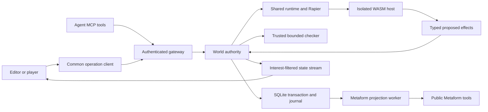

# Continuum World architecture

Project name: **Continuum World**. Project identifier: `continuum-world`.
Stage: Architecture. Roundtable: `a4c0c884`.
Ticket: `154972b6abff4a9d93ec83b8434efcca`.
Author: coded-engine. Date: 2026-10-22.

Build a shared, playable 3D world. People and agents use identical operations. An authoritative scene service accepts changes. WASM extensions propose bounded effects. Metaform retains functional intent.

This package defines the complete build. It supplies architecture, contracts, decisions, and acceptance evidence. Implementation planning belongs to the next stages. Automated preparation keeps execution inactive.

## 1. Grounding and preserved purpose

Original request:

> Multiplayer extensible world with chunks and regions instead of redstone and voxels it uses wasm and a wasm bus ..  agents can extend world which is based on real physics...   regions can have different properties and borders.   like a multiverse A shared, playable 3D canvas where the person and agents edit the same world through one operation format, and every meaningful object and rule keeps its purpose, constraints and decisions through Metaform (I1). Its core is an authoritative scene service (I5) over a portable, renderer-independent world format with one runtime for editor, web export and headless checks (I4). Agents act through a small typed vocabulary (I7) with spatial perception (I8), propose edits as reviewable patches against a revision (I9), and prove intent with bounded simulation checks (I14). Build it JavaScript-first: TypeScript, Three.js, Rapier WASM, Web Workers (I2, I16).

Grounding records:

- [Original discussion](export.json): all 28 submissions, including corrected proposals and passes.
- [Mechanical report](mechanical-report.md): 21 synthesized ideas, rankings, explanations, and summary.
- [Research](research.md): requirements `WR-01` through `WR-22`, SDK recommendations, local experiments, unresolved mechanisms.
- Metaform `AGENTS.md`, `CLAUDE.md`, `README.md`, `specifications/00-index.md`, `02-layers.md` LAYER-012/LAYER-013, and `11-context.md` context inheritance requirements.
- Source evidence: `src/metaform/context.py:31`, `src/metaform/modules/mcp/server.py:871`, `src/metaform/events.py:23`, and `src/metaform/modules/mcp/tests/test_mcp.py:1908`.

`O-I*` denotes original-request ideas. `R-I*` denotes roundtable synthesis. Their numbering overlaps. Research `WR-*` provides the acceptance baseline.

`C(T) = { (r_i ∧ p_i ∧ e) }: Formula for frozen core allowing mutation, not transformation.`

| Receiving element | Operative purpose | Providing element and encounter |
|---|---|---|
| Person editing or playing | Make understandable, shared physical worlds | Editor exposes objects, rules, review, play, and intent |
| Agent extending a world | Change bounded parts with verifiable intent | Scene API supplies spatial perception, proposals, checks, and commits |
| Shared world participants | Observe one accepted physical state | Authority orders edits and simulation inputs |
| Future maintainers | Understand why objects and rules exist | Metaform indexes purpose, constraints, decisions, and functional relationships |

Project effect: introduce an independent TypeScript product. Connect Metaform through public MCP tools. Add one conditional batch command to Metaform memory for safe projection. Existing Python request context remains an integration reference.

Design benefit: common operations preserve editor-agent parity. Shared runtime preserves exported behavior. One commit boundary makes conflicts and recovery explicit.

Existing rationale: Metaform supports tools and agent sessions. `Context.build` copies identity separately from session selection. Process-session fallback suits that environment. Shared authority requires authenticated principals instead. `gateway_identity` extracts headers. It does not authenticate callers.

Actions: separate identity from permission. Resolve worker attribution through authority-owned jobs. Persist intent with state changes. Project functional knowledge through canonical Metaform operations. These choices preserve the requested functional core.

## 2. Scope and settled choices

The first complete product includes multiplayer editing, local play, hosted play, chunks, regions, dimension transfers, WASM rules, agent operations, patch review, bounded checks, undo, export, and Metaform integration.

Physics means rigid-body mechanics. Use metres, kilograms, seconds, gravity, contacts, friction, restitution, impulses, forces, and joints. Fluids, fracture, relativity, arbitrary clocks inside interacting space, marketplaces, billing, and distributed simulation are outside this build.

| Decision | Selected mechanism | Reason and rejected alternative |
|---|---|---|
| A01 Product placement | New sibling repository `/home/rich/continuum-world` during later execution | Independent TypeScript lifecycle. Avoid embedding a game service in Metaform's Python web viewer |
| A02 Authority | One active writer per world, within one service process | Explicit ordering. CRDT merges cannot establish physical validity |
| A03 Shared runtime | Renderer-free TypeScript packages over Rapier WASM | Editor, player, service, checker share semantics |
| A04 Persistence | SQLite WAL, one dedicated storage worker, durable transactions | Adequate local single-writer storage. No distributed database required |
| A05 Simulation | Fixed 1/60-second steps, one Rapier world per dimension | Same-dimension contact stays coherent. Different dimensions transfer explicitly |
| A06 Regional gravity | Zero engine gravity plus per-body regional gravity force | Supports arbitrary vectors inside one collision space |
| A07 Conflict policy | Reject stale revisions, explicit rebase proposal | Predictable review. No implicit merge |
| A08 Checked commits | Bounded world barrier, final verification against frozen checkpoint | Eliminates stale physics verdicts without speculative rollback |
| A09 Extension isolation | Browser worker previews, Linux sandbox processes for shared authority | JavaScript worker limits do not bound all process memory |
| A10 Bus execution | Fixed phases, bounded messages, no synchronous recursive calls | Prevents message floods and timing-dependent effect order |
| A11 Metaform projection | Transactional outbox plus conditional canonical-memory batches | Atomic compare/write prevents concurrent memory edits from being overwritten |
| A12 Identity | Immutable service binding per authenticated principal, issue, optional run | Multiplexed connections cannot mutate attribution |

These are design choices, not measured capacity claims. Research SDK versions remain the proposed lockfile baseline. Compatibility proofs precede dependency adoption. No user-only decision blocks architecture. Public hosting policy and production deployment remain later owner decisions.

## 3. Components and repository boundaries

```text
continuum-world/
  apps/editor/             Three.js canvas, inspector, patch review
  apps/player/             Exported local or connected player
  apps/scene-service/      HTTP, WebSocket, authentication, world actors
  apps/check/              Headless fixture and package checker
  apps/extension-host/     Minimal untrusted WASM process host
  packages/contracts/     Runtime schemas, canonicalization, wire codecs
  packages/world/         Portable records, patches, revision reducer
  packages/runtime/       Rapier adapter, regions, borders, step phases
  packages/wasm-bus/      ABI, module validation, effect validation
  packages/client/        Common operation client, reconnect, subscriptions
  packages/render-three/  Render adapter, asset cache, instance buffers
  packages/storage/       SQLite worker, journal, blobs, recovery
  packages/metaform/      MCP client, context reads, semantic projection
  fixtures/               Worlds, assertions, hostile extensions
  deploy/                 Service image, sandbox profile, local launch
```

These paths are proposed build ownership. This architecture stage creates only this document. It neither creates the sibling repository nor changes runtime code.



`contracts`, `world`, and `runtime` import no DOM, Three.js, network credentials, or Metaform internals. `runtime` accepts a clock driver, storage-independent checkpoints, and an extension executor. Those are host boundaries, not alternative gameplay implementations.

The service owns authentication, ordering, budgets, persistence, and current permissions. Trusted simulation workers own engine instances. Extension processes own only their instances and message buffers. Browsers own presentation and isolated previews. Metaform owns semantic context. World storage owns authoritative state and audit history.

## 4. Portable model and identities

IDs are stable, lowercase UUID strings. Assets and modules use `sha256:<hex>`. Revisions, ticks, and event sequences use canonical decimal strings on the wire. Internally use `bigint`, checked against SQLite signed 64-bit bounds. Exhaustion fails explicitly. Never round through a JavaScript number.

Canonical bytes use UTF-8 JSON Canonicalization Scheme. Reject duplicate JSON keys, invalid Unicode, unknown fields, NaN, infinity, and out-of-range values before hashing. Normalize negative zero. Schema-defined unordered sets sort by stable ID. Patch operation arrays preserve order. Hash canonical validated data, never received JSON whitespace. [RFC 8785](https://www.rfc-editor.org/rfc/rfc8785)

```ts
type Id = string
type Counter = string
type Hash = string
type Vec3 = readonly [number, number, number]
type Quat = readonly [number, number, number, number]

interface WorldManifest {
  schemaVersion: 1
  worldId: Id
  title: string
  revision: Counter
  units: "m-kg-s"
  runtimeHash: Hash
  physicsVersion: string
  busAbi: "continuum.bus/1"
  seed: string
  timestep: { numerator: 1, denominator: 60 }
  dimensions: DimensionRecord[]
  chunks: ChunkRef[]
  assets: AssetRef[]
  modules: ModuleRef[]
  intentBindings: IntentBinding[]
  licenseFiles: string[]
}
```

| Record | Required content and ownership |
|---|---|
| Dimension | ID, bounded extent, default region, chunk edge length, runtime state. One shared clock ratio: 1 |
| Entity | ID, dimension ID, functional type ID, optional instance intent binding, transform, body, colliders, render reference, tags |
| Transform | Position, normalized quaternion, positive scale. Collider scaling becomes explicit geometry during validation |
| Body | Static, dynamic, or kinematic type, positive dynamic mass, damping, velocities, sleep state, CCD flag, finite velocity/force limits |
| Collider | Stable ID, body ID, shape, local pose, friction `[0,1]`, restitution `[0,1]`, sensor and collision groups |
| Joint | Stable ID, endpoint body IDs, type, anchors, limits. No cross-dimension endpoints |
| Chunk | Dimension ID, integer grid coordinate, content hash, entity-ID index. Contains no permission policy |
| Region | ID, dimension, axis-aligned bounds, integer priority, gravity vector, material defaults, permission policy ID, budget, rule bindings, border IDs, policy version |
| Border | Directed source/destination IDs, allow/block/transfer mode, allowed operations, transfer transform, speed bounds, policy version |
| Rule binding | Stable binding ID, module hash, ABI, configuration hash, region scope, subscriptions, installation commit, runtime capability policy |
| Intent binding | Functional type or instance ID, Metaform project, receiving Address, optional providing Address/join identity, desired purpose/constraints/decisions |
| Checkpoint | Revision, tick, per-dimension Rapier bytes, ordered ID/handle mapping, extension state bytes, PRNG state, pending bus messages, runtime hashes |

Render references use GLB/glTF assets. World semantics never depend on a Three.js object graph. Initial colliders support boxes, spheres, capsules, convex hulls, and static triangle meshes. Dynamic triangle meshes fail validation. Visual meshes and collision shapes remain explicit independent fields.

World documents preserve authoring data. Checkpoints preserve running state. Rapier supports snapshot and restore through `takeSnapshot()` and `World.restoreSnapshot()`. Treat binary compatibility as pinned to the runtime version. [Rapier serialization](https://rapier.rs/docs/user_guides/javascript/serialization/)

Portable migration runs offline against a copy. Validate references and hashes before activation. Unknown schema majors or ABI versions fail before play. Runtime upgrades require a new manifest/runtime hash and fresh checks. Preserve the previous package for rollback. Never deserialize old engine snapshots into a different pinned engine.

## 5. Operations, errors, and perception

Every ingress validates the same strict schemas. Editor controls and agent tools call `packages/client`. Agent MCP tools expose `world_inspect`, `world_query`, `world_propose`, `world_check`, `world_commit`, and `world_resume`. Control transport also supports bind, subscribe, cancel, and play input.

```ts
interface Request<T> {
  protocol: "continuum/1"
  requestId: Id
  operationId: Id
  bindingId: Id
  worldId: Id
  payload: T
}

interface Patch {
  patchId: Id
  baseRevision: Counter
  operations: PatchOperation[]
  purpose: string
  constraints: Constraint[]
  decisions: Decision[]
  assertions: Assertion[]
}

interface CommitRequest {
  patchId: Id
  patchHash: Hash
  expectedRevision: Counter
  checkId: Id | null
  approvalOf: Id | null
}

interface Failure {
  code: ErrorCode
  message: string
  path: string | null
  currentRevision: Counter | null
  retry: "never" | "rebind" | "rebase" | "recheck" | "backoff"
}
```

| Operation | Parameters | Result |
|---|---|---|
| `inspect` | Entity/region/rule IDs, bounded field selection | Visible records, intent references, revision, tick |
| `query` | Dimension, ray/overlap/neighborhood shape, filter, limit, cursor | Stable IDs, bounds, permitted relationships, applicable rules, checkpoint ID, truncation and cursor |
| `propose` | Patch, optional explicit persistent draft key | Patch ID/hash, immutable author, normalized diff, affected regions, validation findings |
| `check` | Patch ID/hash, assertion set, horizon, checkpoint ID | Check ID, dependency digest, trusted verdict, counterexample or metrics |
| `commit` | CommitRequest | Durable commit ID, revision, tick, event sequence, synchronization status |
| `resume` | Draft ID, expected draft version, new binding | New draft access and resumer provenance. Original author stays fixed |
| `subscribe` | Dimension, visible chunk interest, event classes, last cursor | Snapshot plus bounded deltas, or explicit resynchronization |
| `input` | Controlled entity, monotonic input sequence, target tick, typed action | Assigned tick or rejection. Never an arbitrary transform |
| `cancel` | Owned run/binding ID | Revocation sequence. Future commits fail |

Patch operations: `entity.create`, `entity.remove`, `entity.transform`, `body.set`, `collider.set`, `joint.create`, `joint.remove`, `region.set`, `border.set`, `rule.install`, `rule.remove`, and `intent.set`. Each variant declares all fields. Removing an entity with joints or bindings requires explicit removals in the same patch. Referential validation evaluates the final batch. Constraints cover finite ranges, allowed types, required references, and named physical assertions. They contain no executable JavaScript.

`input` supports movement axes, jump, grab, release, and bounded impulse through controlled entities. Input uses the same envelope, validation, permissions, and ordered authority as edits. It changes simulated state, not the durable authoring revision. Its accepted sequence enters the replay journal. Schema evolution requires a protocol version and negotiated support.

`query` supports raycast, AABB overlap, and radius neighborhood. Maximum page: 256 objects. Maximum radius and query cost come from current capability. Sort by distance, then ID. Pin paginated results to one short-lived checkpoint and capability version. Changed permissions invalidate cursors. Return `CURSOR_EXPIRED` rather than silently mixing simulation states. Invisible objects and their relationship endpoints are omitted.

Failures include `UNAUTHENTICATED`, `FORBIDDEN`, `INVALID_PAYLOAD`, `UNKNOWN_OPERATION`, `LIMIT_EXCEEDED`, `REVISION_CONFLICT`, `STALE_CHECK`, `CHECK_FAILED`, `RUN_REVOKED`, `OPERATION_ID_REUSED`, `WRONG_WORKER`, `JOB_EXPIRED`, `BORDER_DENIED`, `DESTINATION_UNAVAILABLE`, `UNSUPPORTED_VERSION`, `ASSET_MISSING`, `STORAGE_UNAVAILABLE`, and `RESYNC_REQUIRED`. Responses disclose only records the caller may read.

HTTP supplies health, assets, world packages, session binding, and WebSocket upgrade. WebSocket carries commands and ordered events. Binary transform frames carry world epoch, tick, baseline sequence, count, slot IDs, and packed transforms. Edit results remain reliable and ordered. Presence and obsolete transform frames can coalesce. Every event identifies world, affected entities/chunks, revision, tick, and origin sequence.

## 6. Authentication and authority

Initial deployment uses service-issued opaque credentials. A local setup command creates a person account and scoped agent credentials. Store only token hashes. Browser sign-in exchanges a credential for a secure HttpOnly same-site cookie. Agent transport uses bearer credentials. Remote transport requires TLS. Validate Origin on cookie-authenticated WebSocket upgrades and CSRF on HTTP mutations.

Binding creation authenticates the credential. The authority resolves principal, world, issue access, optional run, capabilities, expiry, and revocation generation. It returns an opaque `bindingId`. Each run gets its own immutable binding. Missing run stays `null`. The same connection can carry several bindings only for its authenticated principal. A binding ID alone grants nothing.

Gateway forwarding requires an authenticated trusted gateway. Strip client-supplied identity headers at that boundary. Validate gateway identity claims against its permitted principal/issue/run scope. Do not derive world identity from process environment, Metaform session fallback, or arbitrary headers.

Capabilities bind world, dimension/region sets, operation classes, object visibility, resource limits, expiry, and generation. All mutations require current capabilities. Apply source, destination, and every intersected-region policy to spatial edits. The editor has no bypass. Authentication identity, proposal author, verifier, approver, runtime principal, and extension hash are distinct stored fields.

Service-owned job records contain job ID, binding, patch hash, checkpoint, dependency digest, assigned worker channel, deadline, status, and causation. Workers receive computation context. Results return only job ID, effects, and diagnostics. Accept results only from the registered channel and current job attempt. Ignore returned identity fields. Terminal jobs reject late or duplicate results. Retire job payloads after terminal handling. Preserve durable operation outcomes.

Cancelled runs cannot commit. Saved proposals remain useful. Person approval creates a new request under current person permissions. It retains original authorship and repeats checks. Installed rules run under `runtime:<worldId>`, constrained by the installed policy and current region grants. Installer history supplies provenance, never continuing authority.

## 7. Commit, checking, and recovery

Patch lifecycle:

```text
proposed -> checked -> commit_requested -> final_check -> committed
     |         |              |              |
     +---------+--------------+--------------+-> rejected
changed dependency -> needs_recheck
changed base revision -> needs_rebase
```

Preview checks clone the requested checkpoint. They never mutate live state. Trusted host assertions include maximum penetration, reachability within declared bounds, speed/energy limits, no unauthorized border crossing, required joint connectivity, and an expected event/object condition. Assertions specify tolerances, observed objects, and a finite horizon. They prove only those conditions over that horizon.

A verdict binds patch hash, edit revision, full starting checkpoint hash, runtime and Rapier version, module/configuration hashes, region/border/policy versions, seed/PRNG state, timestep, assertion definitions, horizon, and verifier identity. Any change invalidates it. Rapier determinism also requires identical initialization and insertion/removal order. Avoid host transcendental math in deterministic paths. Sort entities and effects canonically. [Rapier determinism](https://rapier.rs/docs/user_guides/javascript/determinism/)

Final commit sequence:

1. Authenticate request. Look up durable operation outcome by world and operation ID. An authorized identical retry returns the stored result. A different payload hash fails.
2. Enter the world actor queue. Reject stale edit revision. Verify current capabilities and complete affected-region set.
3. At the next completed tick, establish a world-wide commit barrier. Queue bounded play input. All clients receive `check_pending`. Rendering continues from the frozen state.
4. Capture the exact checkpoint. Reuse a verdict only if every dependency matches. Otherwise run a fresh trusted bounded check from this checkpoint. Maximum final-check wall time defaults to 2 seconds. Timeout rejects and releases the barrier.
5. Prepare the candidate runtime in isolation. Apply the edit to the captured starting state, not the check's future state. This prevents simulation-horizon teleportation.
6. Recheck cancellation, expiry, and authorization generation immediately before transaction enqueue. Revocation remains processable during checking. The actor gives commits and revocations one monotonic authority sequence. The storage worker applies that order and rechecks persisted revocation state inside the commit transaction.
7. Atomically store the new revision, canonical patch, candidate checkpoint, audit context, operation outcome, intent record, and projection outbox row. SQLite commit is the edit linearization point. A lower-sequence revocation wins. A later revocation waits behind an already ordered commit and cannot undo history. Acknowledge cancellation only after its revocation transaction commits. Arrival time alone does not establish cancellation precedence.
8. Swap the prepared runtime only after durable success. Publish the accepted revision. Resume stepping. Failure before durable commit discards the candidate. Failure after commit recovers that candidate from storage before serving more commands.

Only one commit barrier exists per world. Rate-limit expensive checks by principal. Queue at most 120 ticks of input. Overflow returns an explicit rejection. A visible bounded pause is the initial tradeoff for correct live-world checks. No long check silently blocks play indefinitely. Planner must measure this cost before any later incremental-check optimization.

SQLite belongs to a dedicated worker. Use WAL and `synchronous=FULL`, foreign keys, prepared statements, and explicit transactions. Store revisions/ticks as integer values with bigint reads. Use Node 24's `node:sqlite` API after a pinned API smoke test. Synchronous storage calls stay off the network event loop. [Node SQLite API](https://nodejs.org/api/sqlite.html)

| Table | Key and durable content |
|---|---|
| `worlds` | World ID, current revision, committed tick, runtime hash, checkpoint reference |
| `commits` | World/revision unique, commit ID unique, patch, author/verifier/committer, dependency digest, intent |
| `operation_outcomes` | World/operation ID unique, submitting principal, canonical request hash, terminal result |
| `tick_batches` | World/tick unique, accepted inputs, validated effects, rule next-state bytes, bus enqueue/dequeue deltas, timed-force deltas, PRNG changes, deadline/fault outcomes, state digest |
| `checkpoints` | Content hash, versioned runtime bytes and document state |
| `drafts` | World/principal/issue/draft ID unique, explicit version, immutable author, patch, resumer history |
| `bindings` / `jobs` | Expiry, revocation generation, worker attempt, terminal state |
| `outbox` | Commit ID unique, desired semantic projection, target cursor, retry state |
| `projection_steps` | Commit/target/step unique, desired hash, observed postcondition, status |

Checkpoint and small journal payloads initially stay in SQLite BLOBs for atomic recovery. Assets/modules use immutable content-addressed files. Write, hash, fsync, and atomically rename files before referencing them in a transaction. Unreferenced files are removable after a bounded retention window. Referenced blobs cannot be garbage-collected.

Each accepted simulation tick durably records its input/effect batch and all non-physics runtime deltas before broadcasting an accepted tick. Step provisionally, validate, persist, then expose. Failure restores the preceding checkpoint/replay state. Periodic checkpoints occur after a configured number of committed ticks, driven by tick completion. Replay uses logged effects, explicit rule states, pending-message changes, timed-force state, PRNG changes, and failures, never fresh untrusted execution. Include these fields in state digests and checkpoints. A crash between checkpoints must restore them exactly. Accepted edits remain durable after lost acknowledgments and restarts. Startup replays the latest checkpoint plus subsequent tick batches and commits, checks digests, invalidates old worker channels, then opens traffic.

Deduplication retains accepted outcomes for the world's lifetime. Cleanup may compact payloads while retaining operation ID, request hash, authorized principal, and outcome. Draft deletion and job expiry never delete those keys. Unknown requests cannot read someone else's outcome. Offline replay cannot grant historical permissions.

## 8. Physics, chunks, regions, and borders

Create Rapier once per worker through `await init()`. Build each dimension in stable ID order. Reuse preallocated buffers and scratch vectors. Free worlds, event queues, and WASM-owned resources on replacement or shutdown.

Each step has fixed phases: accept ordered input -> resolve rule events -> validate effects -> apply forces -> simulate -> resolve borders -> collect contacts/events -> persist tick -> publish. Bus effects for tick N are determined before simulating N. Late results cannot alter a committed tick.

Dedicated server workers schedule physical-time deadlines. They do not repeatedly query readiness. Step completion schedules the next deadline. Bound catch-up work and report overload. Never vary timestep to conceal overload. Browser hosts use requestAnimationFrame pacing. Headless checks request an explicit bounded step count. UI rendering always uses requestAnimationFrame.

Chunk edge length defaults to 32 metres. Chunk coordinates use floor division, including negative coordinates. One entity owns one record, indexed in every overlapping chunk. Deduplicate queries and subscriptions by entity ID. Large objects retain collision and interest coverage. Client unload releases visual assets only. All admitted authoritative bodies remain loaded initially. Server-side simulation streaming and distributed chunk ownership are deferred. Enforce dimension/body limits before admitting a package.

Regions use axis-aligned volumes with explicit integer priority. Reject overlapping equal-priority regions. Resolve effective physical properties by highest priority at the body's centre of mass. Half-open bounds settle exact-face membership. The default region covers the dimension. Authorization requires every region touched by the body's swept collider bounds, even when another region supplies gravity. Existing colliders retain stored materials until an explicit patch updates them. Region material defaults affect newly created colliders.

Set Rapier global gravity to zero. Before each step, compose permitted external force with `mass * regionGravity` for each dynamic body. Wake bodies when their effective gravity changes. Friction/restitution remain collider properties. Region policy revisions change through patches. Bodies across ordinary region boundaries still collide inside one Rapier world. No claim of seamless contact between distinct dimensions.

Border decisions examine motion continuously enough to prevent bypass. For each candidate step, use conservative swept bounds covering translation and rotation, not endpoint membership alone. Apply analytic segment/plane tests for region faces and Rapier shape casts where applicable. If numerical uncertainty cannot establish clearance, reject conservatively. Cap maximum displacement and angular motion per step. CCD handles physical contacts, while policy checks handle invisible borders.

Denied motion restores the complete affected dimension checkpoint, including contact state, then reruns with the denied body's connected joint group clamped at its last permitted pose and forbidden velocity components removed. A bounded retry count ends in a paused dimension with a visible fault. Do not restore one body while retaining impulses it applied to others. Policy rejection never duplicates or transfers ownership.

Ordinary allowed crossings preserve pose and velocity. Transfers use a unit-scale rigid transform: `p' = R*p+t`, `q' = R*q`, `v' = R*v`, `w' = R*w`. No mass, size, or timestep conversion occurs. Transfer the full connected joint component or reject. Validate destination clearance, extent, capacity, permission, region policy, and availability. Apply at one global tick boundary across both dimension worlds. Prepare both states, persist one batch, then expose both. Failed preparation restores both snapshots. A missing destination blocks at the source boundary.

Limits on dimensions, world extent, speed, body count, and joint-group size are enforced admission controls. They bound memory, broad-phase cost, float precision, and transfer work. Initial profiles use local coordinates within bounded dimensions. Additional dimensions provide larger worlds without promising an infinite single-precision space.

## 9. WASM bus and extension lifecycle

Use `continuum.bus/1`, a small custom ABI. Modules have content hashes and manifests declaring imports, subscriptions, message schemas, capabilities, state limit, memory maximum, and configuration schema. Validate module bytes and declared features before compilation. Reject shared memory, threads, ambient WASI, unbounded memory, and unknown imports in ABI v1.

```text
Host imports, module namespace continuum_v1:
  input_len() -> i32
  input_read(offset:i32, destination:i32, length:i32) -> i32
  output_write(pointer:i32, length:i32) -> i32

Required exports:
  memory
  run() -> i32
```

Input includes ABI version, job-local visible state, logical tick, seed, previous explicit rule state, and bounded messages. Output includes next explicit state, typed effects, outgoing messages, and diagnostics. Host imports copy bytes after overflow-safe bounds checks. Nonzero `run` results fail the invocation. Native code cannot obtain service credentials, identity constructors, filesystem, network, wall clock, or arbitrary host calls. The portable codec defines little-endian scalar representation and length-prefixed buffers. JSON schemas describe cold control payloads. Packed typed buffers carry frequent physics values.

Create a fresh WASM instance per invocation initially. Compile modules once inside the isolated host. Explicit state bytes carry permitted continuity. This prevents hidden state across pooled jobs and makes checkpoints complete. Instantiation occurs outside rendering/physics hot loops. Measure its cost before optimizing instance reuse.

Effects are discriminated records: bounded impulse, force for a declared number of ticks, typed bus message, and proposed durable patch. Runtime effects require current installed-rule grants. Durable changes traverse normal patch/check/commit behavior under runtime authority. A rule cannot certify its own effects. Trusted host code validates quantities, visibility, ownership, region coverage, and assertions.

Messages name schema ID/version, source binding, destination rule, causation ID, logical delivery tick, sequence, and bounded payload. Authority supplies source attribution. Sort by delivery tick, rule ID, originating event sequence, and local message index. Messages emitted during invocation deliver no earlier than the next tick. There is no synchronous module-to-module call. Drop unauthorized destinations with a recorded rejection. Reject batches that exceed causal depth or aggregate quotas.

Initial enforceable defaults: 64 MiB WASM memory, 1 MiB explicit state, 64 KiB message, 256 effects per invocation, 256 messages per region per tick, causal depth 8, 50 ms invocation deadline, and 512 MiB host-process memory. These values are configurable bounds, not performance guarantees. Finite queues and per-principal admission prevent compilation floods.

On Linux, run untrusted hosts under separate unprivileged users/namespaces, read-only module access, no network, no secrets, restricted syscalls, bounded process count, cgroup memory/CPU limits, and a supervisor deadline. Kill the process group on timeout or protocol failure. Return an empty effect batch plus durable fault outcome. Disable the failing rule binding until explicitly reset through a patch. Cgroup v2 supplies process resource controls. [Kernel cgroup v2 documentation](https://docs.kernel.org/admin-guide/cgroup-v2.html)

Browser workers provide deadlines and isolation from the UI thread. They do not establish a hard process memory guarantee. Node worker resource limits also exclude external buffers. Shared authoritative execution therefore requires the sandbox profile. Unsupported hosts reject untrusted server execution with `SANDBOX_UNAVAILABLE`. Browser previews remain advisory relative to a hosted world. An exported local world uses its own authority worker: a separate worker runs WASM, the authority validates effects and applies deadlines, and IndexedDB stores accepted tick batches before display acknowledgment. Timeout terminates the extension worker, records the fault, and disables that binding. Local mode has weaker process-resource guarantees and cannot produce hosted commit authority. Successful extension executions use the same ABI, runtime, ordering, and fixture semantics across all hosts. [Node worker documentation](https://nodejs.org/docs/latest-v24.x/api/worker_threads.html)

Native JavaScript WASM has no portable instruction-fuel API. This build promises wall-clock termination and bounded accepted effects. It does not claim deterministic instruction budgeting. Record timeout outcomes for replay. Same successful fixture runs should match across hosts. Deadline failures are explicit outcomes, not deterministic successful results.

Rule lifecycle: uploaded -> validated -> proposed installation -> checked -> installed -> running -> faulted or removed. Installation is atomic with its policy and intent. Removal drains subscriptions at a tick boundary, cancels jobs, rejects late results, and frees instances. Replacement removes obsolete binding/subscriptions in the same patch. Keep old content hashes only where history or exported packages reference them.

## 10. Metaform integration and maintained knowledge

The service-side adapter negotiates MCP protocol, discovers required tool schemas, and connects to the configured Metaform project. Research recommends MCP v2 for Metaform's `2026-07-28` protocol. Verify that negotiation against the actual server. Keep credentials server-side. World files contain semantic references and portable intent, never credentials.

Existing integration evidence:

- `gateway_identity` copies request headers without environment mutation.
- `gateway_session` selects agent/run, otherwise agent/issue.
- `Context.build` copies identity and can independently select a process session.
- `events.publish` and `publish_async` build subscriber contexts. They do not automatically preserve source identity.
- Existing MCP tests exercise interleaved runs and process fallback. They do not establish shared-world authentication.

Reuse public Metaform operations. Never write its SQLite tables. A later Metaform-side integration hook uses existing `events`/`changes` facilities and explicit validated attribution. Relevant events identify affected nodes before any read. Ignore self-originated changes and coalesce bursts. No periodic map refresh.

An intent binding identifies the receiving element and optional purpose join. Functional types can serve many spatial instances. Create distinct functional nodes only for distinct purposes. Keep per-frame positions, operation outcomes, verification reports, authorship logs, and job history in world/work records. They never become memory observations.

Context reads follow map entry -> task-word memory search -> relevant entities -> directed relations. Resolve inherited context through Metaform's public context surfaces. Do not duplicate its inheritance algorithm. A selected object shows its intent and exact Metaform reference. Missing or offline context shows the committed portable intent with synchronization state.

Outbox recovery contract:

1. World commit atomically records complete intent plus a projection row keyed by commit ID.
2. Commit event wakes the projector. Startup resumes unfinished rows once. Failure schedules bounded retry backoff. No readiness polling.
3. Serialize projection by world and functional target. Read the target's exact entity/observation/relation set, including absent entity names. Persist its digest, canonical mutations, desired digest, and deterministic step ID before calling MCP.
4. Call the proposed `memory_apply` command. It compares the target digest and applies a bounded batch of canonical memory operations within one Metaform transaction. A mismatched digest returns `MEMORY_CONFLICT` without mutation.
5. Store the step receipt in the same transaction as the mutation. Retrying the same step ID and request hash returns that receipt, even if later writers changed memory. Reusing a step ID with different content fails. Receipt storage is integration metadata, never a memory observation.
6. Read the resulting target state. Receipt plus postcondition distinguishes an interrupted delivery from another writer's deletion. Unexpected later changes become reconciliation conflicts. Never blindly replay an acknowledged mutation over changed shared memory.
7. Continue remaining targets. Mark projection complete only after every target's postcondition holds. UI shows `committed, context pending` until then. Per-commit audit stays in world storage.

`memory_apply` is a required, narrowly scoped Metaform addition. Proposed request fields: `node`, `entityNames`, `expectedDigest`, `mutationId`, `mutations`. Return fields: `mutationId`, `requestHash`, `beforeDigest`, `afterDigest`, `applied`, `receiptId`. The mutation union contains existing canonical operations: create/delete entities, add/delete observations, create/delete relations, and index joins. Existing names extend through add-observations semantics. It grants no new permissions or ownership. Cap batch bytes and item counts. Reject cross-project mutations.

Implement the command inside `src/metaform/modules/memory/`. Reuse its canonical graph mutation helpers, validation, change notifications, and public store transaction facilities. `src/metaform/data/store.py:110` exposes `Store.atomic()`. Current memory handlers use scoped table transactions. Factor reusable transaction-level helpers there as needed, preserving existing command behavior. Compare, graph changes, joins, and receipt must share the same write transaction. Emit notifications only after successful commit. Add module declaration/help and focused concurrency/retry tests. If durable receipt storage changes the schema incompatibly, update compatibility level under project rules. The TypeScript adapter never accesses Metaform tables directly.

This closes a concrete gap in plain read-then-write projection. Existing separate canonical calls cannot guarantee atomic compare/write against concurrent agents. Do not claim that current Metaform already exposes the proposed command. Dependency discovery must verify its contract before enabling automatic semantic mutation. Context reads remain usable without it.

An intent target names an existing receiving element or purpose join. A missing target creates a visible `mapping_required` integration result. Mapping is supplied through an explicit intent-binding patch or authorized intake. The projector never guesses purpose or invents a base map. Link implementation entry points through `dispatch_link`. Stable world/functional IDs prevent duplicate semantic entities.

Shared memory remains editable by every agent with CRUD access. Before drafting a batch, compare current observations with the last acknowledged projection and desired state. Preserve unrelated additions. Unexpected edits to affected facts create a reconciliation conflict. Do not restore deleted facts merely because the adapter previously wrote them. Record conflict evidence in work records, then update desired world intent through an authorized patch. No author ownership locks protect memory.

Projection is eventually consistent across functional targets. Each target batch is atomic. World commit and Metaform remain separate transactions. Durable receipts provide idempotent effects, not exactly-once network execution. History remains reachable through stable world commit references after current semantic facts change.

## 11. User experience and worked interactions

The editor opens a world list. Joining shows connection state, current revision, and play status. The main view combines a 3D canvas, object/region inspector, compact participant list, and patch tray. The inspector exposes physical values, applicable region rules, purpose, constraints, and decisions. Region overlays make borders and denied movement visible.

Create/move/delete controls produce patches. A drag shows a local ghost. Release submits a proposal. The patch tray shows additions, removals, affected regions, changed rules, check assertions, and evidence. Approval invokes final checking. A rejected patch stays editable with precise reasons. A conflict offers refresh and explicit rebase. Undo constructs a compensating patch against the current revision. It cannot erase someone else's later work silently.

Play mode controls an avatar through typed inputs. Other users see accepted motion and edits. Editor mode can remain open while the world runs. Final-check barriers show a brief shared pause. Network loss shows disconnected state and keeps drafts local. Reconnection resynchronizes before allowing commits.

Worked edit: an agent queries nearby bodies at revision 12, proposes a bridge with joint constraints, and runs a 120-step check. A person reviews it. The world has advanced since preview. Approval captures a fresh checkpoint, reruns checks, commits revision 13, and broadcasts the result. Metaform is offline. Intent remains durable and displays pending synchronization. Reconnection completes projection without duplicate facts.

Worked cancellation: run A proposes an extension. Its checker finishes after cancellation. Commit rejects `RUN_REVOKED`. A person later approves the saved proposal through a new binding. Current permissions and checks apply. The commit records A as author and the person as committer.

Worked border: a jointed vehicle reaches a dimension portal. The authority checks the whole joint component and destination clearance. Unavailable destination -> vehicle stays at the permitted boundary. Available destination -> both dimension states change in one committed tick batch. IDs, joint relationships, and declared velocity transforms remain intact.

## 12. Hosting, export, and lifecycle

Development launches the editor, scene service, and a configured Metaform endpoint. Production uses a persistent Linux service with durable volume, sandbox supervisor, TLS termination, and bounded asset storage. The service runs one world actor per loaded world. A database lock prevents a second active writer. Startup fails closed if ownership or recovery is uncertain.

Service startup: validate configuration -> open/migrate storage copy if needed -> restore worlds -> verify runtime hashes -> initialize workers/sandbox -> recover outbox -> accept sessions. Shutdown: stop ingress -> complete or reject active transaction -> persist tick/checkpoint -> cancel jobs -> close subscriptions -> free physics/graphics resources -> close storage. Crashed jobs never resume under old worker channels.

Export writes `manifest.json`, chunk documents, content-addressed assets/modules, portable intent, notices, and player assets. Local export also contains the shared runtime host. It runs from a static HTTP origin without Metaform or editor access. Avoid reliance on `file://` module loading. Browser local play uses one local authority worker and IndexedDB persistence, with the same transaction contract adapted to IndexedDB. It creates a forked world identity when the user saves edits. Local changes do not silently merge into a hosted world.

Connected export names its required authority URL and world ID. It obtains fresh authentication. It never embeds live tokens. Version/hash mismatches fail before joining. Offline packages cannot impersonate hosted authority. Exported intent remains readable offline. Hosted multiplayer always requires the service.

Configuration exposes actual forks: local/connected mode, permitted origins, storage location, Metaform endpoint/project, world limits, check limits, bus budgets, and sandbox profile. Region and border behavior belongs in versioned world data. Do not add speculative sharding, renderer, or consensus switches.

Research proposes TypeScript `7.0.2`, Three.js `0.186.1`, Rapier compat `0.21.0`, `ws` `8.22.0`, Zod `4.6.7`, MCP client `2.3.1`, Vite `8.3.5`, Playwright `1.64.1`, and Node `24.22.1`. Carry the complete research inventory into dependency qualification. Pin versions and artifact integrity only after compile, browser-worker, Node, MCP, and export smoke tests pass. Retain license notices for dependencies, assets, and extensions. No full-stack compatibility claim follows from registry existence.

## 13. Performance and observable acceptance

Rendering uses preallocated structures of arrays, reusable vectors, instancing, and batched GPU uploads. Resize pools at admitted topology changes outside hot loops. No per-body object allocation in application step/frame callbacks. Decode network messages outside rendering loops. High-frequency state transfer uses pooled binary buffers. Platform and SDK internal allocation requires profiling rather than a blanket zero-allocation claim.

Bound every queue. Slow clients receive `RESYNC_REQUIRED`; never accumulate unlimited deltas. Resync captures checkpoint plus cursor atomically, then sends subsequent events. Unauthorized interests cannot obtain hidden chunks. Irrelevant events trigger zero reads. Metaform projection never runs inside the physics step. Render frequency is not throttled to hide performance cost.

Reference fixture: two browser clients, one agent, two regions, four chunks, 100 dynamic bodies, one extension, and an additional destination dimension for transfer tests. Record hardware, browser, runtime hashes, frame median/p95/p99, step time, patch latency, draw calls, allocation, queue high-water marks, and idle CPU over 60 seconds. Set measured performance thresholds during implementation qualification. This architecture supplies no invented capacity promise.

| Requirement | Build location | Required observable proof |
|---|---|---|
| WR-01 | Editor, common client, scene API | Person and agent equivalent edits produce identical normalized patches and visible second-client state |
| WR-02 | Contracts, world model, package loader | Save/reload preserves IDs and meaning. Headless load imports no DOM/renderer |
| WR-03 | Runtime, host adapters, player | Same pinned fixture/input sequence matches editor, exported player, and headless state |
| WR-04 | World actor, commit transaction, reconnect | Concurrent base revision yields one commit and one conflict. Reconnect loses no accepted edit |
| WR-05 | Chunk index and subscriptions | Edge crossing preserves collision/identity. Large objects appear once. Client unload preserves authority |
| WR-06 | Region resolver and policy | Adjacent gravity/material policies differ. Overlap priority resolves consistently. Equal-priority overlap fails |
| WR-07 | Border phase and transfer transaction | Fast/rotating crossing cannot bypass policy. Joint transfers are atomic. Failed destinations preserve source state |
| WR-08 | Rapier adapter and validators | Gravity/contact/restitution/joint fixtures meet explicit tolerances. Nonfinite/invalid forces fail |
| WR-09 | Strict schemas and API | Unknown fields/verbs, oversized batches, and bad IDs fail before mutation |
| WR-10 | Perception and capability filter | Spatial queries are bounded, stable, paginated, and visibility-safe |
| WR-11 | Drafts, patch tray, isolated runtime | Preview rejection leaves live state unchanged. Undo revalidates current revision |
| WR-12 | Authentication and binding | Forged headers fail. Multiplexed runs remain separate. Missing run remains null |
| WR-13 | Jobs and trusted checker | Wrong-worker, forged, expired, duplicate results cannot mutate state |
| WR-14 | WASM host, supervisor, bus | Infinite loop, memory growth, forbidden imports, message flood terminate within enforced bounds |
| WR-15 | Dependency digest and barrier | Change each dependency separately. Every stale verdict fails or triggers fresh verification |
| WR-16 | Actor revocation ordering | Cancellation before commit blocks it. Person approval retains author and uses current permission |
| WR-17 | Durable outcomes | Crash after commit/before acknowledgment returns original result after retry and job cleanup |
| WR-18 | Commit/outbox transaction and conditional memory batch | Crash between every projection step converges without duplicate facts. Concurrent memory edits cause conflict. Offline Metaform loses no intent |
| WR-19 | Draft keys and runtime bindings | Another agent cannot resume private drafts. Installed rules survive installer expiry under runtime policy |
| WR-20 | Event filters, pools, bounded streams | Unrelated event burst produces zero reads. Slow client stays within queue limits. Profile hot paths |
| WR-21 | Intent bindings and Metaform adapter | Selected objects reach correct receiver context. Changed rules preserve audit decisions outside memory |
| WR-22 | Export packager | Offline local load succeeds. Hash/asset/schema/ABI failures stop before play |

Additional failure proofs: disk-full transaction, process loss after durable commit before runtime swap, mismatched replay digest, blocked border rollback affecting another body, sandbox supervisor failure, authority restart during transfer, and shared-memory edits during projection. Each proof specifies a concrete invariant and failure point.

Architecture acceptance requires full requirement coverage, resolved core mechanisms, source-grounded integration, explicit failure handling, and a named project. Runtime acceptance requires implementation proofs above. This stage does not claim those proofs have run.

No existing implementation is replaced by this document. No runtime paths, settings, prompts, or tests become obsolete. Later replacement patches must remove their superseded behavior in the same change.

coded-engine
