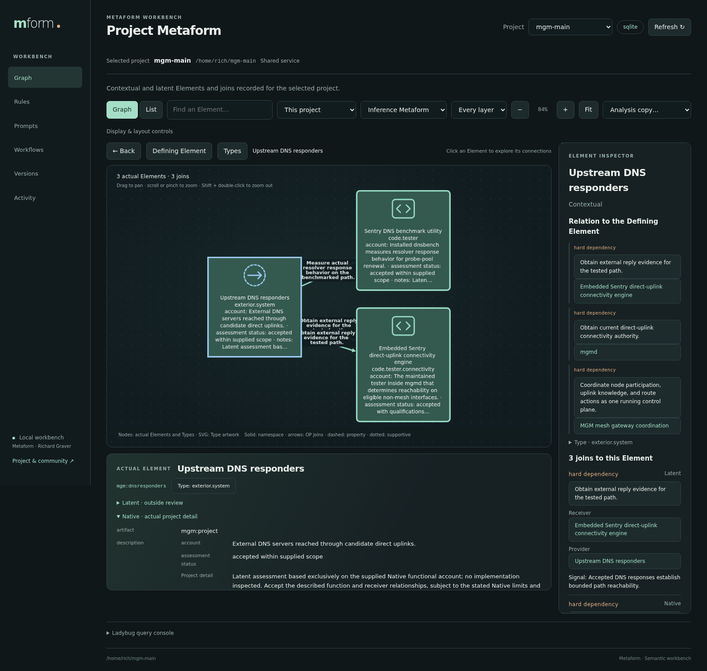

# MGM historical v1 intake sample — 2026-09-10

This is the completed two-pass v1 `mgm-main` intake of the mesh gateway
coordination project, saved for analysis. The generated records are preserved as
recorded, including their descriptions, qualifications, provenance, and SVGs.
They are an example to examine, not a hand-corrected reference answer.

| File | Contents |
| --- | --- |
| [native.json](native.json) | The Native graph and freeform `understanding` supplied to Latent: 58 actual elements, 47 Types, and 101 joins. |
| [latent.json](latent.json) | The completed Latent graph: 72 actual elements, 47 Types, and 204 joins. This includes retained and revised records, not just additions. |
| [manifest.json](manifest.json) | Run identity, source and prompt revisions, counts, and SHA-256 hashes of both graph files. |
| [viewer.png](viewer.png) | History / Compare mode showing the local neighborhood of `mgm:dnsresponders` after clicking it. |

Start with `native.json` → `understanding`, which includes the overall functional
account and a Mermaid diagram. Then read `elements["mgm:project"]`, the Defining
Element, and follow its joins. `object_id` identifies the receiving entity whose
Operative Purpose the join carries; `element_id` identifies the provider. The
join's `type`, `purpose`, and `signal` describe that particular relationship.

Actual records use `metaform:actual-element`. Their `entity_json_obj.description`
holds project-specific detail and `type_ids` references their organizational
Types. Type records use `metaform:element` and retain universal descriptions,
namespace identities, name lengths, and authored SVGs. Type membership is not an
additional Operative Purpose join. For example, `mgm:project` references
`code.coordinator.gateway`.

Compare Native and Latent by element identity and by each join's participants
and purpose. Latent had the complete Native account and no repository access.
The stored runtime name for the Latent scope is `archaeology`; the manifest's
persisted join counts use that name. The files are the completed run's original
graph objects, before publication normalizes scope and join identities. Historical
observation logs and harness execution records are not included.

The run began at `2026-09-10T15:57:41.711174+00:00` against source revision
`5906ded0cd80177046340df41a822801501a0bcd`. Native reused the prior source-inspection
map and checked the current checkout and repository guides. It did not perform a
fresh exhaustive source audit or runtime validation. Original local paths and
assignment identifiers remain where they occur in the generated provenance.

## Loading

The loader for this format was part of the earlier runtime and has been removed. The current chassis cannot load these files. Read them as JSON.
