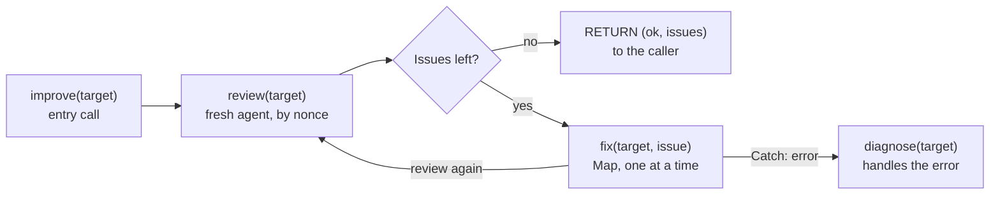

# Workflow Root and Workflow Layers

Oct 3, 2026 · @Rich Graver

## Overview

A workflow is reusable procedure stored as callable logic, outside any project's metaform. It lives under its own namespace root, `workflow`, and is recorded in a workflow-owned layer.

Each step is a subroutine: a logic requirement written in Axiom, called by address and name with parameters, and returning values. A workflow names no project's elements, so the same workflow runs in any metaform; the caller passes the elements as arguments.

This is advance inference amortization applied to procedure. Routing, acceptance conditions and handoffs are reasoned once, when the workflow is made, so the agent running it starts from them.

## The workflow base segment

`workflow` is a namespace root beside `code`, `document`, `media`, `data`, `upstream` and `downstream`. It holds workflow elements: elements whose job is to hold workflow logic.

- **Not part of intake.** Intake never creates, traces or decomposes anything under `workflow`.
- **Not owned by a project.** A workflow element belongs to no metaform. Metaforms use it by calling it.
- **Addressed by the namespace rules.** Reversed, the address names the kind of workflow: `workflow.quality.code` reads "code quality workflow". It names a functional kind of workflow, never a project, tool or genre.
- **Holds three things:** its canonical name, the knowledge layers it includes, and its logic requirements.

## Logic requirements

A logic requirement is one subroutine of a workflow. Its record has four fields; everything else is a parameter in its content.

| Field | Holds |
| --- | --- |
| `type` | `"logic"` |
| `logic_id` | Stable id, assigned when submitted; survives moves and refinement (MAP-003) |
| `name` | The subroutine's function name, unique on its workflow element |
| `content` | Axiom: the subroutine's logic |

- **Parameters** are declared in `@STATE_INIT` as `{name} := PARAM` or `{name} := PARAM = default`. Elements a subroutine works on are always parameters, so its content never holds a metaform address or a project-specific name.
- **Returns** end a pipeline with `RETURN {value}` or `RETURN ( {a}, {b} )`.
- **No order.** Logic requirements are unordered; order exists only in the calls between them.
- **Conditions at the function.** Each subroutine holds the conditions for the function it works on: its acceptance, its retries and its error routes.

## Calling and control flow

A subroutine is called by its workflow element's address and its name, with keyword arguments. It returns a single value or a tuple.

```
( {ok}, {issues} ) := workflow.quality.code.review( target={Element_A}, standard="strict" )
```

The name is the function name; the `logic_id` stays underneath as the stable record. A call can reach any workflow's subroutines, so workflows compose.

Inside a subroutine, control flow uses Amazon States Language terms, which agents already know:

| Need | Term |
| --- | --- |
| Branch on a condition | `Choice` |
| Run independent work at once | `Parallel` |
| Loop on one thing until it is accepted, then the next | `Map` with `MaxConcurrency: 1`, each item until its acceptance holds |
| Retry work that can fail | `Retry: [{ ErrorEquals, MaxAttempts, BackoffRate }]` |
| Route an error to a handler | `Catch: [{ ErrorEquals, Next: <address>.<name>(...) }]` |
| Finish | `RETURN`, or a call to the next subroutine |

Every loop has `MaxAttempts`. An error no `Catch` handles fails the subroutine and propagates to its caller, like an exception. At the top of the call chain, it yields to the orchestrator.

## Handoffs

A handoff is a call that runs on a fresh agent. It goes wherever a step needs independence from the work before it, such as a review with fresh eyes.

1. The call is registered and a nonce is issued for it. The nonce works like a Step Functions task token.
2. The nonce goes directly to a fresh agent where the host supports agent-to-agent handoffs; otherwise it goes through the orchestrator (BASE-050).
3. The fresh agent redeems the nonce and receives the subroutine with complete instructions. It has no prior context.
4. Its `RETURN` comes back with the nonce, and the caller continues.

Every handoff states the data accepted and the data passed back (BASE-051).

## Workflow layers

A workflow is recorded in a workflow-owned layer: a knowledge layer (LAYER-016) that holds the workflow element and its logic requirements. The layer is the workflow's source of truth.

- **Included knowledge layers.** The workflow element lists the knowledge layers it brings, such as a best-practices layer that records best-practice imperatives at each element (LAYER-020's for-each prompt). Turning the workflow on brings them with it.
- **Select and mask.** Selection and masking decide where a workflow applies. It can be turned off or swapped without touching the map (LAYER-007).
- **Provenance.** The layer records the prompt, its exact version, the model and the role that made it.
- **Versions.** Every refinement is a new version, and every earlier version is kept (LAYER-025).
- **A lean map.** The metaform carries no workflow logic. Axiom loads only where a workflow's layer is on.
- **The `.metaform` file.** `<workflow name>.metaform` is the workflow written out as a file, for carrying or reading elsewhere. It is written from the stored workflow, never separately, so the two never drift (BASE-051).

## How workflows are made

Two prompts produce workflows in the same shape, so one executor runs both.

| Prompt | Starts from | Does |
| --- | --- | --- |
| Workflow ingest | An existing prompt or workflow | Delexicalizes it, makes each step a subroutine with its text verbatim, and turns placeholders into parameters. Anything the text leaves unstated, such as acceptance or attempts, becomes a parameter the caller passes. It adds no logic the text does not state. |
| Workflow authoring | A goal | Writes the subroutines, each with its parameters, acceptance, control flow, retries and error routes, then hands the executor the first call. |

Delexicalization replaces each element a prompt mentions with a lettered placeholder: `{Element_A}`, `{Element_B}`, and so on. The same element always gets the same letter.

## Example: workflow.quality.code

A code quality workflow with four subroutines on one workflow element. A run starts with one call, and the caller passes the element to work on.

```
( {ok}, {issues} ) := workflow.quality.code.improve( target=code.engine.game )
```

| Subroutine | Parameters | Returns | Runs on |
| --- | --- | --- | --- |
| `improve` | `target`, `max_attempts = 3` | `( ok, issues )` | the calling agent |
| `review` | `target`, `standard = "default"` | `( ok, issues )` | a fresh agent, by handoff |
| `fix` | `target`, `issue` | `fixed` | the calling agent |
| `diagnose` | `target` | `cause` | the calling agent |



`improve` calls `review` on a fresh agent. While issues remain, `fix` works through them one at a time until each is accepted, errors go to `diagnose`, and `review` runs again; with none left, `improve` returns.

## To build

| Item | Reference | State |
| --- | --- | --- |
| `workflow` root, excluded from intake | — | Open |
| `logic` requirement type, with `logic_id` assigned on submit | BASE-051, MAP-003 | Open |
| `PARAM`, `RETURN` and calls by address and name | Metaform Axiom-OS v1.1 | Language defined; executor open |
| Executor: `Choice`, `Parallel`, `Map`, `Retry`, `Catch`, error propagation | — | Open |
| Nonce redemption over MCP | MCP-030 | Open |
| Host check for agent-to-agent handoffs | MCP-028 | Open |
| Writing `.metaform` from the stored workflow | BASE-051 | Open |
