# Metaform

## A functional walkthrough

16 subsystem views, grounded in the supplied intent graph.

**Source:** `metaform-metaform.xml`  
**Date:** 18 September 2026

| Top-level entities | Named namespaces | Purpose joins |
| -----------------: | ---------------: | ------------: |
|                 10 |               61 |            90 |

### How the diagrams are read

Labels reverse the namespace segments and take the number of words specified by `name_length`. Diagram arrows preserve the join's `operator` text and run from the owner of the join to its referenced namespace. They show functional relationships, not a newly prescribed execution order. All 90 purpose joins appear across the subsystem views; one answer-routing join is repeated for local context. The 11 combined subtype declarations are retained in the final reference section.

## Contents

- [An end-to-end work journey](#an-end-to-end-work-journey)
- [01. Startup and configuration](#01-startup-and-configuration)
- [02. Module activation and ownership](#02-module-activation-and-ownership)
- [03. Declaring a module's behavior](#03-declaring-a-modules-behavior)
- [04. Execution, events and shared data](#04-execution-events-and-shared-data)
- [05. Assignments and exact provenance](#05-assignments-and-exact-provenance)
- [06. Workflow definitions and interpretation](#06-workflow-definitions-and-interpretation)
- [07. Issuing steps and continuing work](#07-issuing-steps-and-continuing-work)
- [08. Rendering prompts with selected context](#08-rendering-prompts-with-selected-context)
- [09. Reading and retaining answers](#09-reading-and-retaining-answers)
- [10. Layer selection and property placement](#10-layer-selection-and-property-placement)
- [11. Knowledge, memory and dependency visibility](#11-knowledge-memory-and-dependency-visibility)
- [12. Artifact history and reconstruction](#12-artifact-history-and-reconstruction)
- [13. Distribution and portable continuation](#13-distribution-and-portable-continuation)
- [14. Launching an agent harness](#14-launching-an-agent-harness)
- [15. MCP and terminal adapters](#15-mcp-and-terminal-adapters)
- [16. Web inspection and workflow editing](#16-web-inspection-and-workflow-editing)
- [Combined subtypes](#combined-subtypes)
- [Traceability and coverage](#traceability-and-coverage)

## An end-to-end work journey

The following is a narrative assembled from the relationships in the XML. The authored workflow still determines actual step order, branching, synchronization and completion.

### 01. Start and expose capabilities

The bootstrap resolves the state root. The host discovers and activates modules, registers settings, and presents each active module's commands and event subscriptions. Shared runtime and graph services supply execution and durable identity.

### 02. Load or prepare the procedure

The workflow module loads a definition, or separately interprets a foreign procedure. When requested, lexicalization binds its nouns to project objects. Definitions remain revisioned independently of runs.

### 03. Select context and issue the work

The renderer resolves exact bindings, applicable properties, selected layers and task rules. It retains the delivered prompt snapshot and the assignment registry issues a nonce with the required submission header.

### 04. Enter the assignment and perform it

An existing agent enters the nonce, or the launcher starts a configured harness with the nonce and invocation. CLI and MCP retrieve the same work. Operations carry explicit project, assignment and producer context through the shared runtime.

### 05. Retain the answer and its effects

A headed answer identifies its assignment. The workflow routes it; the reader retains the exact answer and materializes the applicable objects and joins. Provenance connects consumed revisions, the producing occurrence and the resulting records.

### 06. Continue, inspect or carry the work elsewhere

The engine follows the authored procedure. Knowledge and memory attach to their subjects, artifact history retains reconstructable variants, and the web interface inspects the shared state. Distribution can carry the selected work and a pending assignment into a directly executable wheel.

## 01. Startup and configuration

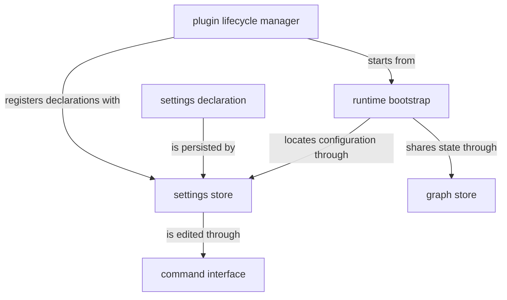

Arrows are source relationships; edge labels retain the XML `operator` field.

### 1. Enter the same chassis

Start Metaform as an installed command, with python -m metaform, or directly from its wheel. The runtime bootstrap prepares an isolated owned runtime when needed and enters the same command contract on Linux, macOS and Windows. The host discovers modules under modules/ even when every feature module is disabled or physically absent. A directly run wheel does not alter an installed copy.

### 2. Resolve settings by state root

The bootstrap locates the authoritative configuration outside the delivered package. Module declarations supply setting keys, types, defaults, descriptions and constraints. The host registers them under module identity, fills missing values, and resolves defaults, saved values and glue. Saved and glued values survive disablement, removal and restoration. Generated feature configuration belongs in writable runtime space.

### 3. Edit and retain compatible state

A keyboard-driven setup screen and equivalent scripted commands inspect, edit, enable, disable, reset and glue settings. Changes are staged for save or discard; help comes from the live declarations. Installed and direct-wheel execution use the same configuration for the same state root. Older and newer 1.x surfaces preserve unknown compatible fields, references, revisions and provenance when reading and writing shared state, without a one-way migration.

**Source joins:** J02, J06, J09, J17, J18, J31.

**Requirements:** REQ-030, REQ-031, REQ-035, REQ-042, REQ-060, REQ-061, REQ-062, REQ-063, REQ-064, REQ-065, REQ-066, REQ-077, REQ-078, REQ-079, REQ-170, REQ-171, REQ-174, REQ-180, REQ-181, REQ-182, REQ-183, REQ-184, REQ-185, REQ-213, REQ-216, REQ-217.

## 02. Module activation and ownership

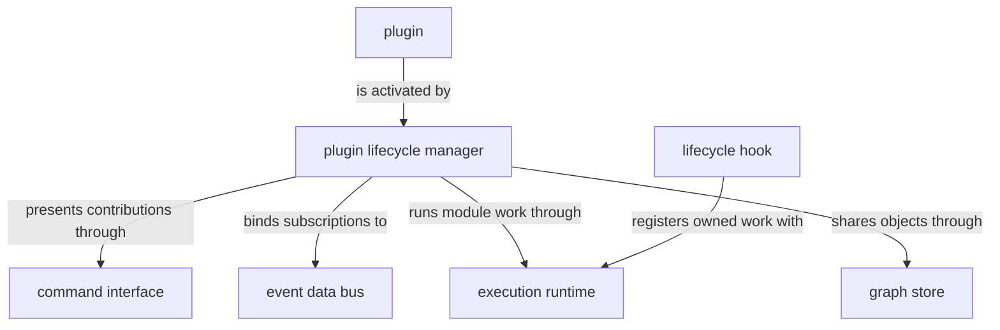

Arrows are source relationships; edge labels retain the XML `operator` field.

### 1. Discover and activate

A module can be one Python file or one contained package. Information readable before import identifies candidates under modules/. Candidates listed in modules/disabled, or unsupported on the current platform, are skipped. Shipped and community modules follow the same activation path. Activation is one owned lifecycle and rolls back on failure.

### 2. Expose the active module

The lifecycle manager presents each active module through its own command menu and binds its event subscriptions. Help, completion, status and invocation resolve the same live capabilities. Chassis administration remains usable when modules are disabled, absent or broken. Modules share namespace objects, receiver-owned typed joins and exact revisioned references; records remain readable after the owning module is removed.

### 3. Track work through unload

Registered operations run synchronously or asynchronously through one runtime. Modules invoke another module's public operation without importing it. Startup and shutdown account for tasks, workers, subprocesses and other owned resources. Unload withdraws commands and subscriptions and tracks work until it actually stops. Requested cancellation and completed cancellation remain distinct. The showcase teaching module demonstrates all services; event_requester and harness_runner follow the same contract independently of showcase.

**Source joins:** J01, J03, J04, J05, J19, J32.

**Requirements:** REQ-013, REQ-016, REQ-017, REQ-018, REQ-030, REQ-033, REQ-034, REQ-035, REQ-036, REQ-037, REQ-038, REQ-039, REQ-040, REQ-041, REQ-042, REQ-053, REQ-054, REQ-071, REQ-072, REQ-077, REQ-090, REQ-091, REQ-093, REQ-094, REQ-095, REQ-100, REQ-107, REQ-108, REQ-110, REQ-201, REQ-202, REQ-214.

## 03. Declaring a module's behavior

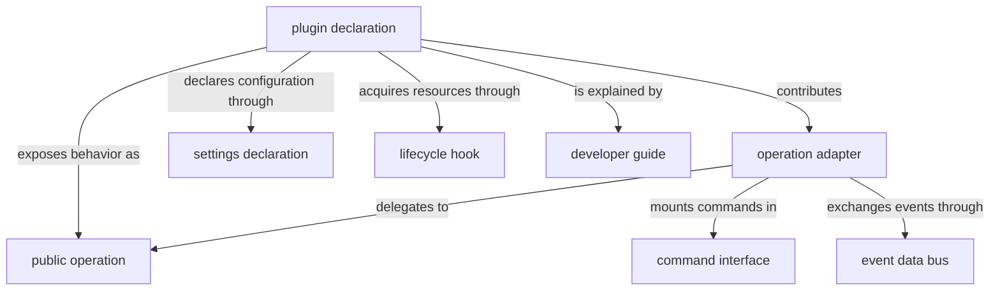

Arrows are source relationships; edge labels retain the XML `operator` field.

### 1. Give each feature one implementation

The plugin declaration exposes behavior as registered public operations inside the module. Operations accept chassis-supplied context and return through the public operation contract, whether synchronous or asynchronous. CLI, events, other modules, MCP, web and workflow steps all reach that same implementation.

### 2. Adapt commands and events

A module contributes complete Click commands, including help and availability predicates, and event subscriptions with their handlers. Each adapter translates its trigger into an operation call. Commands appear inside the module's own menu rather than the chassis root. Direct invocation and help observe the same live state. Events carry managed object references and preserve chassis attribution, including eventual success, failure and cancellation responses.

### 3. Declare configuration and lifecycle

Settings are typed Python declarations, including settings controlling the module's own commands. Lifecycle hooks acquire and release tasks, subprocesses, listeners, caches and sessions; importing a module starts nothing. The developer guide describes purpose, template derivation, declaration, imported services, operations, CLI, settings, events, data ownership, provenance, sync and async behavior, lifecycle, dependencies, platforms, resources, nonce context, installed and direct-wheel execution, and a runnable demonstration.

**Source joins:** J20, J21, J22, J23, J24, J28, J29, J30.

**Requirements:** REQ-032, REQ-038, REQ-040, REQ-041, REQ-054, REQ-060, REQ-071, REQ-072, REQ-074, REQ-077, REQ-093, REQ-095, REQ-096, REQ-097, REQ-200, REQ-203.

## 04. Execution, events and shared data

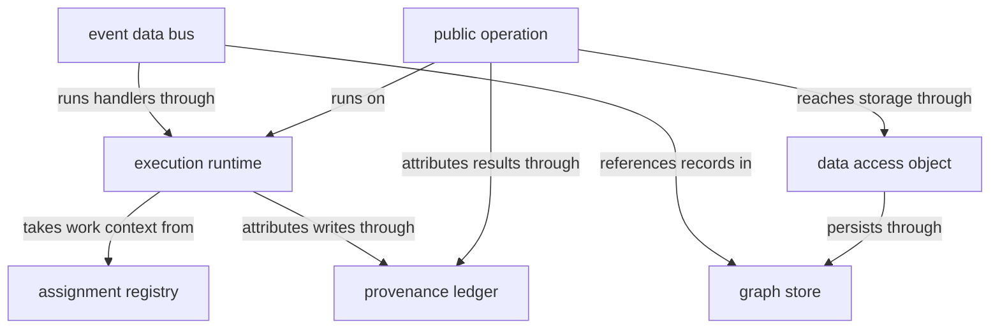

Arrows are source relationships; edge labels retain the XML `operator` field.

### 1. Run with explicit work identity

The runtime carries project, module, operation, assignment, nonce, producer, step and working folder explicitly into each operation. Concurrent operations therefore retain their own context. Blocking or long work is declared for scheduling as a job. The module uses the chassis runtime instead of creating a private event loop, scheduler or second runtime.

### 2. Deliver references and execute handlers

An event announces stored requests, answers or variables through managed references; the records stay in the graph store. Each subscriber's handler runs as attributable work with the event's project and work context. Handler outcomes are recorded independently so a slow or failing subscriber does not block the publisher or another module.

### 3. Persist through the producing operation

Public operations reach domain records through a data access object using metaform.data. They do not open raw SQLite connections or another module's store. Domain types map to namespace objects and owned typed joins, with project, producer and assignment context retained. Modules define their own join types without closing the schema and preserve chassis addresses, revisions and uninterpreted content. Every produced record follows provenance with its actual inputs and real origin, including authored, imported, migrated and deterministic work. Writes cannot continue under an already completed producer.

**Source joins:** J10, J11, J12, J13, J25, J26, J27, J33.

**Requirements:** REQ-017, REQ-039, REQ-040, REQ-050, REQ-051, REQ-052, REQ-053, REQ-080, REQ-090, REQ-093, REQ-095, REQ-096, REQ-097, REQ-100, REQ-102, REQ-103.

## 05. Assignments and exact provenance

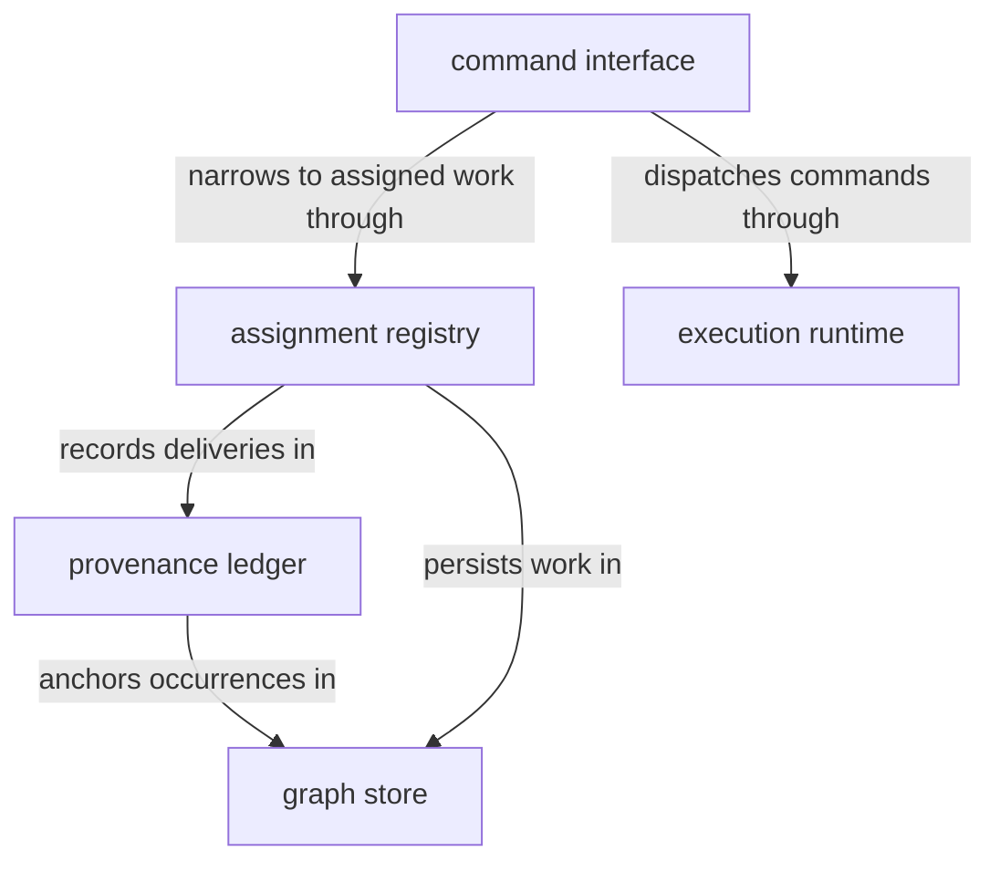

Arrows are source relationships; edge labels retain the XML `operator` field.

### 1. Enter assigned work

A nonce entered at the CLI, or discovered through the hidden working-folder marker, resolves a durable assignment. The command surface then shows the actual instructions, prompt, selected context, knowledge addresses, submission header, status and lifecycle commands for that work. The marker is a discovery reference; the assignment record is authoritative. Leaving the menu leaves the work open.

### 2. Invoke the owning operation

A command is fully specified by arguments or structured input, without requiring an interactive prompt. Dispatch reaches the same owning operation used by the other interfaces and returns structured results separately from diagnostics. Assignments, exact issued prompts and headed submissions are durable project records that outlive their client, transport, process and working folder.

### 3. Record what was actually delivered

The assignment registry records exact revisions received through CLI, MCP, module calls, events and jobs, including context fetched after issuance. The provenance ledger connects prompt definitions, bindings, consumed inputs and outputs at immutable join revisions. Equal content from two runs remains two producing occurrences. References continue to resolve after current content is edited, hidden, moved or deleted, allowing an answer to be traced through its prompt and inserted earlier answers back to the original selected context.

**Source joins:** J07, J08, J14, J15, J16.

**Requirements:** REQ-054, REQ-070, REQ-073, REQ-074, REQ-075, REQ-076, REQ-078, REQ-080, REQ-081, REQ-082, REQ-083, REQ-092, REQ-101, REQ-102, REQ-104, REQ-105, REQ-106, REQ-145.

## 06. Workflow definitions and interpretation

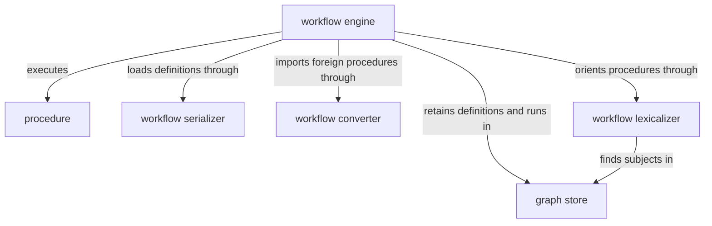

Arrows are source relationships; edge labels retain the XML `operator` field.

### 1. Load an authored procedure

The workflow engine executes the maintained Canonical Intake, Native then Latent, through the same engine as any other authored workflow. Its terminology, response protocol, annealing and completion semantics stay intact. The declared target forms are URL, Type and inline content. Later operations can deepen an element, join, branch or bounded region.

### 2. Keep three transformations distinct

Serialization round-trips the canonical representation through XML, JSON and Markdown without inference. It preserves execution meaning, bindings, order, repeated content, attributes, mixed text, schemas, aliases and section names; the XML mapping names ElementTree. Conversion is a separate reasoning task that interprets an external procedure into steps, handoffs and earlier-output-to-later-input relationships while retaining the original source. Lexicalization is an explicit agent task that binds procedural nouns to this project's namespace objects. Import alone does not lexicalize.

### 3. Retain definitions and runs separately

The lexicalizer resolves objects by namespace address and readable name, inserts inspectable references, preserves the source definition and records a new revision. Definitions and runs remain independent revisioned records. Editing a step creates a new definition revision; replay from the edited point reuses earlier retained outputs while preserving the earlier run and its references.

**Source joins:** J34, J35, J36, J37, J42, J51.

**Requirements:** REQ-013, REQ-020, REQ-021, REQ-022, REQ-024, REQ-025, REQ-140, REQ-141, REQ-142, REQ-143, REQ-144, REQ-146, REQ-147.

## 07. Issuing steps and continuing work

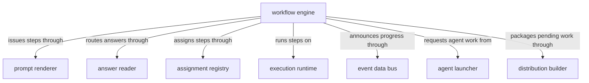

Arrows are source relationships; edge labels retain the XML `operator` field.

### 1. Issue an exact step

The engine renders authored text together with resolved bindings, selected knowledge, applicable rules, the object index, imperatives and the submission header. It stores the exact prompt actually delivered, keeping inserted contributions distinguishable from authored text. An issued step has a nonce; a headed submission identifies the assignment to which the answer belongs.

### 2. Continue according to the procedure

Agent steps, tools, branches, loops, parallel work and nested handoffs run as asynchronous jobs with retained continuation state. They survive the initiating client and return later without blocking unrelated activity. Submit, advance, complete, abort and navigation exit remain distinct operations. An authored human wait stays open until a person answers. Step issue, completion, failure and cancellation are announced as events, while sequence, branching and synchronization remain the engine's responsibility.

### 3. Choose the execution setting

The engine can request a configured harness through the shared request-and-eventual-response pattern, or an agent already inside a harness can enter the nonce itself. Answers are routed where the authored workflow specifies. When work must move elsewhere, the workflow module prepares the workflow and pending assignment for upload; generic distribution and runtime services build the delivery wheel.

**Source joins:** J38, J39, J40, J41, J43, J44, J45.

**Requirements:** REQ-021, REQ-023, REQ-040, REQ-076, REQ-081, REQ-082, REQ-087, REQ-090, REQ-091, REQ-092, REQ-096, REQ-097, REQ-140, REQ-143, REQ-145, REQ-148, REQ-149, REQ-150, REQ-211.

## 08. Rendering prompts with selected context

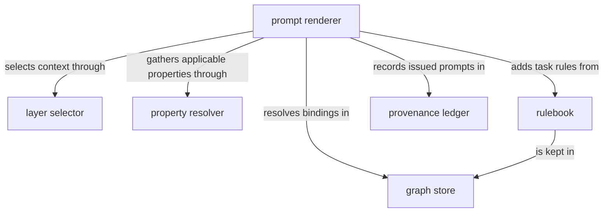

Arrows are source relationships; edge labels retain the XML `operator` field.

### 1. Resolve bindings at exact revisions

The prompt renderer resolves inline references to namespace objects, owned joins, knowledge, variables and prior outputs. Readable names come from name_length, while bindings retain object identity and exact revisions instead of becoming copied prose. Preview and issue use the same renderer.

### 2. Assemble the applicable knowledge

The renderer asks the knowledge module which contributions are selected at each bound object. Workflow selection and namespace masks apply consistently to direct objects, properties, providers and workflow paths. Property resolution uses placement between trunk and leaf, so a property such as an installer's language applies to the relevant objects without leaking into unrelated branches.

### 3. Add task rules and retain the snapshot

The rulebook supplies semantic rules keyed to the operation, including their concise statements, explanations, examples and teaching distinctions. These can govern intake or the import of a prompt or workflow. Rules are revisioned graph records, discoverable and editable through the common object interface with CLI access independent of web. The renderer records the prompt definition and revision, rendered text, variables, bindings, consumed revisions, selected layers, answer, outputs and links to prior producing occurrences. Later rule edits affect later work, not an already issued snapshot.

**Source joins:** J46, J47, J48, J49, J50, J54.

**Requirements:** REQ-013, REQ-101, REQ-102, REQ-121, REQ-122, REQ-130, REQ-131, REQ-132, REQ-133, REQ-134, REQ-143, REQ-145.

## 09. Reading and retaining answers

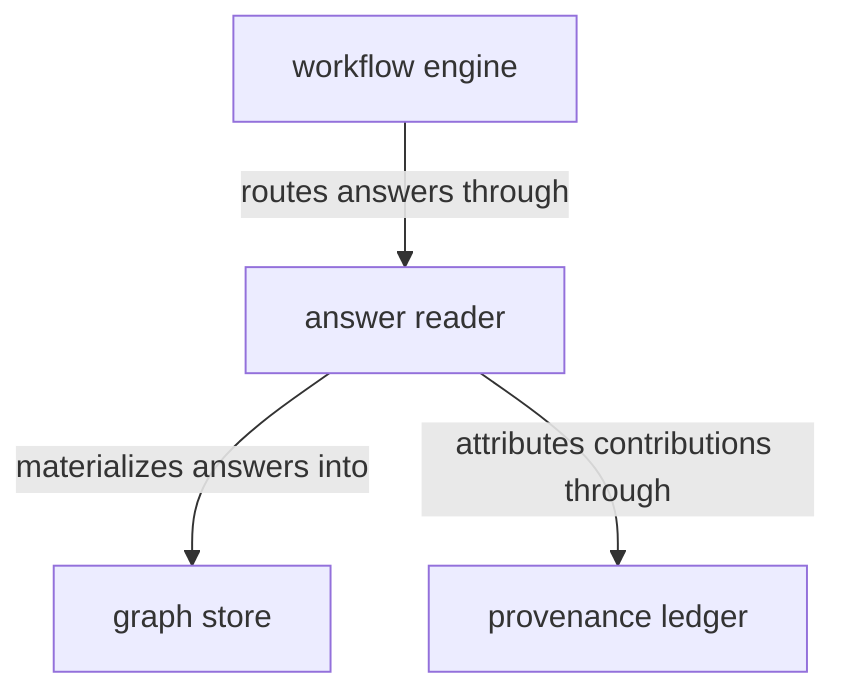

Arrows are source relationships; edge labels retain the XML `operator` field.

### 1. Keep the answer before interpretation

An answer belongs to a stored assignment and is routed according to the authored workflow. The answer reader retains the exact submitted answer even when it cannot be read. Mismatches are recorded alongside it, preserving the evidence for inspection instead of losing the response.

### 2. Materialize the authored structure

For an intake answer, the reader writes namespace elements and receiver-owned joins with their encounter functions. Open authored fields remain available. Annealed positions remain addressable as inactive records rather than being deleted. A structural correction is an explicit revision recording the previous state, the new state, the reason and the evidence.

### 3. Attribute Native and Latent separately

Native and Latent outputs remain separate producing contributions. Latent findings attach to the subjects they concern, with their own provenance. The retained answer, the graph records created from it and the occurrence that produced them therefore remain distinct but connected. This gives later review access both to what the agent actually submitted and to how that answer became project knowledge.

**Source joins:** J39, J52, J53.

**Requirements:** REQ-012, REQ-014, REQ-015, REQ-016, REQ-021, REQ-023, REQ-025, REQ-026, REQ-140, REQ-211.

## 10. Layer selection and property placement

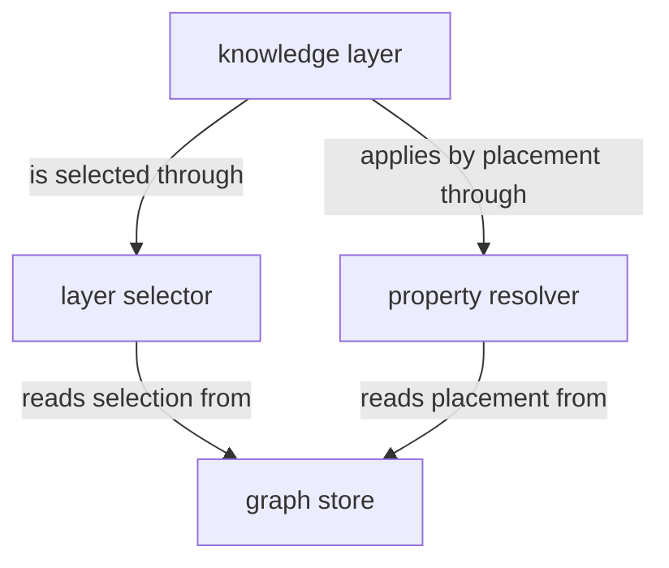

Arrows are source relationships; edge labels retain the XML `operator` field.

### 1. Start with project selection

A project supplies the initial knowledge selection. At each object, selection is computed from the inherited selection, the local mask and the local selection. The specified rule is outgoing selection = (incoming selection AND local mask) OR local selection. Evaluation proceeds from trunk to leaf. A descendant can select a layer again after an earlier mask.

### 2. Resolve what applies at this object

The layer selector reads stored selections and masks from namespace objects along the path. The property resolver reads property joins and their placement. Knowledge on a property or provider applies to the objects that placement covers, forward to named branches and back toward the trunk, under the same selection mechanism. An unselected layer cannot enter indirectly through a provider.

### 3. Keep unresolved selection explicit

An unsupported selector stays stored and is reported instead of widening to project defaults. The resulting selection answers which contributions enter this particular operation at this particular object. Selection and placement are separate decisions: one determines whether a contribution participates, while the other determines which subjects its position makes it applicable to.

**Source joins:** J55, J56, J61, J62.

**Requirements:** REQ-121, REQ-122, REQ-123.

## 11. Knowledge, memory and dependency visibility

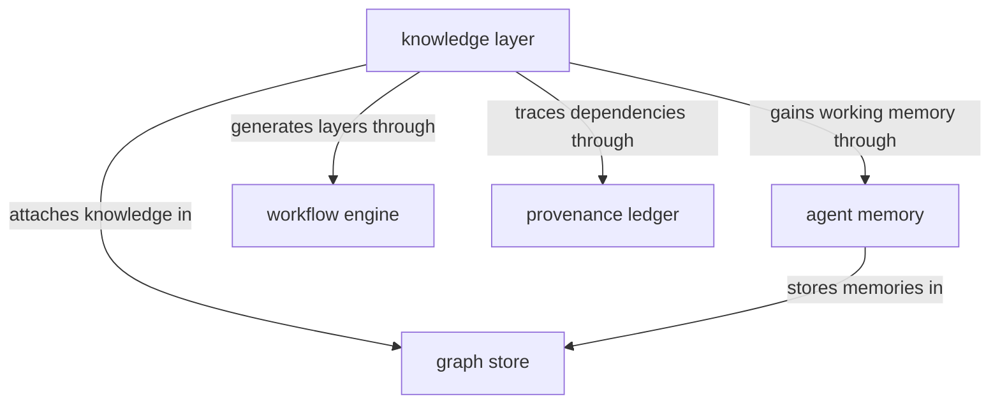

Arrows are source relationships; edge labels retain the XML `operator` field.

### 1. Attach knowledge where it explains

A knowledge contribution is a typed join on the element or owned join it concerns. Attachment location is kept separate from the inputs that caused the contribution. An authored request can be applied to every selected object and owned join through the workflow engine, for example best practices per object or blind spots per join; each answer attaches to its own subject.

### 2. Use memory as selected knowledge

Agents record what they learn against the elements and joins they are working with. Memory is editable knowledge governed by the same layer-selection mechanism. Common memory operations create, read, search, update and delete it through CLI, MCP and web. Each memory is a revisioned join at an existing address, preserving the historical revision consumed by an earlier prompt when current content changes.

### 3. Follow actual inference dependencies

Provenance records only nodes, properties, prior knowledge and revisions actually included in the producing prompt, not everything that was available. Hiding a consumed source hides dependent inference transitively while keeping it stored. Restoring one source leaves other hides in place. The source separately states that removing one memory hides nothing else; this walkthrough preserves that specific memory behavior rather than extending the broader visibility rule to memory removal.

**Source joins:** J57, J58, J59, J60, J63.

**Requirements:** REQ-010, REQ-016, REQ-040, REQ-106, REQ-120, REQ-124, REQ-125, REQ-126, REQ-127, REQ-128.

## 12. Artifact history and reconstruction

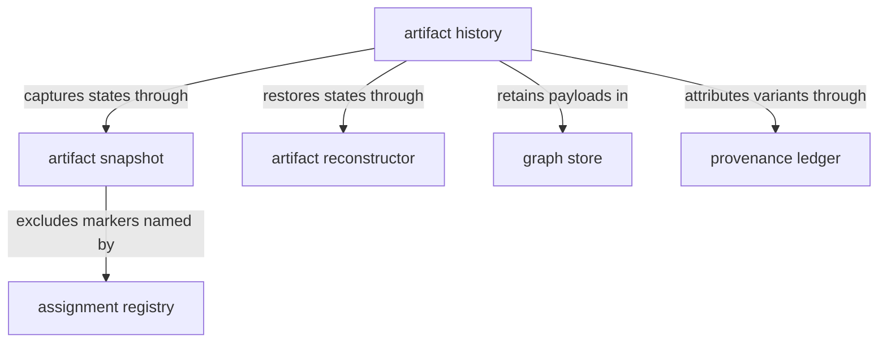

Arrows are source relationships; edge labels retain the XML `operator` field.

### 1. Fix an explicit origin

Select an artifact boundary and capture it consistently for baseline, change, comparison, reconstruction and export. The boundary includes tracked, untracked, ignored, binary, added, removed and renamed content, plus applicable metadata. A Git origin retains the selected commit's bytes; a folder origin retains an equally explicit baseline. Later work does not overwrite an origin. Experiments remain sibling variants.

### 2. Retain variants and their origin

The history module stores origin identity, baselines, variant payloads and their references under project ownership. Recoverable payload writes prevent an interruption from leaving half-replaced content. Each variant is attributed to the producing occurrence that actually made it. Context, nonce, discovery, runtime and navigation markers are identified through assignment context so they are excluded from artifact edits and reconstruction.

### 3. Reconstruct without the original environment

The artifact reconstructor rebuilds a selected origin or variant from the retained baseline and changes. It restores text, binary and filesystem content using Python alone, without the originating repository or a Git executable. Export can therefore carry the exact artifact states needed to continue elsewhere rather than depending on access to the original working copy.

**Source joins:** J64, J65, J66, J67, J68.

**Requirements:** REQ-011, REQ-102, REQ-109, REQ-160, REQ-161, REQ-162, REQ-163.

## 13. Distribution and portable continuation

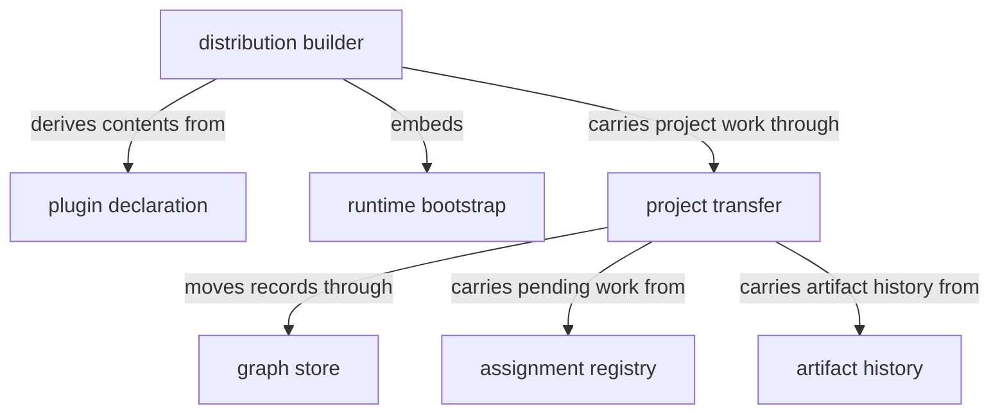

Arrows are source relationships; edge labels retain the XML `operator` field.

### 1. Build from selected declarations

The distribution builder reads each selected module's implementation, owned resources, dependencies and platform limits from its declaration. A wheel contains exactly the selected modules; a zero-module wheel contains only the chassis. Built-in names receive no special treatment, and native content receives an accurate platform tag.

### 2. Carry the work needed to continue

Project transfer gathers the selected work's necessary closure: project knowledge, eligible referenced global knowledge, exact historical contributions, rules, prompts, workflow definitions, artifact payloads and pending assignment state. A pending assignment includes its dedicated workfolder, staged inputs, generated outputs and binaries. Origin baselines and the variants needed for reconstruction travel with it. Unrelated project content is excluded.

### 3. Run and merge with identity intact

The delivered wheel runs as python /path/to/metaform.whl, cold and offline without installation, checkout, network access or a prepared cache. A hosted agent can fetch its assignment, reason in its own context and submit in separate invocations. Export and import preserve object, join, revision, project and provenance identities. Coordinated import writes preserve complete state during interruption; conflicts are reported with both histories visible rather than replacing one. The bootstrap enters the same command contract without altering an installed copy.

**Source joins:** J69, J70, J71, J72, J73, J74.

**Requirements:** REQ-036, REQ-040, REQ-107, REQ-109, REQ-163, REQ-164, REQ-165, REQ-170, REQ-171, REQ-172, REQ-173, REQ-174, REQ-175, REQ-176, REQ-177, REQ-215.

## 14. Launching an agent harness

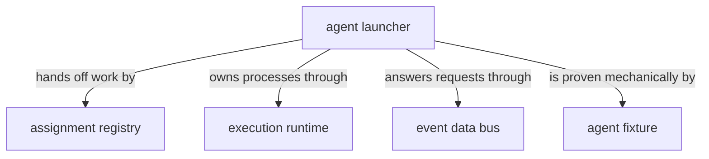

Arrows are source relationships; edge labels retain the XML `operator` field.

### 1. Hand off the reference to work

The launcher gives a configured Codex, Claude or other harness only the nonce and the Metaform invocation. The agent retrieves the exact stored assignment itself, avoiding a paraphrased handoff. A request from any requester module carries a stored request reference on the shared event bus.

### 2. Launch and return asynchronously

The launcher queues the harness job and returns immediately. The runtime owns the asynchronous process and its descendants through actual exit and returns a durable receipt. Success, failure, requested cancellation, completed cancellation and interruption are distinct outcomes. A stored response reference is published for success, failure and cancellation so the requester receives the eventual result through its subscription.

### 3. Exercise the same mechanics locally

The agent fixture deterministically exercises launch, nonce entry, headed submission and response without credentials. Its outcome is identified as a fixture run, never a provider run. The event_requester and harness_runner teaching pair demonstrates both sides of request and response through the same module contract, independently of the broader showcase module.

**Source joins:** J75, J76, J77, J78.

**Requirements:** REQ-081, REQ-087, REQ-091, REQ-093, REQ-094, REQ-096, REQ-202, REQ-212.

## 15. MCP and terminal adapters

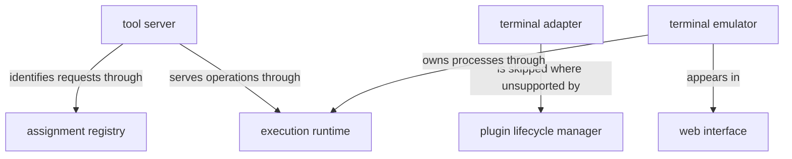

Arrows are source relationships; edge labels retain the XML `operator` field.

### 1. Resolve each MCP request independently

The tool server takes a nonce from the designated Metaform header, or from an explicit argument when the transport has no headers. It resolves that request to the assignment, project, workfolder and producer. One server process can interleave many assignments; process or connection identity does not stand in for work identity.

### 2. Expose the common operations

MCP invokes the same owning operations as the CLI, delivering the same assignment, actual prompt, references, selected knowledge and memory, lifecycle and submission contract. It does not replace the CLI or implement a separate feature path.

### 3. Add a platform-specific browser terminal

The terminal adapter is a separate optional module. Its declared platform limits are read before platform-specific imports, so unsupported environments skip it without changing the chassis or web module. Its emulator contributes a browser terminal for a shell or coding agent to the web interface. Each shell or agent process is registered under its owning module, tracked through the shared runtime and released at unload.

**Source joins:** J79, J80, J88, J89, J90.

**Requirements:** REQ-037, REQ-042, REQ-054, REQ-080, REQ-084, REQ-085, REQ-086, REQ-093, REQ-196.

## 16. Web inspection and workflow editing

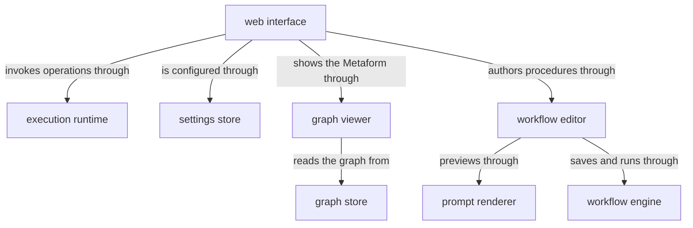

Arrows are source relationships; edge labels retain the XML `operator` field.

### 1. Use the same operations and state

The web interface presents the same module operations, work identity, references, provenance and durable state as CLI and MCP. It has no private workflow or data path. It remains removable while CLI, data, workflow, memory, provenance and administration continue to work. Module settings own bind, port, token access and an explicitly enabled trusted-environment bypass; unauthenticated non-loopback access is never the default. One instance serves the tracked projects of one state root.

### 2. Inspect the live graph

The graph viewer reads the current project's namespace objects, receiver-owned joins and layer attachments through the shared object service. It displays stored relationships and names decoded with name_length. Details and attached layers are inspectable. Stable positions, pan, zoom and keyboard movement support navigation. Updates as agents record work preserve camera position, selection and unfinished text.

### 3. Edit procedures with bindings intact

The workflow editor lets a person change surrounding prompt text while inline object identities, selected contributions and exact revisions remain inspectable. Bindings do not become copied prose. Preview uses the same renderer that issues a step. Saving creates new definition revisions, while starting, inspecting and continuing runs uses the workflow module's public operations.

**Source joins:** J81, J82, J83, J84, J85, J86, J87.

**Requirements:** REQ-054, REQ-143, REQ-145, REQ-146, REQ-190, REQ-191, REQ-192, REQ-193, REQ-194, REQ-195.

## Combined subtypes

The XML nests these declarations inside purpose joins. This table preserves their containing target, decoded name and operator without adding a separate source-to-subtype edge to the diagrams.

| Containing join target | Combined entity                  | Operator    |
| ---------------------- | -------------------------------- | ----------- |
| command interface      | administration command interface | administers |
| execution runtime      | job execution runtime            | tracks      |
| execution runtime      | process execution runtime        | owns        |
| graph store            | mirror graph store               | places      |
| command interface      | configuration command interface  | edits       |
| operation adapter      | command operation adapter        | parses      |
| operation adapter      | event operation adapter          | handles     |
| artifact snapshot      | origin artifact snapshot         | fixes       |
| artifact snapshot      | variant artifact snapshot        | records     |
| project transfer       | export project transfer          | gathers     |
| project transfer       | import project transfer          | merges      |

## Traceability and coverage

**Source document:** `metaform-metaform.xml`  
**Result ID:** `metaform-intended-shape-20260918-417d3a2b`

The J01-J90 labels are document-local references assigned to purpose joins in XML order. Requirement identifiers are copied from each selected join's `refs`. They have not been independently checked against an external requirements document.

The source contains 10 top-level entities, 61 unique named namespaces, 90 purpose joins and 11 combined subtype declarations. The 16 subsystem views cover every purpose join. J39, the workflow engine's answer-routing relationship, appears in both the step-issuance and answer-reading views. Diagrams omit the long `data` and `function` attributes visually; the walkthrough explains their functional substance.

The source's full behavior remains authoritative. In particular, the general inference-hiding rule and the specific memory-removal behavior are both retained in subsystem 11. This walkthrough does not resolve that distinction by adding behavior. References to other documents and requirement IDs establish traceability, not evidence that those external materials were read.
