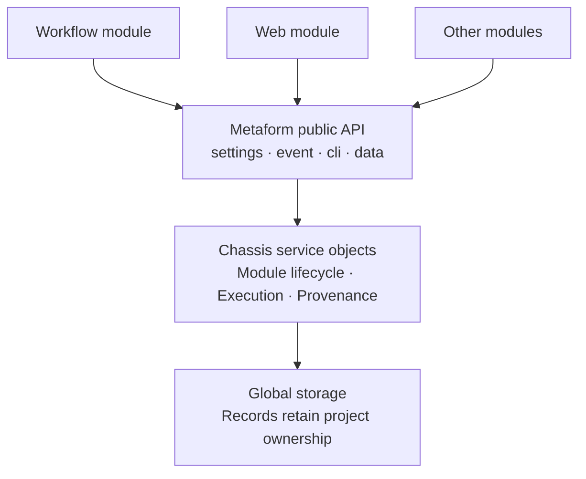

# Metaform chassis and plugin system specification

> **Superseded plan/specification — retained evidence.**
> [REQUIREMENTS.md](REQUIREMENTS.md) is the complete governing contract.
> Its [section 20](REQUIREMENTS.md#20-remediation-instructions) authorizes
> active outside-in remediation, tracked in the [live matrix](REMEDIATION-MATRIX.md).
> The earlier tasks, authority statements, technology choices, open questions and
> completion claims below add no requirements and impose no continuing pause.
> They remain useful as historical implementation and verification evidence.

Date: 2026-09-15

## Status and authority

This file collects the plugin-system requirements established in the design-recovery conversation, including the capabilities the plugins and chassis must support. It accompanies the [recovery plan](../docs/superpowers/plans/2026-09-15-chassis-plugin-recovery.md).

The requirements below record Rich's decisions. Sections explicitly marked **Proposed implementation** are concrete engineering recommendations, not additional settled product behavior. The supplied Python/SQLite/Click snippet is an unchecked starter: Rich subsequently instructed us to use it loosely and build what the project needs. Its example names, UUID scheme, environment variable, directory condition, and two-table layout do not become requirements.

Latest corrections take precedence over older implementation-oriented documents. The [September 15 handoff](../docs/handoff/2026-09-15-design-recovery.md), [SPEC](../docs/SPEC.md), and [data-folder account](data_folder.md) provide earlier context, with the historical limitations noted below. This specification describes intended behavior; it does not certify the current checkout.

## Current chassis implementation

The [chassis product specification](chassis-product.md) and
[public module API](../docs/plugin-api.md) record the now-settled service and hook
signatures, persistent host, drop-in discovery, authoritative `plugins/disabled`
file, module-owned settings/help, glued baselines, and terminal setup menu. Use
those documents for the current implementation where the earlier proposals below
leave these details open.

This broader specification also covers subsequent feature work. Intake, workflows,
MCP adapters, graph layers, and complete origin/variant reconstruction have not
been migrated merely by implementing the chassis and its demonstration modules.

## 1. Purpose

Build a community-extensible Metaform platform with executable Python modules connected to concrete chassis services. The chassis must support Metaform's functional semantics, project inference, knowledge layers, prompt objects, and authored workflows. A small first implementation demonstrates the full architecture's contracts; it does not define the limits of the intended chassis.

The base Metaform is a coarse map of an artifact by its Element Types. More specific relationships and detail enter through Receiving Entity-owned joins. Further inference extends that account through attached objects and knowledge layers, giving subsequent work addressable project understanding.

Functional execution and semantic conformance both matter. A working command that implements a different interpretation is not completion.

### Architectural pattern

Metaform uses a **microkernel (plugin) architecture with shared object services, explicit operations, and an event bus**. The stable chassis supplies infrastructure; external, dynamically loaded modules supply features. This names the architecture established by the requirements below.



Modules depend on the public chassis contract. The chassis discovers their contributions through that contract and retains its independence from particular feature implementations. Storage, provenance, execution, and module management are focused service objects composed into the runtime.

The following mapping relates this design to the vocabulary in the supplied [Python patterns catalog](https://github.com/faif/python-patterns). It describes the purpose of each pattern here; concrete Python APIs remain governed by the public contract.

| Pattern | Role in Metaform |
| --- | --- |
| Facade | Public imports expose convenient interfaces to chassis services. |
| Registry | Tracks modules and their command, operation, setting, and subscription contributions. |
| Command | Represents an operation and its arguments for invocation through CLI, MCP, workflows, or web. |
| Publish–subscribe | Delivers events to dynamically registered sync/async handlers. |
| Adapter | Connects harnesses and transports to the shared execution contract. |
| Dependency injection | Supplies service instances and operation/assignment context when activating modules and invoking work. |

The global instance is a deployment choice. Service objects remain independently constructible for isolated tests. Async describes execution behavior across these services and module hooks.

The knowledge system has a blackboard-like aspect: agents contribute to shared, addressable knowledge. Metaform's namespace, RE ownership, provenance, and layer-selection rules define that knowledge structure; authored workflows retain their explicit execution semantics.

## 2. Requirements inventory

| ID | Requirement |
| --- | --- |
| R01 | Preserve Metaform's Type semantics, receiver-owned Operative Purposes, Encounter Functions, naming rules, and authored workflow intent. |
| R02 | The immutable chassis owns concrete services: object-oriented provenance, module management, settings, an event bus, a CLI template surface, context/assignment tracking, and shared storage/execution access. |
| R03 | Features are chassis-external, dynamically loaded Python modules. Built-in and community modules use the same public extension contract. Removing a feature leaves the chassis and unrelated features functional. |
| R04 | Build the command surface dynamically from persisted module/context state and live loaded module objects. Particular modules' command trees are supplied by those modules. |
| R05 | Expose chassis hooks through which modules participate synchronously, asynchronously, or both. Agent work is asynchronous. |
| R06 | Support both calling a harness directly and operating inside an already-running harness. Preserve harness universality. |
| R07 | A nonce retrieves assigned work. The delivered instructions supply a submission header. Answers must carry that header; submissions missing it are rejected. |
| R08 | `-h` and `--help` show contextual status and available commands. A bound agent sees its work surface until submission/finalization or abort. |
| R09 | CLI invocations recover assignment context from the working path and hidden nonce file; agent entry asks for a nonce when none is available. CLI completion can clear the local binding. |
| R10 | Initially use one global data root in the user folder and one database for Metaform state across tracked folders and repositories. Store project records, provenance, assignments, and edit copies globally, retaining project ownership. Source files stay in their existing locations. Storage placement can evolve after this initial implementation. |
| R11 | Each namespace object is its own record, identified by `namespace_address` at the top. The bases are `code`, `document`, `asset`, `data`, and `exterior`. |
| R12 | Joins remain with their Receiving Entity inside its namespace-addressed record. Join dictionaries contain typed entries that can express logic, including Layer Select and Layer Select Mask. |
| R13 | Project and workflow layer selection observe the same object masks and established priority direction. Each layer also has a general-graph visibility flag. |
| R14 | Hiding an object also hides knowledge layers derived from that object, including dependent inference. Provenance supplies those dependencies. |
| R15 | Convert workflows into native format. Use ElementTree for XML-to-dictionary conversion; XML and JSON must round trip. |
| R16 | Preserve imported workflow text and authored behavior. Explicit lexicalization attaches namespace objects to prompt language. The GUI edits workflows and resolves inserted context as objects. |
| R17 | Intake is an actual workflow executed by shared workflow machinery. Other authored inference operations can use that same machinery. |
| R18 | Provide agent memory as a basic feature: an agent can create and maintain a memory layer indexed by the Metaform. |
| R19 | Every produced record is traceable through object-oriented provenance to its producer, prompt, bindings, inputs, and answer. |
| R20 | Modules supply usable help and guidance. Community developers receive a documented public contract and working examples on both sides of the sync/async boundary. |
| R21 | Every functional operation is available through the CLI with the web and MCP plugins absent. The workflow module owns preparing workflows for upload and execution through the wheel's entrypoint in web-based environments, using the chassis's common entrypoint and services. Preserve installed and portable operation. The advanced remote work-packet capability remains a future module. |
| R22 | The web service is global: one instance, one port across tracked folders and repositories. Its dynamically loaded workbench features expose graph/context, workflow steps, live job activity, prompt editing, and provenance inspection. The web experience should remain current with modern capabilities. |

## 3. Chassis and module responsibilities

### Chassis services

The chassis owns module state and lifecycle, structured administration and settings, the CLI presentation template, contextual discovery and dispatch, assignments and nonce lookup, process/work tracking, namespace-object access, provenance, and the shared execution boundary. Existing project and storage ownership remain part of this responsibility.

Chassis administration is legitimate chassis functionality. The fault to remove is embedding particular plugins' capabilities and menus in the chassis. A loaded module contributes those capabilities through the public interface.

Object-oriented provenance must be part of the initial service model, including module operations. Appending an unrelated log after executing arbitrary callbacks does not establish the requested provenance relationships.

### Module contributions

Features live outside the chassis and load dynamically, including the web interface, workflow authoring/execution features, knowledge tools, memory, and harness integrations. Shipping a feature with Metaform does not make it a chassis dependency. Removing that feature removes its capabilities while leaving the chassis and unrelated modules usable. The chassis retains the concrete shared responsibilities above and exposes the hooks those features use.

Modules contribute executable operations, their parameter definitions, CLI commands/help, settings and guidance, workflow definitions, and integrations with the chassis services. A harness integration connects agent execution to those same services. Modules can supply typed join-entry logic and knowledge-producing operations.

The extension contract must specify the entry point, hook signatures, lifecycle ownership, execution context, return values, and how a module accesses chassis services. Storage is accessed through that public interface. Built-in modules follow it too.

### Public Python service imports

The chassis is Metaform. Plugins access its public services through this import surface:

```python
from metaform import settings, event, cli, data
```

`settings` exposes settings registration and access, including contributions to the chassis settings menu. `event` exposes event publication and subscriptions. `cli` exposes command contributions to the contextual CLI. The chassis owns these services and their lifecycle; feature implementations remain external modules. Exact methods and signatures are part of the public contract to implement.

`data` exposes access to namespace records, RE-owned joins, and stored results through chassis storage and provenance services. It carries the relevant project/operation context and uses the initial global store. Modules access records through this service; physical placement remains a chassis responsibility. Its sync/async access methods will follow the shared execution contract.

The imported interfaces reach the active chassis services with the relevant module and operation context. Project/assignment identity belongs to each operation; simultaneous agents must retain their individual contexts. Importing a service interface does not create a separate global store or runtime for that plugin.

### Event bus

The chassis provides an initially in-process event bus in the global runtime. Modules register subscriptions dynamically; unloading a module removes its subscriptions. Sync and async handlers execute through the shared runtime. Direct operations return requested results; events announce changes to interested modules.

Events identify the publishing module, project, assignment nonce when applicable, provenance, and affected record references. Data remains in chassis-managed records. A stored contribution can publish an event that the web module uses to update its view and other subscribed modules use for their work. Handler failures remain attributable to the subscribing module.

CLI and MCP adapters reach that global runtime through their interfaces. The event bus carries notifications; the workflow engine retains ownership of explicit step progression and synchronization.

### Proposed implementation: hook families

| Hook family | Module supplies | Chassis supplies |
| --- | --- | --- |
| Load/lifecycle | A live Python plugin object and initialization/teardown hooks as needed | Resolved module identity, settings, service access, lifecycle management |
| Commands | Click command objects, parameters, help, and any context-dependent availability function | The contextual root, status/help template, command lookup and invocation |
| Settings | Feature setting definitions and menu contributions | Settings registration, persistence, lookup, and the chassis settings menu |
| Events | Published events and sync/async subscriptions | Event dispatch, operation context, failure attribution, and subscription lifecycle |
| Operations | Named sync/async callables and their data contracts | Assignment context, execution scheduling, result/provenance recording |
| Workflows | Native definitions and conversion/lexicalization operations | Definition and prompt revisions, assignment issuance, shared execution |
| Knowledge | Memory operations, inference operations, and typed entry handlers | Namespace resolution, RE-owned join access, layer attachment and provenance |
| Harness | Direct launch or in-harness interaction implementation | Work identity, prompt/header delivery, asynchronous lifecycle tracking |

These are proposed interface boundaries. They do not impose an arbitrary closed list of application behaviors or inference-output conditions.

## 4. Dynamic Python modules and Click

### Recorded design

SQLite records module management state and assignment/context relationships. Loaded Python module objects supply current capabilities. Runtime command registration is rebuilt from those objects; a persisted command manifest is not the executable plugin contract.

### Proposed implementation

Use a custom `click.Group` for contextual `list_commands` and `get_command`. Click merged `MultiCommand` into `Group` in 8.2; the current API recommends the latter extension point. This preserves the starter's dynamic multi-command design. [Click API](https://click.palletsprojects.com/en/stable/api/#click.Group)

Allow modules to supply complete Click commands, including arguments, options, types, defaults, and nested groups. Pass the chassis execution context through Click's context object. This answers the starter's parameter question: command signatures belong to the module; the chassis does not hardcode each module's arguments. The CLI callback delegates work to the shared operation interface so MCP and web callers can invoke the same behavior.

Resolve available commands once for the current invocation and use that resolution for both enumeration and named invocation. A command omitted from the active surface is not reachable merely by guessing its old name. Apply the same context during help and completion. Click can load commands during help and completion as well as invocation. [Click complex applications](https://click.palletsprojects.com/en/stable/complex/)

Initialize the read-side context before eager help processing. Put persistent initialization and discovery updates in their proper lifecycle, not in a root callback that help bypasses. Help reads the current state without creating an assignment or touching its activity timestamp, consistent with the documented help behavior.

A module's conditional availability callback describes availability in the execution context. The starter's `secure_zone` string check is an illustration, not a Metaform rule. No new inference-content conditions follow from conditional CLI discovery.

Use the documented module roots and installation model when choosing loader paths. Installed Python entry points are an optional packaging proposal; self-contained module folders remain supported. A `PLUGIN` export can hold a live object, but the final public export shape is an API decision rather than an obligation to reproduce the starter's dictionary.

Loading Python executes its module body. A loader cannot guarantee that arbitrary imports have no side effects. Module-author guidance must separate defining capabilities from executing work. [Python importlib](https://docs.python.org/3/library/importlib.html#importing-a-source-file-directly)

## 5. Assignment entry and contextual CLI

The orchestrator supplies an agent with its nonce and the Metaform command. Metaform retrieves and delivers the actual assignment; the orchestrator need not restate its prompt.

The normal interaction uses independent command invocations. Continuity is persisted; an interactive shell loop or exported environment variable is not required. The CLI reads the working path and hidden nonce file to recover assigned work. If the agent is entering work without a nonce, Metaform asks for it. The starting chassis administration surface and the bound agent surface are distinct contexts.

Once bound, the available surface is the current module/workflow's work surface plus applicable chassis lifecycle operations. Running Metaform displays status, the current step, its prompt and instructions, the required submission header, and direct knowledge addresses. Both help spellings show contextual status and commands. Exiting the module/workflow context restores the chassis context.

An assignment delivery contains:

- The assigned workflow or agent-facing module and current step.
- Its prompt, handoff instructions, and applicable appended imperatives.
- Namespace references and knowledge addresses, with the active layer context.
- The nonce and the header to include with answers.
- The contextual means to submit/finalize or abort.

These are required information, not a finalized serialized header schema.

### Submission and cleanup

Missing submission headers are rejected, as explicitly requested. The header identifies the assigned work; a server PID is process metadata rather than sufficient logical-agent identity.

MCP tool arguments and CLI structured input provide submission routes. The CLI supports the complete assignment journey itself. CLI submission/finalization provides a natural place to clean up the local nonce file and active binding. Rich suggested making that final CLI step mandatory; the exact distinction between recording an intermediate answer and ending the active assignment remains a lifecycle decision.

**Proposed implementation:** record data through CLI or MCP, with finalization available through the CLI. The completion operation records durable completion before clearing the active marker. It preserves answers, provenance, and workflow history. Abort leaves the work context through its own lifecycle path. For multi-step work, distinguish progressing a step from ending the nonce's assignment before implementing cleanup.

## 6. Sync/async execution and harnesses

Modules may expose sync operations, async operations, or both. Agents participate asynchronously. The system both invokes harnesses directly and operates from inside existing harnesses.

**Proposed implementation:** the shared runtime owns active operation/assignment lifecycle and awaits agent work. A synchronous module callable runs through an execution adapter appropriate to that callable; blocking work must not monopolize the async loop. Async callables execute on the runtime's loop. Thread/process ownership of resources and cancellation semantics must be explicit in the SDK contract rather than hidden inside a generic call-and-check-for-awaitable wrapper.

Direct execution launches the harness through an adapter and follows the assignment asynchronously. In-harness execution delivers work through CLI/MCP and awaits the agent's submissions. Both use the same stored assignments, submitted header, prompt bindings, and provenance. Neither requires a vendor-specific agent identifier in order to route a correctly headed answer.

Each MCP server records its PID and relevant assignment/nonces for work tracking. A shared process may handle more than one agent's work. Parent PID, working directory, or a transport connection must not silently substitute for the submission's work identity.

Protocol-version compatibility is an integration concern: the earlier session-bound initialization model and the 2026-07-28 per-request model differ. The portable Metaform interaction is the nonce/header supplied in ordinary calls. Custom harness metadata injection is not required. [Current MCP request model](https://modelcontextprotocol.io/specification/2026-07-28/basic#statelessness)

## 7. Persisted state and existing data folders

The [global data pattern](global-data.md) adapts `specs/data_folder.md` into the initial all-global design: one index/database, origin identities, retained variants, producing-operation provenance, import preservation, and reconstruction through workflow delivery. It includes a proposed physical layout and focused recovery checks.

The initial implementation uses one global data root in the user folder and one database for Metaform state. Global tracks folders and repositories and stores their Metaform records, provenance, assignments, and edit copies. Source files stay in their existing locations. Records retain their project ownership within the shared store.

Modules access storage through chassis services. This provides the initial surface for testing module loading, assignments, provenance, and workflows, while allowing physical storage placement to evolve later. Repository-local Metaform storage and synchronization are later evolution work.

Keep the existing documented distinctions between project identity, operating folder, source origin, artifact variants, assignments, process state, and knowledge ownership. A new `chassis.db` under whichever directory happens to be current is not the storage design.

The starter's tables identify two useful responsibilities: module registration/enabled state, and nonce-to-work routing. They do not capture the complete Metaform state. An assignment must resolve its project, workflow or agent-facing module, step, workfolder, prompt/context bindings, selected layers, and durable submission/provenance records. It cannot be modeled solely as an arbitrary token pointing at a plugin file.

The [data-folder account](data_folder.md#rich-2026-09-13-early-morning-on-the-history-layout) records the earlier repository-local/global placement design, origin identities, variants, and reconstruction. The later all-global decision supersedes that placement for the initial implementation. Preserve the documented identity and history semantics and the refinements to small-variant storage when mapping existing records.

The [project tracking specification](../docs/SPEC.md#13-project-aware-startup-and-onboarding) records the operating folder and its selected project in the base database. The current source replaced the nonce file with database bindings and later added PID/PPID linkage. The conversation restores the hidden file for CLI context. That marker remains a local assignment-discovery mechanism referring to durable global assignment records.

The current SQLite tables and existing archives require an explicit mapping into any changed record format. Data conversion must retain source records, prompts, answers, ownership, and provenance. The recovery plan begins with that inventory rather than resetting stored data.

## 8. Namespace objects and RE-owned joins

Each namespace object is its own record. `namespace_address` identifies the object at the top of that record. Physical storage does not imply one file per object.

Namespace addressing should reach the system's objects, including imported workflows and context objects. Proper names are read backward from the leaf using `name_length`; for example `code.engine.game`, length 2, displays as Game Engine while retaining the object reference.

The base previously named `media` is now `asset`. Examples supplied by Rich include Photograph Asset, Image Asset, Binary Asset, and Personal Photo Asset. Existing evidence and source records must remain attributable when current namespace records are migrated.

**Joins stay with their Receiving Entity.** The later correction supersedes the suggestion that joins should be separate namespace-object records. Knowledge and provenance can refer to an owned join through its RE and its identity within that record. The concrete owned-join reference encoding is still to be selected.

Join dictionaries contain typed entries usable as logic. Each object's dictionary representation automatically includes `type:layer_select` and `type:layer_select_mask`. The public services must also reach entities combined into joins: the Codex sample has nine base Elements, fourteen joins, and sixteen combined namespace entities, all addressed by its knowledge layer.

The established conjunction remains `C(T) = { (r_i AND p_i AND e) }`: each Receiving Entity is bound to its Operative Purpose and the Type's single Encounter Function. Adding executable join-entry logic does not change who owns the join or what those terms mean.

## 9. Object-oriented provenance

Provenance is a chassis-owned object model available through the public services from the beginning. Every produced record has a producer. A producer records the issued prompt revision and rendered prompt, the variable-to-object/value binding map, the revisions of referenced inputs, and the received answer. Imports and authored objects retain their source/authoring provenance rather than inventing an inference producer.

From an object or an owned join's knowledge, callers can inspect the producer, prompt, bindings, and referenced objects. Following those references reaches their producers and ultimately source material and authored prompts. The GUI exposes that traversal, including inserted prompt objects.

This dependency information also drives visibility of derived inference. Hiding a contributing object hides the layers derived from it and dependent inference. It must remain possible to distinguish the saved inference from its visibility in a particular graph context. Exact visibility scope and mixed-dependency layer granularity are listed in section 15; this document does not invent them.

## 10. Knowledge layers and selection

### Default browsing flags

Each layer has a flag for its default visibility in the general knowledge graph. This is the ordinary means of hiding a layer.

### Initial selectors and masks

| Location | `layer_select` | `layer_select_mask` |
| --- | --- | --- |
| Project knowledge graph | All `1`s | No project mask specified |
| Every object | All `0`s | All `1`s |
| Workflow | Its own layer selection | Observes object masks |

The project-level selector supplies the initial project selection. It is not stored at a base Type such as `code` or `asset`. Every object's initial mask passes inherited authority through. A workflow supplies its own selection and observes the same object masks as the project graph. The selected workflow or agent-facing module and its included layers belong to the nonce's work context.

An enabled selection flows upward from the trunk toward the leaves. With the trunk lowest, a selection lower in the tree has higher priority until a mask blocks its authority. At each object the mask sits below its own `layer_select`: filter the incoming selection through the mask, then apply the object's selection and propagate the result upward. The all-ones default mask passes incoming selection through. An object above a blocking mask can explicitly select the layer again.

For example, a project selects a layer. An object's mask clears that incoming selection and its own selector leaves it unselected. A later object toward the leaf selects the layer, making it available from that point upward. An object's own selection also sits above its own mask and can enable the layer there.

This ordering is settled. Layer-to-bit encoding and the interactions with per-layer browsing flags and step selectors still need concrete implementation examples.

### Inference and attachment

Inference can target an attached property such as `code.cpp.cxx23` and generate guidance for each relevant object and its set of joins. Those results form a layer attached at those subjects. An agent's own memories use the same addressable layer mechanism.

Rich's porting example introduces `code.csharp.cpp.port` to supply porting context and generates guidance across objects and joins. A `code.csharp` attachment can separately supply C# guidance. Hiding the porting object at completion detaches the inference derived from it; independently derived guidance remains available according to its own dependencies and selection.

## 11. Workflow import, lexicalization, and authoring

Workflow documents roundtrip through Markdown, XML, and JSON. Inspect [the existing XML work](xml/README.md) and all supplied variants when defining the mapping. Attributes, repeated siblings, ordering, embedded schemas, and mixed text/child content are present in those samples. A conversion mapping must preserve those structures. Each imported workflow retains a local alias table connecting its authored section names to their intended roles and editable regions. Embedded response schemas remain structured nodes across formats.

Import preserves the authored text and operative behavior. An agent performs workflow intake to infer the imported workflow's steps, handoffs, and input/output relationships, and supplies their local aliases. This interpretation gives the shared execution engine the relationships needed to issue nonce assignments and retain each answer as input to subsequent work. Deterministic serialization preserves the source and that interpretation across formats.

Lexicalization is an explicit agent operation that edits each step to address the project through namespace references. Those references render as proper names while remaining attached objects. Imported text does not automatically undergo lexicalization merely because it was imported.

A workflow has its layer selection. Each step can receive a Layer Select tag/footer. Imperative layers append instructions to steps; an index layer can expose the objects referenced by the prompt. The exact interaction between a step-specific selector and the workflow selector remains to be stated.

The GUI supports workflow authoring and context-object insertion. Users can drill into inserted objects and inspect the source of their inference. Definition/prompt revisions and the exact issued binding map preserve what an agent actually received. The same editor supports an individual prompt step and a chain.

Intake is a workflow definition using shared execution. A run field merely containing `workflow = metaform.intake` is not sufficient: the engine must consume and execute the definition. Preserve Rich's authored intake procedure and the complete Native account supplied to later Latent reasoning.

Metaform maintains core intake workflow definitions internally, separately from
the execution implementation. Their system ownership is distinct from whether
users can edit the supplied definitions; that editing policy remains open.

## 12. Memory as a community-contract example

Provide basic agent memory operations: create, read, search, update, and delete memories in a layer indexed by namespace objects and RE-owned joins. Agents can record what they learned at the corresponding functional position or relationship. Layer selection determines the context in which those memories are supplied, and chassis provenance records their origin.

**Proposed implementation:** ship this as a built-in module using the same hooks and services available to a community module. It demonstrates object resolution, storage, agent identity, knowledge attachment, and provenance together. The reference MCP memory server is a behavior reference for agent memory operations, not a replacement for Metaform's object/RE semantics.

## 13. Interface and delivery requirements

CLI, MCP, and the web workbench consume the same public operations and object services. They present information suited to their users: contextual CLI instructions for agents, structured MCP data, and graph/prompt/provenance inspection for people.

The web feature operates globally as one instance on one port across tracked folders and repositories. Opening another project uses that instance. Web features attach dynamically through the module contract; the chassis remains usable when the web feature is absent.

The web plugin contributes two commands: `metaform web` and `metaform web stop`. It contributes its settings to the chassis settings menu: bind address (a hostname or IP address, such as `localhost`, `0.0.0.0`, or a specific interface IP) and port. These commands and settings apply to the single global web instance. Their implementations belong to the web plugin; the chassis supplies command discovery and the settings menu. Default bind/port values and when a changed setting takes effect have not yet been specified.

**Proposed implementation:** an ASGI web module served by Uvicorn, with Starlette as the initially recommended web framework. These remain engineering recommendations from the web-stack discussion. The shared chassis runtime owns assignments and provenance; the web module presents and invokes those services. Its startup/shutdown and route contributions belong to the module lifecycle. ASGI supports the asynchronous interface and streaming workbench requirements. [Starlette documentation](https://starlette.dev/)

**Web access (agreed 2026-09-18):** `metaform web` provides a token-bearing access link. Opening it authenticates that browser directly and exchanges the token for an independent browser session. Logout revokes that browser's session. This lets the owner open the interface on another device without creating an account. The web plugin owns authentication and session persistence in the global data root. Its token belongs to the running web instance; restarting creates a new token and requires a new browser login. Browser authentication establishes web access; the agent's workflow nonce and submission header identify assigned work.

The owner can disable login for a private LAN through the plugin's `require_login` setting in the chassis menu or CLI, and enable it again through the same setting.

**Module platforms and web cooperation (agreed 2026-09-18):** The Python chassis
remains cross-platform. Modules declare their operating-system compatibility;
the chassis omits incompatible modules while retaining their settings. Optional
features own their platform-specific dependencies. Native Windows can run the
chassis while omitting the terminal module; WSL is another way to run that module.

Modules may cooperate with the web module through the chassis event and operation
services to contribute launcher entries and working interfaces. This participation
is optional. The global web instance presents those contributions on its existing
port. Removing a contributing module removes its interface and closes its resources
while the web module and other modules remain usable.

The terminal module provides configurable shell or command launchers, including
access to the existing BIOS-style configuration menu and installed coding agents.
The configuration menu remains the shared settings interface in a local terminal
and through the browser terminal. The graph and inline workflow editor retain
their graphical browser interface. Implementation details are documented in the
[web module guide](../modules/web/README.md) and
[terminal module guide](../modules/terminal/README.md).

### Complete CLI and uploaded-wheel operation

Every functional operation exposed by a feature has a CLI route, including settings, workflow import/authoring/execution, assignment delivery and submission, data/knowledge/memory operations, and provenance inspection. The web provides an additional presentation of these capabilities. The complete CLI journey works with the web and MCP plugins absent, including from an uploaded wheel in a web-based environment that can execute Python commands.

The workflow module owns the uploadable-workflow feature: preparing a workflow for delivery and exposing its CLI execution through the wheel entrypoint. It uses chassis packaging/runtime services through the public contract. The chassis provides the generic entrypoint, module loading, contextual CLI, data, events, and provenance. Workflow-specific preparation and execution commands belong to the workflow module.

The executable wheel provides an archive-level entrypoint so the invocation shape is:

```sh
python /path/to/metaform.whl --help
```

This entrypoint dispatches into the same contextual CLI used by the installed `metaform` command and `python -m metaform`. The current checkout already includes `packaging/__main__.py` at the wheel root through `pyproject.toml`; its existence is packaging evidence, not verification of complete CLI capability. Python executes ZIP archives containing a root `__main__.py`. Dependencies and module assets must be made available by the actual delivered artifact and tested from that artifact. [Python executable archive documentation](https://docs.python.org/3/library/zipapp.html#the-python-zip-application-archive-format)

The chassis runtime remains independent of the web plugin. CLI invocations use the same storage, event, and execution services, preserving assignments across successive commands in the environment's user folder. The packaged CLI must support the in-harness route so the calling agent can obtain and submit work through commands.

**Proposed CLI conventions:** supply structured operation input through files/stdin, selectable machine-readable output with diagnostics separate from data, descriptive long options, documented exit statuses, and contextual examples/parameter descriptions. Invocation with supplied arguments must work without a terminal. When required information is missing and interactive input is unavailable, report what to supply rather than waiting for a terminal prompt. These recommendations draw on the supplied [Agent CLI Guide](https://github.com/Johnixr/agent-cli-guide/blob/main/GUIDE.md). They preserve Metaform's contextual help and authored prompt behavior; the guide is a reference, not an additional source of product rules.

The chassis has built-in guidance explaining how to build modules, import workflows, and use its interfaces. Loaded community modules contribute to the discoverable help/skill catalog. Onboarding and status remain concrete chassis responsibilities.

Installed and portable forms must carry executable modules and their required assets correctly. The existing portable-project requirements remain in scope for delivery. The later command-and-control work packet is a future module, not an added first-release implementation requirement.

## 14. What the starter demonstrates and what must change

The starter establishes the intended direction: persisted module state, live Python capabilities, dynamic context-dependent command lookup, and nonce routing. The following are engineering findings about the supplied example, not criticism of its intended use as a sketch.

| Observation | Consequence for the recovery design |
| --- | --- |
| It subclasses `MultiCommand`. | Use current `Group` APIs for the same dynamic behavior. |
| `get_command` returns admin commands before checking the active session. | Help and named invocation must use the same resolved context. |
| The root callback initializes the database and discovers modules. | Eager help can run first; read-side help initialization must occur earlier. |
| A normal `--nonce` option is read from `ctx.params` during eager help. | Test explicit nonce help in both argument orders; resolve context before formatting it. |
| `close_session_cmd` references an undefined `ctx`. | Supply an explicit execution context through the public callback contract. |
| The plugin example omits its `click` import; pasted imports/decorators are concatenated. | Treat the code as a sketch, not executable delivery evidence. |
| `exec_module` is called a side-effect-free import. | Python executes module code; lifecycle conventions must make actual work explicit. |
| Only callback/help are copied into constructed commands. | Preserve complete module-owned parameter definitions and nested commands. |
| Plugin paths and `chassis.db` are relative to the current folder. | Resolve against the documented module/data locations so agent directory changes do not select another registry. |
| Discovery uses `INSERT OR IGNORE`; removed/moved files and cached imports are not reconciled. | Define module refresh and enabled-state behavior at invocation/lifecycle boundaries. |
| A shortened UUID is minted for a plugin session. | Use Metaform's assignment issuance and recorded identity relationships. |
| The schema has only plugins and active sessions. | Recover the full object, provenance, workflow, project, and data-folder model. |

A local read-only Click 8.5.0 probe on 2026-09-15 confirmed two starter-shaped failures: help in either `--nonce abc --help` or `--help --nonce abc` saw no parsed nonce and skipped the root callback; a hidden admin command remained invocable when `get_command` returned it unconditionally. No production source was changed by the probe.

## 15. Decision status and remaining questions

Resolved decisions link to their current contracts. The remaining entries are implementation questions, not extra approval gates or new product requirements. Independent work can proceed while a dependent contract is clarified.

| ID | Concrete decision | Status / next step |
| --- | --- | --- |
| D01 | Exact live plugin export shape and typed public hook signatures | **Resolved:** the `Plugin` dataclass supplies operations, complete Click commands, settings, subscriptions, sync/async lifecycle hooks, visibility predicates and embedded help. Typed public services and work context are specified in the [public module API](../docs/plugin-api.md) and demonstrated by the three modules in the [chassis product](chassis-product.md). |
| D02 | Does CLI `submit` both record an answer and end the assignment, or does finalization follow MCP writes? When does a multi-step nonce end? | Write one single-step and one multi-step interaction with the exact cleanup point. |
| D03 | Header fields and how they identify an assignment/step | Start with the existing nonce/run/request relationships; show the actual delivered header and corresponding tool arguments. |
| D04 | Layer-to-bit encoding and interaction with visibility flags and step selectors | Use the settled mask-before-local-select ordering, including re-selection above a blocking mask, in concrete project/workflow/step examples. |
| D05 | Does hiding an object change a saved project view or a nonce-specific view, and does a mixed-dependency layer hide as a whole? | Work the porting example with separate C# and porting layers and a derived layer. |
| D06 | Native XML grammar/mapping and representation of context references, typed join entries, and owned-join references | Use the supplied XML and Codex samples to propose concrete records without changing their meaning. |
| D07 | Exact schema and existing-record mapping into the initial global store | Map project identity, records, provenance, assignments, and artifact references into one global database/data root while preserving ownership and existing evidence. |
| D08 | How unbound agent entry requests its nonce while unbound administration remains available | Show the contextual starting screens using the existing main-folder/onboarding distinction. |

## 16. Acceptance evidence

| Scenario | Evidence needed |
| --- | --- |
| External Python module | Load a separately authored module through the public contract; exercise its parameterized command and settings/help without chassis edits. |
| Feature removal | Remove a loaded feature and verify that chassis administration and unrelated module operations remain usable, including operation with the web feature absent. |
| Public services and events | An external module imports `settings`, `event`, `cli`, and `data` from `metaform`, contributes settings/commands, and publishes/subscribes through the chassis bus. Exercise sync/async handlers with interleaved assignment contexts, attributable failures, and subscription removal on unload. |
| Web plugin surface | Load the plugin and exercise `metaform web` and `metaform web stop`; configure bind address and port through its contributions to the chassis settings menu. Verify configured bind addresses against the listener and confirm repeated web entry uses the same global instance. |
| Global web and storage | Open two repositories and a non-repository folder through one web instance/port; verify their Metaform state uses one global database/data root with distinct project ownership and correct source-folder references. |
| Contextual discovery | Exercise bare command, both help spellings, completion, and direct named invocation in chassis, module, and assignment contexts. |
| Nonce continuity | Use separate CLI processes, recover the hidden marker, retrieve the same assigned work, submit/finalize, and observe cleanup while durable work remains. |
| Shared MCP transport | Interleave two nonces on one server and verify data attaches to the correct work; reject a submission missing the supplied header. |
| Sync/async | Keep an async agent operation pending while sync and async module operations complete; inspect lifecycle/provenance and cancellation behavior. |
| OO provenance | Follow an actual produced object through its producer, prompt revision, input bindings, and sources. |
| Namespace and joins | Resolve an RE record and its owned joins, including combined entities, without turning joins into independent namespace records. |
| Layers | Demonstrate exact defaults, trunk-priority rules, masks, project/workflow contexts, and hiding dependent inference using the settled D04/D05 examples. |
| XML and workflows | Round-trip supplied document structures and execute an actual intake definition through the shared engine. |
| Memory | Create/read/search/update/delete attached memories and retrieve them under the selected work context. |
| Workbench | Observe an actual agent intake, inspect context objects and provenance, edit a prompt, and inspect the resulting run. |
| Distribution | Install the rebuilt artifact and exercise module discovery, CLI/MCP, and the existing portable workflow with retained data. |
| Uploaded wheel and complete CLI | Execute the actual wheel entrypoint in a clean supported Python environment without an installed Metaform checkout, web server, or MCP connection. Use separate non-terminal CLI invocations for module discovery, settings, workflow intake, nonce/header submission, data/memory reads and writes, provenance inspection, and completion. Verify packaged dependencies/assets and parity with the installed entrypoint. |
| Workflow delivery ownership | Prepare the uploaded workflow through the workflow module's public operations and execute it through the generic wheel entrypoint. Verify workflow-specific command contributions come from that module. |

Tests must enforce these requirements rather than being rewritten to endorse an accidental implementation. Real examples and semantic review complement automated checks.

## 17. Supplied references

- [Click complex example README](https://github.com/pallets/click/blob/main/examples/complex/README) and its [Python implementation](https://github.com/pallets/click/blob/main/examples/complex/complex/cli.py): dynamic subcommand example.
- [Click complex applications](https://click.palletsprojects.com/en/stable/complex/): contexts, composition, and lazy command loading.
- [Click custom groups](https://click.palletsprojects.com/en/stable/extending-click/#custom-groups): public dynamic group extension points.
- [Python importlib](https://docs.python.org/3/library/importlib.html): module loading behavior.
- [OneUptime plugin-system article](https://oneuptime.com/blog/post/2026-01-30-python-plugin-systems/view): supplied background on discovery, hooks, and lifecycle. It is illustrative, not a Metaform requirement or authority over the primary library documentation.
- [MCP request model](https://modelcontextprotocol.io/specification/2026-07-28/basic) and [tools](https://modelcontextprotocol.io/specification/2026-07-28/server/tools): transport-facing integration references.
- [Agent CLI Guide README](https://github.com/Johnixr/agent-cli-guide/blob/main/README.md), [guide](https://github.com/Johnixr/agent-cli-guide/blob/main/GUIDE.md), and [checklist](https://github.com/Johnixr/agent-cli-guide/blob/main/CHECKLIST.md): supplied CLI usability reference, applied within Metaform's established semantics.
