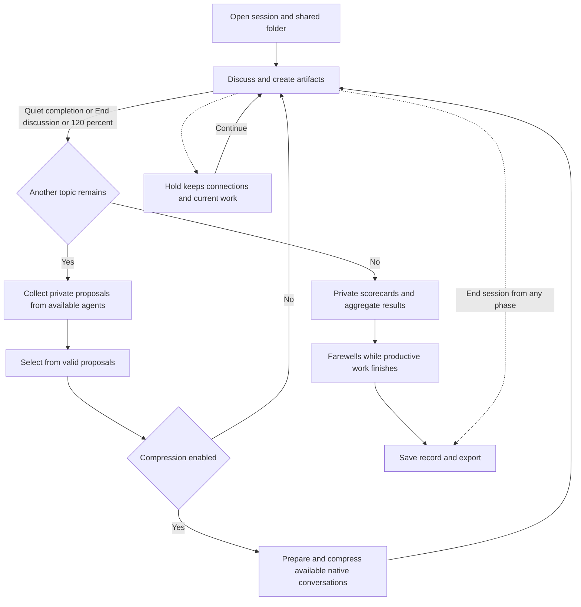

# Roundtable design specification

Current design, 5 November 2026.

A roundtable session is a continuing group of agents discussing successive topics and creating shared work. Agents keep their conversations, do file work while others speak, and rejoin with the context they missed. The chair can follow, steer, hold or end the session.

This is the consolidated contract for that process. It carries the owner's corrections recorded in [VIEW-052](09-viewer.md#view-052-roundtables-expose-the-transcript-and-its-cited-evidence). The [module README](../src/metaform/modules/roundtables/README.md) also describes independent legacy tables and optional follow-through workflows. Historical runs retain the rules captured when they opened.

## RT-001 Continuous conversations

- **Requirement:** Participants traverse the session's topics in their existing conversations.
- **What this means:** Advancing a topic, continuing a held session or reseating an unavailable participant preserves its native session ID, delivered history and shared files. A topic transition does not start a fresh agent.
- **Why:** Earlier decisions, disagreements and working context belong to the ongoing discussion.
- **How it shows:** The same participants return with their previous context. A qualified advertised model ID, including a context-window suffix, still resolves correctly. Ambiguous variants require a specific model choice.
- **Build:** Persist session IDs, messages, delivery cursors and private state in seat records. Resume through the negotiated ACP operation. Continuous sessions bypass the legacy automatic context handoff. Optional compression follows RT-008.
- **Acceptance:** Session continuity, model matching and mixed-lineup continuity regressions preserve IDs and reject automatic rebuilds.
- **Relates to:** RT-002, RT-004, RT-008, RT-013.
- **Status:** Confirmed design.

## RT-002 ACP owns the work lifecycle

- **Requirement:** Native work remains owned until its negotiated ACP completion or an actual connection or process exit.
- **What this means:** ACP v1 completes a turn through its prompt response. ACP v2 acknowledges prompt insertion separately and reports foreground completion through state updates. An acknowledgment alone is insufficient. Background work can remain active after foreground completion.
- **Why:** Elapsed time and an SDK waiting future do not establish that the agent finished its work.
- **How it shows:** A native turn can run beyond the external `agent_wait` setting. Hold, topic changes and budget advancement neither cancel it nor close its client. Explicit Stop or End can cancel through ACP.
- **Build:** Track foreground activity, permissions, original outgoing request IDs, wire replies and reported background activity. Omitted, null or malformed background information is unknown. Preserve a previous positive report until an explicit empty work list or authoritative exit. Initial unknown background does not itself invent work. If an SDK future is cancelled or times out after delivery, retain the original request and await its real reply or exit. Keep a lost client's process handle for explicit cleanup. Provider errors, process exits and actual transport losses have distinct meanings.
- **Acceptance:** Fake ACP v1 and v2 clients prove late completion, no overlapping prompts, no timeout cancellation, background readiness, unknown snapshots, real EOF and explicit cleanup.
- **Relates to:** RT-003, RT-008, RT-011, RT-013.
- **Status:** Confirmed design. Native lifecycle regression checks cover both protocol versions.

## RT-003 Busy participants skip opportunities

- **Requirement:** Ready participants continue while busy participants keep working.
- **What this means:** A busy skip supplies no PASS, veto or reply. It creates no obligation to replace each missed turn. One participant cannot impose a group barrier merely by working on files or being temporarily unavailable.
- **Why:** Discussion and production must proceed together.
- **How it shows:** Ready participants rotate and can complete quiet cycles. When everybody is busy, the runner waits for actual activity or chair-control events. When everybody is temporarily unavailable, existing recovery deadlines apply. Neither case manufactures empty rounds.
- **Build:** Permit at most one foreground request per participant. Consult native foreground and background readiness before scheduling. Observe readiness without cancelling productive tasks. Retain requests across ordinary topic and budget transitions. Save a late closed-topic reply once with its original topic, usage and receipt as an unjudged record. A same-topic reply can enter the current rotation.
- **Acceptance:** Scheduler tests cover ready-only progress, all-busy waits, unavailable recovery, late replies, background-only EOF and responsive controls.
- **Relates to:** RT-002, RT-004, RT-006, RT-010.
- **Status:** Confirmed design.

## RT-004 Ordered context and reply credits

- **Requirement:** Returning participants receive queued accepted context and one reply allowance that reflects their earned credits.
- **What this means:** Each participant has an ordered inbox. A native send checkpoints delivered items. New accepted peer messages remain queued while the participant works, including across topics. Continue does not replay already delivered items.
- **Why:** A participant needs enough context and space to rejoin without a separate reply for every missed contribution.
- **How it shows:** The participant can give one catch-up reply citing several public message IDs, or PASS. At the default base, its allowance is `512 × (1 + PASS credits + missed accepted peer messages)` characters. Rejected messages earn no credit.
- **Build:** Freeze the allowance and receipt for a physical request. Preserve that promise through retries and topic transitions. An actual PASS banks one base allowance. Acceptance spends only the credits offered with that reply, retaining newer credits. Missing or rejected replies do not spend the bank. Truncate substantive replies to their promised limit before judging. Keep the ledger private.
- **Acceptance:** Allowance and inbox tests cover PASS, accepted and rejected peers, concurrent new credits, retries, cross-topic catch-up and exactly-once delivery.
- **Relates to:** RT-001, RT-003, RT-005, RT-013.
- **Status:** Confirmed design. The base is configurable and defaults to 512 characters.

## RT-005 Three independent Jev contribution checks

- **Requirement:** A judged contribution must pass each of three independent checks.
- **What this means:** One Jev request evaluates the following questions. There is no fourth combined keep score.

| Check | Exact current question |
|---|---|
| `new_context` | Does this add anything to the discussion which has not been already stated, or does it express a position on a matter which was recently mentioned? |
| `valuable` | Does this message move the discussion forward and help answer the question? |
| `on_topic` | Does this message address the subject being discussed? |

- **Why:** Useful agreement or disagreement can advance a discussion even when it restates the matter being addressed. Empty repetition still has to satisfy value and relevance.
- **How it shows:** Every check must meet its captured threshold, 0.70 by default. A higher score on one check cannot offset a failure on another. A PASS is voluntary and is not judged as a substantive contribution.
- **Build:** Capture criteria and thresholds when opening the discussion. Send the complete original instructions, current topic, full candidate and newest whole accepted messages and chair clarifications as escaped XML. Omit rejected and private material. The desired context cap is 50,000 estimated tokens, additionally bounded by 80% of the configured request and per-question limits, 65,536 and 32,000 respectively. Drop oldest whole responses first. Use the same checks for repeated positions rather than an automatic repeat veto.
- **Acceptance:** Judging-window and prompt-contract tests protect all three checks, their boundaries and request padding. Historical judgments retain their captured criteria.
- **Relates to:** RT-004, RT-006, RT-012.
- **Status:** Confirmed design. With contribution judging disabled, substantive replies enter directly. Private next-topic comparison still follows RT-007.

## RT-006 Quiet completion uses actual outcomes

- **Requirement:** Judged discussion completes after two actual quiet cycles among currently ready participants.
- **What this means:** There must be no accepted contribution, and ready participants need at least two actual outcomes since the last acceptance or chair clarification. Busy, unavailable and departed participants do not block this quorum. Their missing outcomes are never invented. Pending judgments must finish before completion is assessed.
- **Why:** The group needs a completion rule that permits a correction opportunity without endlessly demanding answers from unavailable workers.
- **How it shows:** Let `P` mean an actual PASS and `V` a veto. The latest pairs `PP`, `VV` and `VP` are finished. `PV` needs another correction opportunity. Acceptance or chair input resets progress.
- **Build:** Track actual outcomes and quiet cycles. With judging disabled, a complete unanimous-PASS rotation of ready participants can finish discussion. End discussion and the 120% phase-budget rule can advance independently. Make no separate Jev sufficiency or completion request.
- **Acceptance:** Completion tests cover each outcome pair, reset conditions, pending judgments, busy and unavailable quorums, and no fabricated PASS.
- **Relates to:** RT-003, RT-005, RT-010, RT-011.
- **Status:** Confirmed design.

## RT-007 Private next-topic selection

- **Requirement:** Select the next topic from private proposals without letting one participant stop the group.
- **What this means:** Each available participant has at most two actual proposal attempts. Missing, empty, PASS and DONE replies consume an attempt. Skip a participant already doing other work before dispatch. A skipped opportunity does not consume an attempt.
- **Why:** Participants choose the next subject together while productive work continues.
- **How it shows:** Successful proposals are retained. After failed attempts, proceed with valid proposals already received. The chair sees aggregate collection and comparison progress. Participants do not receive proposals or proposer identities.
- **Build:** Persist attempts and distinct receipts before dispatch. Start the shared `topic_proposal_wait` collection window at the first actual reservation, 30 seconds by default. The window bounds collection, never native work. Once a valid proposal exists, collection can close and leave unfinished workers running. Retain late private replies without changing a committed topic. If none is valid while native work remains, wait for actual completion or readiness. Unasked busy participants remain possible future proposers. A lost participant is skipped without automatically closing or restarting it. Explicit reseat can reopen a remaining attempt only before any valid candidate or completed choice exists.
- **Comparison:** A sole proposal wins directly. Otherwise, in one Jev request compare every unordered pair once for similarity. Credit the same probability to both proposals, average each proposal's pair scores and select the highest exact average, with no minimum threshold. Preserve tied winning texts verbatim, unattributed and joined without synthesis. If no proposal is available after real opportunities are exhausted, report that condition. Do not create a replacement topic silently.
- **Acceptance:** Topic-selection tests cover two attempts across restarts, stale and late receipts, busy and all-slow participants, explicit reseat, sole proposals, ties and pairwise scoring. A local comparison failure before transport is retryable. Completed comparisons are reused, and ambiguously sent paid requests are not automatically replayed.
- **Relates to:** RT-001, RT-003, RT-008, RT-013.
- **Status:** Confirmed design. The collection window is configurable, separate from agent execution.

## RT-008 Optional native compression

- **Requirement:** Conversation compression between topics is an explicit session option, off by default.
- **What this means:** Select the next topic first. An available participant can then retain context relevant to that topic using its advertised native compression command in its existing conversation.
- **Why:** The owner chooses whether to compress, and useful continuity must survive the operation.
- **How it shows:** The setup offers `Compress conversations between topics`. Session IDs, original records and shared documents remain intact. Busy participants keep working. Unsupported or failed compression does not impose a group hold or substitute a fresh conversation.
- **Build:** Capture `compress_between_topics`. Prepare goals, constraints, decisions and reasons, evidence, disagreements, open questions and references to the original transcript and shared files. Await actual command completion. Mark each transition attempt durably so restarting the runner does not repeat it. No compression is requested after the final topic. Hold pauses new commands. Explicit End can cancel outstanding work.
- **Acceptance:** Native-compaction and session tests cover preparation, advertised support, actual completion, failure, preserved IDs, controls and restart deduplication.
- **Relates to:** RT-001, RT-002, RT-007.
- **Status:** Confirmed design. Native support depends on what the participating client advertises.

## RT-009 Participants create the shared product

- **Requirement:** Participants create and maintain the requested artifacts in the supplied shared session folder during discussion.
- **What this means:** File work is part of the discussion. The native workspace is the selected project, and prompts supply the shared folder. All participants can contribute. A generated transcript does not stand in for a requested specification, diagram or code sample.
- **Why:** The purpose of the session is the work the owner needs, as well as the discussion that produces it.
- **How it shows:** Shared files are visible while agents work. The document browser lists them and opens each in a separate reading window. Work can continue after a participant skips speaking.
- **Build:** Keep the folder and original assignment in session context. Native clients provide their own file tools and ACP permissions. Participants may elect a coordinator for tracking decisions and document owners, with equal permissions and no additional voting barrier. No separate intertopic collaboration phase, DONE barrier or required `next-topic.md` exists.
- **Acceptance:** Shared-record, workspace, permission and document-reader tests protect access, folder delivery and visibility. Artifact contents remain the responsibility of the assignment and its participating authors.
- **Relates to:** RT-003, RT-008, RT-012.
- **Status:** Confirmed design. The engine currently does not enforce a final document owner, mandatory filenames, diagrams, code samples or an artifact-completeness gate. Those deliverables must be specified in the assignment and maintained by the participants.

## RT-010 Budgets close phases without aborting work

- **Requirement:** Budget thresholds control discussion progression without interrupting native production.
- **What this means:** The token limit is per participant per discussion. Zero disables it. New sessions default to uncached input plus output, including cache writes and excluding cache reads. Full usage retains the reported details. Existing legacy records keep their saved counting basis.
- **Why:** The owner needs visible costs and predictable progression without losing work already under way.
- **How it shows:** The first participant reaching 50% triggers one halfway notice. From 80%, each turn repeats wind-down instructions. From 100%, it repeats closing instructions. These notices do not hold the session. At 120%, advance to private topic selection or, after the last discussion, scoring and farewell.
- **Build:** Reset discussion counters at the next discussion, while preserving in-flight request ownership and reply credits. Count each completed physical reply and each observed paid judgment once. A late old-topic judgment retains its audit and cost without changing the new topic. Missing usage remains unreported, not measured zero, and cannot trigger a measured cap. An external spend or credential problem may hold paid scheduling, preserving native connections and existing work.
- **Acceptance:** Phase-budget, runtime-budget and usage tests cover thresholds, basis choices, late results, once-only accounting and non-cancelling advancement.
- **Relates to:** RT-002, RT-003, RT-006, RT-013.
- **Status:** Confirmed design. The project default token limit is zero.

## RT-011 Chair controls and final phases

- **Requirement:** Chair controls remain responsive without confusing a pause, a topic advance and ending the whole session.
- **What this means:** Hold pauses new requests and keeps native connections alive. Continue resumes the same session. End discussion finishes only the current discussion. End session saves the current record and shared materials and stops the remaining phases. Abort is a separate action.
- **Why:** The owner must be able to steer or stop the process without accidentally destroying continuing work.
- **How it shows:** Comments can be queued while held. End discussion is disabled with an explanation during topic selection, scoring and farewell. End session remains available during those phases and while held. Controls reflect current engine state independently of delayed transcript playback.
- **Build:** Use event-driven control wakeups. A recoverable scheduler failure holds scheduling while retaining native clients. After the final discussion, collect private scorecards and share aggregate results, then exchange farewells. Busy productive work continues before natural completion. Unavailable or departed participants supply no invented scorecard or farewell. Explicit End can cancel through ACP and export the saved record immediately.
- **Acceptance:** Session, control and phase-budget tests cover Hold/Continue, explicit End, natural completion, private phases, errors and missing participants.
- **Relates to:** RT-002, RT-006, RT-007, RT-010.
- **Status:** Confirmed design. Scorecard categories are Efficient, Alert & Aware, Thorough and Coordination, each 0–5 stars, plus a Boolean bonus.

## RT-012 Transcript visibility and privacy

- **Requirement:** The chair can read the original discussion and its evidence while participant-private material stays private.
- **What this means:** Accepted messages get contiguous IDs such as `R1-1` within each discussion. Vetoes, PASS replies and failures do not consume public IDs. Message, file/line and quoted literal-search references open readable evidence. Shared Markdown content cannot execute scripts.
- **Why:** The owner needs direct evidence and a place to comment, while participants need accepted context without private judging metadata.
- **How it shows:** Transcript entries show actual source timestamps when available, otherwise their recorded observation time, with local clock time and a full date/time-zone tooltip. Invalid or absent legacy timestamps are not invented. Usage not yet reported is labelled separately from a reported zero. Automatic Haiku Breakdown is absent once reference readers are available.
- **Build:** Carry source `created` and observation `at` through follower storage and published events. Keep names stable and provider/model identities out of peer prompts and shared `participants.md`. Only the author receives plain-language veto conditions. Peers receive no rejected text, veto notice, thresholds or score ledger. The chair can inspect recorded failed scores and cutoffs.
- **Acceptance:** Message-ID, public-projection, privacy, reference-reader and UI tests protect numbering, timestamps, safe reads, usage labels and private feedback.
- **Relates to:** RT-004, RT-005, RT-009, RT-013, VIEW-052.
- **Status:** Confirmed design. Automatic preservation of cited source excerpts and graph storage of specifications remain deferred.

## RT-013 Durable recovery

- **Requirement:** Recovering the runner preserves completed work and does not replay successful or ambiguously sent paid requests.
- **What this means:** Completion records, proposal attempts, request receipts, native IDs and delivery cursors survive process replacement. Native restarts use saved conversations. Reseating is an explicit recovery action, not an automatic fresh-context fallback.
- **Why:** A temporary failure must not erase the discussion or silently repeat spending.
- **How it shows:** Completed proposals are reused, failed opportunities retain their attempt counts, and late replies cannot overwrite newer or committed work. A provider/request error is not described as a disconnection without transport evidence.
- **Build:** Use fenced runner ownership, short SQLite transactions and compare-and-set receipts. Persist reply usage before downstream judgment. Record late paid judgments without applying them to the new topic. Retain known lost process handles until explicit cleanup. Retry local preflight failures after repair while preserving protection for uncertain transport outcomes.
- **Acceptance:** Store, topic, session and native-delivery regressions cover fencing, attempt migration, stale replies, explicit reseat, once-only usage and original-session restoration.
- **Relates to:** RT-001, RT-002, RT-004, RT-007, RT-010.
- **Status:** Confirmed design. An agent or runner process crash cannot guarantee that an external provider continues the interrupted work.

## Session progression

Hold resumes the phase in which it was requested, including private topic selection or final phases. The diagram shows discussion as the example. Phase changes retain busy native tasks. Compression tasks may finish after the next discussion starts, and their participants remain unavailable for a new prompt until ready.

## Implementation entry points

Paths are relative to the repository root.

| Responsibility | Owning paths |
|---|---|
| Session setup and shared folder | `src/metaform/modules/roundtables/__init__.py`, `chain.py` |
| Native ACP lifecycle and readiness | `src/metaform/modules/roundtables/roundtable/harness.py`, `seat.py` |
| Scheduling, discussion and final phases | `src/metaform/modules/roundtables/roundtable/runner.py` |
| Durable records and receipts | `src/metaform/modules/roundtables/roundtable/store.py` |
| Private proposals and comparison | `src/metaform/modules/roundtables/roundtable/topics.py` |
| Reply credits | `src/metaform/modules/roundtables/roundtable/allowance.py` |
| Token usage and phase warnings | `src/metaform/modules/roundtables/roundtable/budget.py` |
| Judging and bounded context | `src/metaform/modules/roundtables/roundtable/judge.py` |
| Engine controls and defaults | `src/metaform/modules/roundtables/roundtable/server.py`, `config.py` |
| Exact participant and Jev prompts | [engine prompts](../src/metaform/modules/roundtables/roundtable/resources/prompts.xml), [module prompts](../src/metaform/modules/roundtables/resources/prompts.xml) |
| Follower and real event timestamps | `src/metaform/modules/roundtables/follow.py` |
| Transcript, setup and usage UI | `src/metaform/modules/web/page/app/roundtable/stage.js` |

## Relevant defaults

| Setting or control | Current default | Meaning |
|---|---|---|
| Base reply allowance | 512 characters | Credits can increase a participant's promised discussion allowance. |
| Contribution thresholds | 0.70 each | All three independent checks must pass their captured threshold. |
| Session token budget | 0 | Disabled until configured. |
| Token counting basis | `uncached` | Count uncached input, cache writes and output for new sessions. |
| `compress_between_topics` | `false` | Preserve conversations without requesting native compression. |
| `topic_proposal_wait` | 30 seconds | Shared private collection window, not a native-work timeout. |
| `agent_wait` | 300 seconds | External response waits. Native ACP turns and compression do not use it as a work deadline. |
| `jev_wait` | 300 seconds | Jev transport and retry waiting. |
| `probe_wait` | 300 seconds | Initial delay before probing a temporarily unavailable participant. Ready peers can continue. |
| `context_tokens` | 24,000 estimated tokens | Legacy independent-table handoff trigger. Continuous sessions do not use it to replace conversations. |
| Native startup wait | 120 seconds | Connection and session initialization, before productive prompting. |
| Native setting wait | 30 seconds | Applying a model or native permission mode. |
| Cancellation acknowledgment wait | 15 seconds | Grace after explicit cancellation, separate from normal work duration. |

Engine defaults live in `roundtable/config.py`. Native control waits live in `roundtable/harness.py`. The module's project settings and each session's captured options remain separate from those engine defaults.

## Full review references

The following references retain the detailed rules and current implementation differences needed to refine the design:

- [Agent ratings and score storage](../docs/reference/roundtable-agent-ratings.md): the original detailed category rubric, every scoring-phase prompt, weights, bonus, scorecard validation, cumulative profiles and task-board storage.
- [Agent genesis and name generation](../docs/reference/agent-genesis-naming.md): the owner's genesis rule, both fixed word lists, exact hashing procedure and the current roundtable alias discrepancy.
- [ACP conversation history](../docs/reference/acp-conversation-history.md): native conversations, local mirrors, persisted threads, replay handling, compaction, recovery and retention boundaries.
- [Accolades and recognition](../docs/reference/roundtable-accolades.md): the original recognition promise, its source, current profile behavior and the missing accolade mechanism.

## Standards and verification

ACP's [v1 prompt-turn contract](https://raw.githubusercontent.com/agentclientprotocol/agent-client-protocol/main/docs/protocol/v1/prompt-turn.mdx) and [v2 prompt lifecycle](https://agentclientprotocol.com/protocol/v2/prompt-lifecycle.md) define protocol completion. The [v2 schema](https://raw.githubusercontent.com/agentclientprotocol/agent-client-protocol/main/docs/protocol/v2/schema.mdx) defines activity and unknown background information. ACP permits client cancellation. Preserving work through Hold, elapsed time and phase changes is the owner's product policy implemented on that protocol.

Behavioral validation uses fake ACP clients and isolated stores, with no paid model calls. The owning regression suites are in `src/metaform/modules/roundtables/tests/`, `src/metaform/modules/dispatch/tests/test_dispatch.py` and `src/metaform/modules/web/tests/roundtable-*.test.mjs`. A passing regression suite establishes the covered behavior, not the completeness of an agent-authored product from an earlier run.

Current limitations are explicit in RT-009: shared-folder access and prompts do not enforce completion of every requested deliverable. No live provider run is required or automatically started when this specification is updated.
